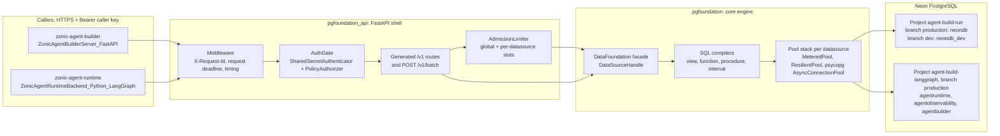
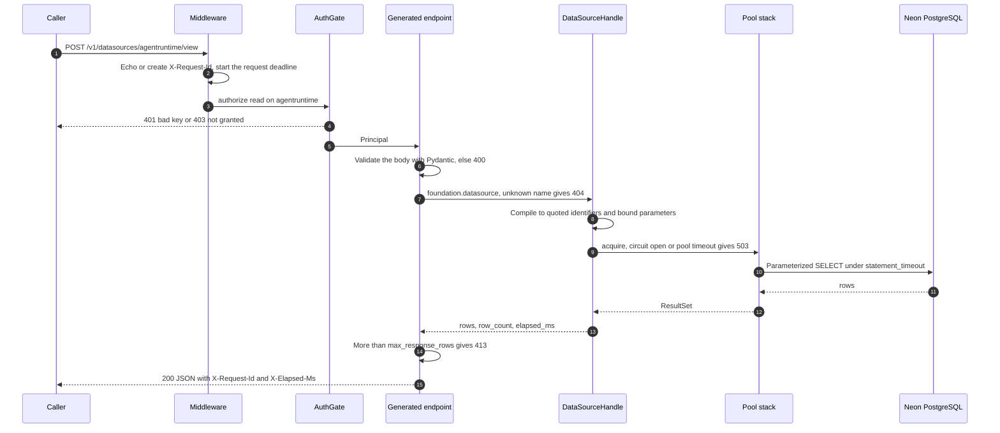

# Technical design: ZonicPostgresqlServer_FastAPI

How this repository is built. Setup, commands and the hackathon summary are in the [README](../README.md).

This section summarizes the design as the code implements it. The detailed
reasoning is in [`documentations/`](../documentations/README.md); where a document
and the code differ, this section follows the code.

## Architecture

Two Zonic services call the gateway over HTTPS. Each request names a
**datasource**, a configured alias for one PostgreSQL database with its own
connection pool and circuit breaker. On Lambda, the five datasources point at
two Neon projects.



Four [Import Linter](../postgresqlmodule/code/.importlinter) contracts enforce the
layering in CI. Dependencies point inward only. The core imports no driver and no
web framework. Only the driver adapter
([`psycopg_driver.py`](../postgresqlmodule/code/pgfoundation/_internal/drivers/psycopg_driver.py),
which also maps SQLSTATE codes onto the core error hierarchy) and the composition
root import psycopg. See [02 — Architecture](../documentations/02-architecture.md) and
[09 — Project structure](../documentations/09-project-structure.md).

## The governed surface

Each capability is one `OperationSpec` row in
[`api/v1/operations.py`](../postgresqlmodule/code/pgfoundation_api/api/v1/operations.py).
From that row the [router](../postgresqlmodule/code/pgfoundation_api/registry/router.py)
generates the REST endpoint, the `/stream` variant, the batch dispatch entry and the
OpenAPI operation. The row's `action` (`read` or `write`) becomes the endpoint's
authorization dependency, so no endpoint can be registered without an auth check
([ADR-003](../documentations/adr/ADR-003-declarative-operation-registry.md)).

All data-plane routes are `POST /v1/datasources/{name}/<op>`:

| Op | Request | Action | Stream | Compiles to |
|---|---|---|---|---|
| `view` | `name`, `schema`, `columns`, `filters`, `order_by`, `limit`, `offset` | read | yes | `SELECT … FROM "schema"."name" WHERE …` |
| `function` | `name`, `schema`, `args` (named or positional), `scalar` | read | yes | `SELECT * FROM f(…)` or `SELECT f(…) AS result` |
| `procedure` | `name`, `schema`, `args` (positional) | write | no | `CALL p(…)` |
| `interval` | `source`, `time_column`, `start`, `end`, `every`, `metrics`, `group_by`, `tz` | read | yes | Time-bucketed aggregate over `[start, end)` |
| `fetch-since` | `sql`, `params`, `cursor`, `limit` | read | no | Keyset page that returns `next_watermark`; never `OFFSET` |
| `execute-many` | `sql`, `params_seq` | write | no | psycopg `executemany` |
| `copy` | `table`, `rows` | write | no | `COPY <table> FROM STDIN` |
| `query`, `execute` | `sql`, `params` | read / write | `query` only | Raw parameterized SQL. Registered only when `api.enable_raw_sql` is true. |

Other routes: `POST /v1/batch`, `GET /v1/datasources` (action `list`),
`GET /v1/datasources/{name}/subscribe/{channel}` (LISTEN/NOTIFY over SSE), and
`/health`, `/ready`, `/metrics` with `/v1/health` and `/v1/ready` as aliases.
The full contract is in [08 — API surface](../documentations/08-api-surface.md), and
runnable examples are in [curls/CURLS.md](../curls/CURLS.md).

**Why callers name objects instead of sending SQL.** The view, function and
procedure payloads carry names and values only. The compiler in
[`invocation.py`](../postgresqlmodule/code/pgfoundation/_internal/access/invocation.py)
validates every identifier against `^[A-Za-z_][A-Za-z0-9_]*(\.[A-Za-z_][A-Za-z0-9_]*)*$`,
emits it double-quoted, accepts only the 13 whitelisted filter operators, and binds
every value as a `%(name)s` parameter. The database schema becomes the API
contract: a caller can reach only the views, functions and procedures that exist
there, and the gateway never interprets caller text as SQL. The compiled text is
the same for every call of the same shape, so psycopg's prepared-statement cache
(threshold 5, up to 100 statements per connection by default) is reused.
Both Zonic callers use only this surface: the builder calls `view`, `function` and
`procedure`, and the runtime calls `view`, `procedure` and `/v1/batch`.

Raw SQL (`query`, `execute`) is off by default and on Lambda, so those routes are
absent from the route table and from OpenAPI. `fetch-since` and `execute-many`
still take parameterized SQL text, with values bound, and need the caller's grant
for the datasource.

A request, as the runtime sends it:

```http
POST /v1/datasources/agentruntime/view
Authorization: Bearer <caller key>
Content-Type: application/json

{"schema": "agent_runtime", "name": "v_run",
 "filters": [{"column": "session_id", "op": "eq", "value": "<uuid>"}],
 "order_by": [{"column": "queued_at", "descending": true}],
 "limit": 20}
```

```json
{"rows": [{"run_id": "…", "status": "…", "queued_at": "…"}], "row_count": 1, "elapsed_ms": 4.2}
```

Reads return `rows`, `row_count` and `elapsed_ms`. With `"row_format": "tuple"`
the rows are arrays and a `columns` list names them
([ADR-007](../documentations/adr/ADR-007-serialization-and-row-format.md)). Writes
(`execute-many`, `copy`) return `row_count`. `Decimal` values are serialized as
strings, such as `"42.00"`, so precision survives JSON.

**Batch.** `POST /v1/batch` takes `items` (`id`, `datasource`, `op`, `payload`)
and a `mode` ([ADR-004](../documentations/adr/ADR-004-batch-and-parallel-execution.md),
[06 — Concurrency, batch and parallel](../documentations/06-concurrency-batch-parallel.md)):

| Mode | Connections | Behaviour |
|---|---|---|
| `parallel` (default) | One per item, bounded | Semaphore-bounded `asyncio.gather`; items may target different datasources; each item has its own timeout. |
| `sequential` | One, pinned | One datasource; statements in order in psycopg pipeline mode, so fewer round trips. Not atomic. |
| `transactional` | One, pinned | One datasource; one transaction; all or nothing. Rerun whole on `40001` or `40P01`, up to 3 attempts with exponential backoff and jitter. |

Partial success returns HTTP 200 with a `status` per item. Only whole-batch
failures return another status: validation, duplicate item ids, too many items,
authorization, or the total timeout. Clients can lower `max_concurrency` and
`timeout_ms`, but the server clamps both to its configured maximums.

**Streaming.** Every `streamable` operation also has `POST …/{op}/stream`. It reads
from a server-side cursor in batches of the datasource's `stream.itersize` and
writes NDJSON, or SSE when the request sends `Accept: text/event-stream`. A client
disconnect stops the query. An error after the first row arrives as a final
`{"error": …, "partial": true}` record, because the status line has already been
sent ([ADR-006](../documentations/adr/ADR-006-streaming-delivery.md)).

## Datasources, callers and authorization

The configuration file names datasources, pools and callers; secrets enter only
through environment variables or mounted files. The Lambda deployment uses
[`pgfoundation.lambda.yaml`](../postgresqlmodule/code/config/pgfoundation.lambda.yaml):

```yaml
datasources:
  - name: agentruntime
    dsn: ${env:PGF_AGENTRUNTIME_DSN}      # resolved at startup; held as SecretStr
    statement_timeout_ms: 30000
    pool: { min_size: 0, max_size: 3, acquire_timeout_seconds: 10,
            max_idle_seconds: 240, max_lifetime_seconds: 1800, check_on_checkout: true }
    stream: { itersize: 5000 }
auth:
  enabled: true
  provider: token
  policy:
    default: deny
    callers:
      - subject: zonic-agent-runtime
        datasources: [agentruntime, agentobservability, batch]
        actions: [read, write]
```

`PGF_CONFIG` names the file and `PGF_PROFILE` deep-merges an overlay from
`config/profiles/`. Invalid configuration fails at startup, never at the first
request ([05 — Configuration](../documentations/05-configuration.md)).

| Caller subject | Datasources | Actions |
|---|---|---|
| `zonic-agent-builder` | `agentbuilder`, `neondb`, `neondb_dev` | read, write |
| `zonic-agent-runtime` | `agentruntime`, `agentobservability`, `batch` | read, write |
| `zonic-agent-runtime-node` (the earlier Node runtime) | `neondb_dev`, `batch` | read, write |

How a request is authorized ([ADR-008](../documentations/adr/ADR-008-auth-boundary.md)):

1. **Authenticate.** The `token` provider reads `Authorization: Bearer <key>`,
   hashes it with SHA-256, and compares it with each known key's digest using
   `hmac.compare_digest`. A match yields a `Principal` whose subject is the caller
   name. No match returns 401.
2. **Authorize.** `PolicyAuthorizer` looks up the subject's single rule and allows
   the request only if the datasource from the path and the operation's action
   are both granted (`*` matches all). Unknown callers get the policy default,
   which is `deny`; a denial returns 403.
3. **Batch.** `/v1/batch` first needs `write` on the pseudo-resource `batch`. Then
   every item must pass its own operation's action on its own datasource, so a
   batch cannot reach a datasource the caller could not call directly. The whole
   batch is refused before any database work.

The gateway authenticates **services**, not end users. End-user identity,
tenancy and row ownership stay with the callers, which are the only layer that
knows the user. An `mtls` provider, which trusts an identity header set by a
service mesh, is the production-profile default for in-VPC deployments.

## Request lifecycle



Errors are translated in one table in
[`errors.py`](../postgresqlmodule/code/pgfoundation_api/errors.py), not in each
endpoint. Every error body is `{"error", "type", "request_id"}`, and 503
responses carry `Retry-After: 1`.

| Status | Cause |
|---|---|
| 400 | Invalid request body (a generic message that echoes no values), unsafe identifier, unsupported filter, SQLSTATE class `42` or `22` |
| 401 / 403 | No valid caller key / caller not granted the action on the datasource |
| 404 | Unknown datasource |
| 409 | Integrity violation, SQLSTATE class `23` |
| 413 | Result larger than `api.max_response_rows` (default 50,000); the message names the `/stream` route |
| 503 | Pool acquire timeout, circuit open, connection error (class `08`), serialization failure or deadlock, `statement_timeout` (`57014`), admission rejected, request deadline exceeded |

## Connection management and performance

- **Driver and pool.** psycopg 3 with `psycopg_pool.AsyncConnectionPool`, one pool
  per datasource. Connections run in autocommit; transactions are explicit
  through a `UnitOfWork` that pins one connection. Each new connection gets its
  prepared-statement settings and, when configured, `SET statement_timeout` and
  `default_transaction_read_only`.
- **Pool stack.** `MeteredPool` (metrics) wraps `ResilientPool`, a per-datasource
  circuit breaker (opens after 5 consecutive acquire failures, probes once after
  30 s), which wraps the psycopg pool. After three consecutive failed health
  checks the pool is rebuilt, because psycopg_pool's reconnect worker can stop
  retrying after an early connect failure.
- **Admission control.** `AdmissionLimiter` holds a global and a per-datasource
  semaphore, and waits at most `admission_timeout_ms` (2 s) before rejecting with
  503, which is cheaper than waiting out a pool timeout. Batch items pass through
  it; unary requests are bounded by the pool's `max_size` and acquire timeout.
  Startup refuses a `batch.max_concurrency` above `concurrency.max_inflight_total`.
- **Deadlines.** `TimingMiddleware` bounds each request at `api.request_timeout_ms`
  (default 15 s). `statement_timeout` stops the query in PostgreSQL itself, so an
  abandoned request does not keep the database working.
- **On Lambda.** One uvicorn worker runs per execution environment. Pools start
  empty (`min_size: 0`) because a frozen environment cannot keep connections warm.
  Idle connections are dropped after 240 s, before Neon suspends an idle compute
  (about 5 minutes). Every connection is checked on checkout, because the first
  request after a suspend otherwise failed with `57P01`. The 10 s acquire timeout
  leaves room for a Neon compute to resume. With at most 10 concurrent
  environments and `max_size: 3`, one datasource opens at most 30 connections.
  The gateway uses Neon's direct endpoint, not the `-pooler` host, so server-side
  cursors and session `SET` work.

Throughput features and latency budgets are in
[07 — Performance](../documentations/07-performance.md).

## Security

- **SQL injection.** Values are always bound parameters. Identifiers pass a strict
  regular expression that excludes the quote character, and are then quoted.
  Aggregates are limited to `sum`, `avg`, `min`, `max` and `count`; filter
  operators to a fixed enum. `COPY` table names and `LISTEN` channel names are
  validated and quoted the same way. `LIMIT`, `OFFSET` and the `statement_timeout`
  value, which PostgreSQL's `SET` cannot take as a parameter, are inlined only
  after `int()`.
- **Raw SQL.** `enable_raw_sql` defaults to false. Startup refuses
  `enable_raw_sql: true` with auth disabled outside the `dev` profile.
- **Fail closed.** The service refuses to start when auth is enabled with no or an
  unknown provider, when a policy caller has no key, when a key is blank, or when
  `default: deny` is set with no callers.
- **Secrets.** Connection strings and caller keys are never in the configuration
  file. A caller's key is read from `PGF_API_KEY_<SUBJECT>` or from the mounted
  file `/mnt/secrets-store/caller-<subject>` (Secrets Store CSI driver on EKS).
  The authenticator keeps only SHA-256 digests in memory, and DSNs are held as
  `SecretStr`. On Lambda they come from AWS Secrets Manager through `deploy.sh`
  (see [Current deployment](../README.md#current-deployment)).
- **Exposure.** `/docs` and `/redoc` are disabled on Lambda, so the public URL
  publishes no map of the surface. The container runs as a non-root user.

## Observability

| Endpoint | Behaviour |
|---|---|
| `GET /health` | Liveness. Always 200 while the process runs, and lists datasource names without probing them, so a slow database cannot get a healthy process killed. The Lambda Web Adapter uses it as its readiness check. |
| `GET /ready` | Readiness. Runs `SELECT 1` per datasource and reports `healthy`, `degraded` (some down) or `down` (all down, HTTP 503). |
| `GET /metrics` | Prometheus text. Empty unless `observability.metrics_enabled` is true, as in the Helm chart; it is off on Lambda. |

Every response carries `X-Request-Id` (echoed from the request or generated), and
the id is in every error body. Completed requests also carry `X-Elapsed-Ms`. When
metrics are enabled, the in-process collector records HTTP
(`pgf_http_requests_total`, `pgf_http_request_duration_seconds`), pool and query
(`pgf_query_duration_seconds`, `pgf_pool_timeouts_total`), admission, auth and
batch metrics, including `pgf_batch_concurrency_peak`, which shows whether a
parallel batch really fanned out. Labels use route templates, never concrete
paths, and the caller's subject is never a label. Structured logs and tracing are
not implemented yet: `# OBSERVE (LOG|METRIC|TRACE)` comments mark each emission
point, catalogued in
[11 — Observability instrumentation points](../documentations/11-observability-instrumentation-points.md).
On Lambda, process output goes to CloudWatch Logs with 14-day retention.

## Deployment

| Target | Status | Files |
|---|---|---|
| AWS Lambda container (arm64, 512 MB, 60 s), public Function URL in response-streaming mode | **Live** | [`deploy/aws-lambda/`](../deploy/aws-lambda/README.md) |
| EKS through Helm, built by Jenkins and CodeBuild | Configured, not live | [`deploy/helm/zonic-postgresql-server/`](../deploy/helm/zonic-postgresql-server/values.yaml), [`Jenkinsfile`](../Jenkinsfile), [`buildspec.yml`](../buildspec.yml) |

- **Lambda.** The image adds the AWS Lambda Web Adapter 0.9.1 as an extension. It
  starts the unchanged `uvicorn pgfoundation_api.app:create_app --factory`, waits
  for `/health`, and translates Function URL events to HTTP, so there is no Lambda
  handler code. Only runtime dependencies are installed, to keep cold starts
  short. `deploy.sh` is idempotent: it creates the ECR repository, builds and
  pushes the image, sets up the IAM role, function, Function URL and log
  retention, then smoke-tests `/health` and `/ready`.
- **EKS (not live).** Jenkins runs the quality gates, then CodeBuild builds the
  image, writes an SPDX SBOM with Syft, fails on critical or high Trivy findings,
  and pushes it. Jenkins deploys by digest with `helm upgrade --install --atomic`
  and smoke-tests `/ready`. The chart has 2–6 replicas with an HPA, a
  PodDisruptionBudget, a NetworkPolicy, an ALB ingress whose health check is
  `/ready`, and a SecretProviderClass for the DSN and caller keys. See
  [12 — Deployment targets](../documentations/12-deployment-targets.md) and
  [15 — CI/CD and deployment](../documentations/15-cicd-and-deployment.md).
- **Locally.** `python -m pgfoundation_api.run_local` from `postgresqlmodule/code`,
  with `PGF_CONFIG` set.

## Testing

Tests live in [`postgresqlmodule/code/tests/`](../postgresqlmodule/code/tests) and run
with `pytest -q` from `postgresqlmodule/code` (`asyncio_mode = auto`). Most build an
isolated app per test with `create_app(settings, foundation=...)`, injecting a
foundation backed by `FakeDriver`, so the whole HTTP shell runs without a database.

| Suite | Test functions | Covers |
|---|---|---|
| `unit/` | 58 in 6 files | Config, the facade, invocation compilers, transactions, streaming and interval, resilience |
| `service/` | 106 in 9 files | The HTTP shell: auth seam and key loading, batch modes, streaming, row format, hardening, observability, config tunables |
| `contract/` | 25 in 3 files | OpenAPI snapshot, registry invariants (every row yields its routes), parity with the Django contract |
| `integration/` | 5 in 1 file | Live PostgreSQL through psycopg; skipped unless `PGF_TEST_DSN` is set |
| `load/` | 4 in 1 file | Performance gate on ratios, not milliseconds: parallel batch versus sequential, one connection for `sequential` |

With parametrization the suite counts 225 passing tests and 4 live-database
skips ([14 — Build status](../documentations/14-build-status.md)). The GitHub Actions
workflow [`.github/workflows/ci.yml`](../.github/workflows/ci.yml) runs Ruff lint and
format checks, mypy on `pgfoundation/core` (blocking), Import Linter and pytest
on every push. The integration job runs on `main` only, with `PGF_TEST_DSN` from
a repository secret. The test strategy and gates are in
[10 — Testing and delivery plan](../documentations/10-testing-and-delivery-plan.md).

## Key design decisions

| ADR | Decision | Why |
|---|---|---|
| [ADR-001](../documentations/adr/ADR-001-fastapi-service-shell.md) | The service shell is FastAPI on ASGI. | Async endpoints that await the async core, generated OpenAPI, Pydantic validation. |
| [ADR-002](../documentations/adr/ADR-002-core-ported-unchanged.md) | Port the core engine unchanged; rewrite only the shell. | Feature parity becomes structural rather than re-derived. |
| [ADR-003](../documentations/adr/ADR-003-declarative-operation-registry.md) | Generate endpoints from one `OperationSpec` table. | One row per capability; routes, batch dispatch, OpenAPI and the auth check cannot drift apart. |
| [ADR-004](../documentations/adr/ADR-004-batch-and-parallel-execution.md) | One batch endpoint with pluggable strategies. | `parallel`, `sequential` and `transactional` share one request shape and one dispatcher. |
| [ADR-005](../documentations/adr/ADR-005-di-via-lifespan-and-depends.md) | Wire with lifespan, `app.state` and `Depends`. | No module globals; pools bind to the serving event loop; tests build isolated apps. |
| [ADR-006](../documentations/adr/ADR-006-streaming-delivery.md) | Stream NDJSON and SSE over `StreamingResponse`. | Constant memory for large reads; SSE for browser change feeds. |
| [ADR-007](../documentations/adr/ADR-007-serialization-and-row-format.md) | Pydantic-native serialization with `Decimal` as string, and a selectable `row_format`. | Keeps the numeric contract; `tuple` rows cut payload and allocation on wide results. |
| [ADR-008](../documentations/adr/ADR-008-auth-boundary.md) | The gateway owns caller authentication and coarse datasource × action authorization; end-user policy stays with callers. | A shared data layer reachable by several services must know who is calling, but not who the end user is. |
