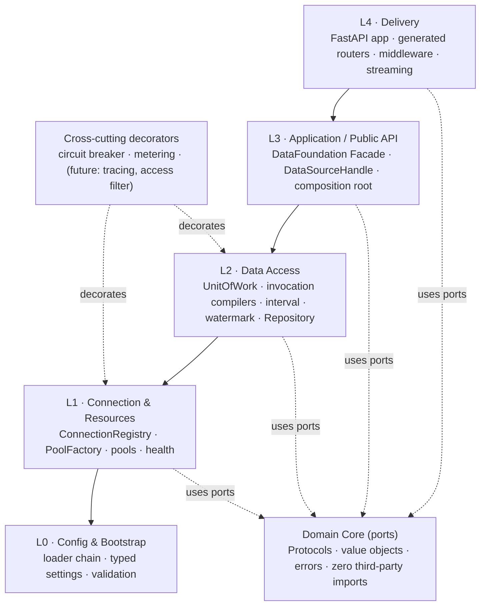
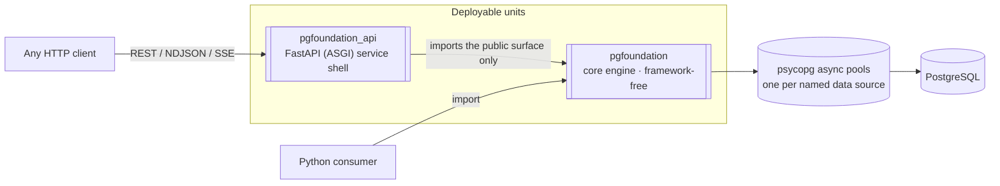
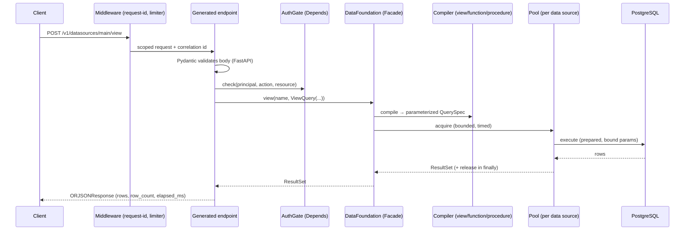

# 02 — Architecture

## 2.1 Style (unchanged, and deliberately so)

Two complementary styles, inherited from the Django project because they are
correct and because they are what makes the port cheap:

- **Hexagonal (Ports & Adapters)** — the core defines `Protocol` ports; psycopg,
  the HTTP transport, config sources, and metrics backends are adapters.
- **Layered / Clean** — dependencies point **inward only**. The core imports
  stdlib only.

> **The dependency rule:** `psycopg`, `fastapi`, `pydantic-settings`, and the
> process environment are *details at the edges*. They never appear in the core.

The one architectural change is at L4: the delivery framework. That is exactly the
layer the hexagonal design declares swappable, so the change is contained.

## 2.2 Layer stack

| Layer | Responsibility | May import | Must not know about |
|-------|----------------|------------|---------------------|
| **Core** | Ports, value objects, errors | stdlib only | psycopg, fastapi, env |
| **L0 Config** | Load & validate settings | Core, pydantic | data-access details |
| **L1 Connection** | Own pools, registry, health | Core, L0 | HTTP, use cases |
| **L2 Access** | Execute, transact, compile, map | Core, L1 | HTTP, config sources |
| **L3 Facade** | Public API, orchestration, DI wiring | Core, L0–L2, the driver | HTTP framework |
| **L4 Delivery** | FastAPI transport, batch orchestration, streaming | **L3 Facade only** | L1/L2 internals |

L4 talking only to L3 is what guarantees library-mode/service-mode parity. The
batch layer (§06) lives at L4 and is built strictly from public Facade calls — it
adds *scheduling*, never data access.

## 2.3 Containers

The shell is *just another consumer* of the core. In service mode it doubles as a
**connection concentrator**: a fleet of app instances shares one bounded pool set
instead of each opening its own connections — a real reduction in PostgreSQL
backend processes.

## 2.4 Request path (unary call)

Note what the endpoint *does not* do: build SQL, touch a pool, or catch driver
exceptions. It validates, delegates, serializes. That is why the endpoint can be
generated rather than written (§04).

## 2.5 What changes vs the Django shell

| Concern | Django today | FastAPI plan | Effect |
|---------|--------------|--------------|--------|
| Routing | Hand-written `urlpatterns` list, one line per view | Generated from the operation registry | Fewer places to edit; routes cannot drift from DTOs |
| Endpoint bodies | 9 hand-written `async def` views, each repeating *check auth → validate → map DTO → call facade → wrap result* | One generic endpoint factory + one descriptor per operation | The repeated 5 steps exist once |
| Request validation | Manual `Model.model_validate_json(request.body)` in every view | Declared parameter type; FastAPI validates | Removes a line per view and a `try/except` branch |
| OpenAPI | 75-line hand-built `apispec` document listing paths, params, responses by hand | Generated by FastAPI from the same DTOs and route table | Spec cannot drift; `/docs` becomes a real UI |
| Error translation | `@api` decorator wrapping every view | `app.add_exception_handler` per error family, driven by the same status map | Cross-cutting concern leaves the call sites |
| Wiring | Module-global `_foundation` / `_auth_gate` mutated by setters | `lifespan` builds it into `app.state`; endpoints receive it via `Depends` | Removes the service-locator anti-pattern the project's own doc 04 §4.6 forbids; makes per-test isolation trivial |
| Lifecycle | Hand-written ASGI `lifespan` loop reimplementing the protocol (~30 lines) | `@asynccontextmanager` lifespan | Protocol handling is the framework's job |
| Streaming | Not possible without a second `StreamingHttpResponse` code path | `StreamingResponse` over the existing async generators | Streaming endpoints become table rows |
| Concurrency | One query per request; no batch, no fan-out | Batch layer with pluggable strategies | Requirement 4 |

## 2.6 The seams that stay open

Unchanged from the Django design — these are the reason future work is additive:

| Future need | Seam | Core change? |
|-------------|------|--------------|
| New secret backend | Config resolver in the provider chain | none |
| New observability backend | `MetricsPort` / `LoggerPort` / `TracerPort` adapter | none |
| Read/write routing | `RoutingStrategy` at L1 | none |
| Caching | New decorator in the pool/connection chain | none |
| Another PostgreSQL-compatible driver | New `DriverPort` adapter | none |
| TimescaleDB bucketing | Interval bucketing Strategy | none |
| gRPC / Arrow surface | New transport reading the **same operation registry** | none |
| Semantic layer | Consumes the L3 Facade | none |
| Access filters (row-level policy) | Decorator around compilation | none |
