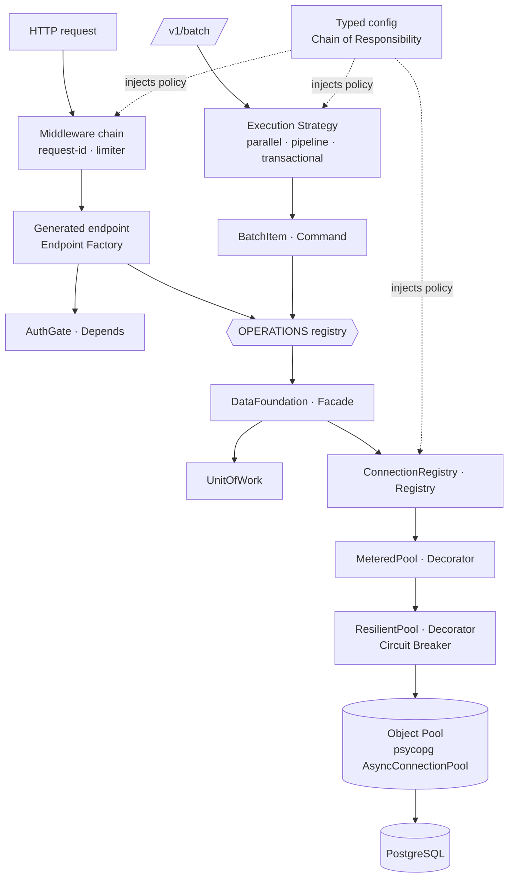

# 03 — Design Patterns

Every pattern here earns its place by solving a stated requirement. Patterns are
the *mechanism* by which "low code," "no hard-coding," and "high throughput"
become real rather than aspirational.

## 3.1 Inherited from the core engine (kept, unchanged)

| Pattern | Where | Problem solved |
|---------|-------|----------------|
| **Ports & Adapters** | `core/ports.py` — `ConnectionPort`, `PoolPort`, `DriverPort`, `Logger/Metrics/Tracer/ClockPort` | Isolates the core from psycopg, the web framework, config sources, and wall-clock time. The primary decoupling mechanism and the reason the whole stack is testable without a database. |
| **Layered / Clean Architecture** | whole system | One-directional dependencies, enforced by `import-linter` contracts. |
| **Facade** | `DataFoundation` | One small public surface; everything under `_internal` is private. |
| **Adapter** | `PsycopgDriver` / `PsycopgPool` / `PsycopgConnection`, `errors_map` | Wraps psycopg behind core ports; psycopg exceptions never escape. |
| **Abstract Factory** | `PoolFactory`, `DriverPort.build_pool` | Builds pools without the caller knowing the concrete driver, and applies the configured decorator stack. |
| **Registry** | `ConnectionRegistry` | O(1) `name → pool` lookup for N named data sources. |
| **Object Pool** | `AsyncConnectionPool` behind `PoolPort` | Connection reuse — the single biggest performance lever. |
| **Unit of Work** | `UnitOfWork` | One atomic transaction boundary; pins a connection, commits on clean exit, rolls back on exception, nests as savepoints. |
| **Repository** | `Repository[T]` | Collection-like access with a pluggable row mapper; deliberately *not* an ORM (no identity map, no lazy loading). |
| **Decorator** | `ResilientPool` (circuit breaker), `MeteredPool` / `MeteredConnection` (metrics) | Cross-cutting behavior added without touching data-access logic; stackable and config-ordered. |
| **Strategy** | Interval bucketing, retry policy, row mapping, config resolvers | Swap algorithms by config, not by editing branches. |
| **Chain of Responsibility** | Config reference resolution (`${env:}` → `${secret:}` → default) | Resolve a value across sources with a documented precedence. |
| **Circuit Breaker** | `CircuitBreaker`, one per data source | Stop hammering an unhealthy database; fail fast instead of queueing. |
| **Null Object** | `NoopMetrics` / `NoopLogger` / `NoopTracer` | Observability is optional with zero `if metrics is not None` noise and ~zero cost. |
| **Context Manager (RAII)** | pools, transactions, streams, the app lifespan | Deterministic acquire/release even on error or cancellation. |
| **Command / CQRS-lite** | `Query` vs `Command` value objects | Intent is explicit: reads are retry-safe and replica-routable; writes are not retried unless idempotent. |
| **Builder** | The invocation compilers (`compile_view` / `compile_function` / `compile_procedure`) and `compile_interval` | Assemble parameterized SQL from validated identifiers + bound values. No string-formatted user input, ever. |
| **Bulkhead** | One pool + one breaker per data source | One overloaded database cannot starve the others. |
| **Iterator / Generator** | `stream()`, `interval()`, `listen()` | Lazy, constant-memory pull over large or continuous sets. |
| **Memento / Checkpoint** | `WatermarkCursor` | Resumable, gap-free incremental fetch. |
| **Keyset / Cursor pagination** | `fetch_since` | Constant-cost deep pagination; never `OFFSET`. |

## 3.2 Patterns the FastAPI shell adds

These are the new ones, and each maps to requirement 2 (low code) or 4
(throughput/concurrency).

| Pattern | Where | Problem solved | Req |
|---------|-------|----------------|-----|
| **Descriptor table + Endpoint Factory** (a Registry of operations feeding a generic factory) | `OPERATIONS` tuple → `build_router()` | The nine near-identical Django views collapse to one generic endpoint plus one data row per operation. New capability = new row. | 2 |
| **Command** | `BatchItem` — a self-describing `{datasource, op, payload}` | A batch item is *data*, not a function call, so it can be queued, dispatched, reordered, retried, and logged uniformly. The batch dispatcher looks each item up in the same operation registry that generates the routes. | 2, 4 |
| **Strategy** (execution) | `ParallelStrategy` / `SequentialPipelineStrategy` / `TransactionalStrategy` | The *semantics* of a batch (fan-out, pipelined, atomic) are selected per request; adding a fourth mode adds a class, not an `if`-chain. | 3, 4 |
| **Scatter–Gather** | `ParallelStrategy` | Fan N independent operations across N pools concurrently, gather into one ordered response. | 4 |
| **Semaphore-bounded pool (backpressure)** | Global + per-datasource `asyncio.Semaphore` | Bounds in-flight DB work so concurrency doesn't just relocate the queue from the pool to the event loop and turn into acquire timeouts. | 4 |
| **Dependency Injection (framework-native)** | `lifespan` → `app.state` → `Depends` | Removes the module-global service locator; each test gets an isolated app. | 2, 3 |
| **Middleware / Interceptor chain** | request-id, concurrency limiter, timing | Cross-cutting concerns declared once, outside every endpoint. | 2 |
| **Exception handler map** | `{error type → HTTP status}` registered with the app | Error translation leaves the call sites entirely; the mapping stays a single table. | 2 |
| **Producer–Consumer (bounded queue)** | Streaming endpoints | DB fetch rate is governed by client consumption rate; memory stays flat. | 4 |
| **Content negotiation Strategy** | NDJSON / SSE (Arrow reserved) | One internal async generator, several wire formats, selected by `Accept`. | 4 |
| **Template Method** | Batch execution skeleton (validate → admit → dispatch → collect → envelope) with strategy-varying dispatch | Fixed, auditable batch lifecycle; only the dispatch step varies. | 3 |

## 3.3 How they interlock

The important edge is `BATCH → STRAT → CMD → REG`: **the batch layer reuses the
same registry the routes are generated from.** That is why adding one operation
descriptor gives you a unary endpoint, a batch-dispatchable command, and (if
marked streamable) a streaming endpoint — three surfaces, one row.

## 3.4 Anti-patterns explicitly avoided

Carried from the Django design, plus two the port fixes:

- **Service Locator / global mutable singletons** — the Django shell's
  `bootstrap._foundation` global (mutated by `set_foundation`) violates the
  project's own doc 04 §4.6. Replaced by lifespan + `app.state` + `Depends`.
- **Copy-paste endpoints** — nine views repeating the same five steps. Replaced by
  the endpoint factory.
- **God object** — no "Manager"; responsibilities split by layer. The batch layer
  schedules and never executes SQL itself.
- **Leaky abstractions** — psycopg types never cross the Facade; FastAPI types
  never enter the core.
- **Stringly-typed config** — all config validated into typed models at boot;
  invalid config fails fast and loudly.
- **Hidden hard-coding** — no magic numbers for pool sizes, timeouts, retry
  counts, batch limits, concurrency caps, or `itersize`. All config, with
  documented defaults (§05).
- **Unbounded concurrency** — `asyncio.gather` over an unbounded list is a
  denial-of-service against your own database. Every fan-out is semaphore-bounded.

## 3.5 Pattern → requirement traceability

| Requirement | Patterns serving it |
|-------------|---------------------|
| **1 · Same features** | Facade, Ports & Adapters (the core is ported, not rewritten); Command + Registry (every operation reachable through one uniform mechanism) |
| **2 · Low code, no hard-coding** | Descriptor table + Endpoint Factory, Command, DI, Middleware, Exception-handler map, Strategy, Chain of Responsibility |
| **3 · Design patterns** | this whole document |
| **4 · Performance / concurrency / parallel / batch** | Object Pool, Bulkhead, Scatter–Gather, Semaphore backpressure, Producer–Consumer, Strategy (pipeline mode), Iterator, Keyset, Decorator (pay only for enabled features) |
