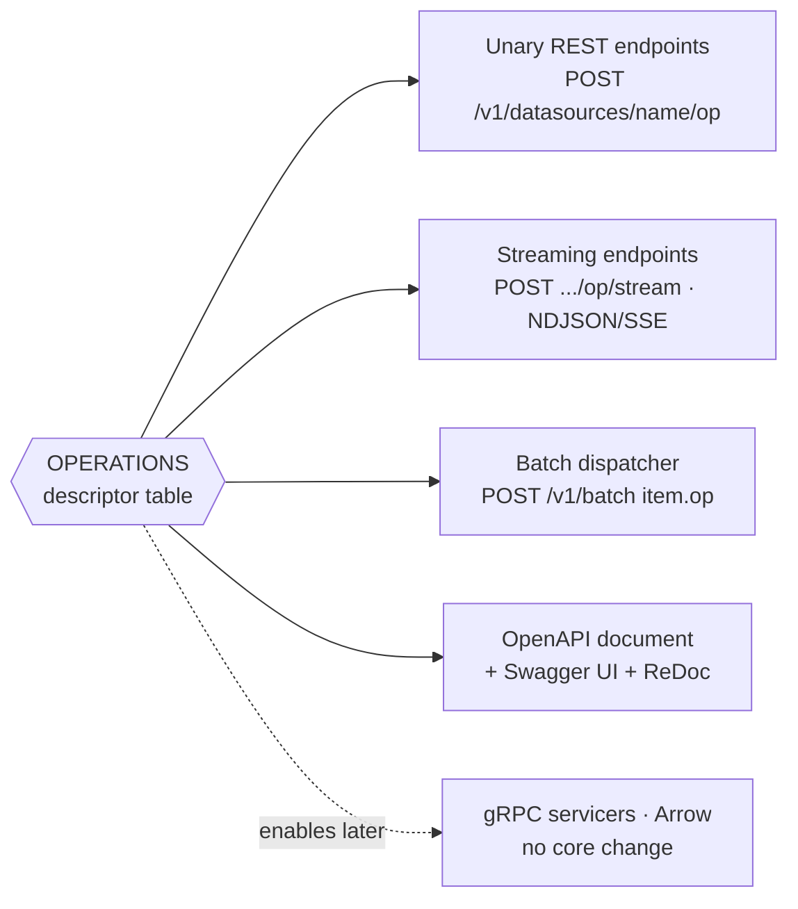

# 04 — The Declarative Operation Registry

**This is the answer to requirement 2 (low code, no hard-coding).** It is a single
mechanism, so it is worth stating precisely.

## 4.1 The problem in the Django shell

`pgfoundation_service/views.py` contains nine `async def` views. Structurally they
are the same five steps:

```python
@api
async def function_view(request, name: str):
    await get_auth_gate().check(request, action="read", resource=name)   # 1 authorize
    dto = FunctionIn.model_validate_json(request.body)                   # 2 validate
    spec = FunctionQuery(name=dto.name, args=dto.args,                   # 3 map DTO → core
                         schema=dto.db_schema, scalar=dto.scalar)
    return _result(await get_foundation().function(name, spec))          # 4 call  5 serialize
```

Every operation repeats all five. Then the same operation is repeated a **third**
and **fourth** time: once in `urls.py` as a route line, once in `openapi.py` as a
hand-written path + parameter + response block. Adding one capability means
editing four files, and nothing keeps them consistent — the OpenAPI document can
describe a route that does not exist, or miss one that does.

Two of those four repetitions are pure framework tax that FastAPI simply deletes
(routing is a decorator; OpenAPI is generated). The registry deletes the other
two.

## 4.2 The mechanism

**One descriptor per operation; everything else is generated from it.**

```python
@dataclass(frozen=True)
class OperationSpec:
    """One row = one capability. The single source of truth for that capability."""
    op: str                                  # stable id: "view", "function", …
    suffix: str                              # URL segment under /v1/datasources/{name}
    request_model: type[BaseModel]           # Pydantic DTO — also the OpenAPI schema
    response_model: type[BaseModel]
    to_core: Callable[[BaseModel], Any]      # DTO → core value object
    handle_method: str                       # method name on DataSourceHandle
    action: Literal["read", "write", "list"] # what AuthGate authorizes
    streamable: bool = False                 # also expose /{suffix}/stream
    trusted_only: bool = False               # raw-SQL ops, gated by config
    summary: str = ""

OPERATIONS: tuple[OperationSpec, ...] = (
    OperationSpec("view",      "view",      ViewIn,      QueryOut,   to_view_query,   "view",      "read",  streamable=True),
    OperationSpec("function",  "function",  FunctionIn,  QueryOut,   to_function_query,"function", "read",  streamable=True),
    OperationSpec("procedure", "procedure", ProcedureIn, QueryOut,   to_procedure_call,"procedure","write"),
    OperationSpec("interval",  "interval",  IntervalIn,  QueryOut,   to_interval_query,"interval",  "read",  streamable=True),
    OperationSpec("fetch_since","fetch-since",FetchSinceIn,PageOut,  to_fetch_since,  "fetch_since","read"),
    OperationSpec("execute_many","execute-many",ExecuteManyIn,ExecuteOut,to_many,     "execute_many","write"),
    OperationSpec("copy",      "copy",      CopyIn,      ExecuteOut, to_copy,         "copy_stream","write"),
    OperationSpec("query",     "query",     QueryIn,     QueryOut,   to_query,        "query",     "read",  streamable=True, trusted_only=True),
    OperationSpec("execute",   "execute",   QueryIn,     ExecuteOut, to_command,      "execute",   "write", trusted_only=True),
)
```

One generic endpoint factory consumes it:

```python
def make_endpoint(spec: OperationSpec):
    async def endpoint(
        name: str,
        body: spec.request_model,                        # FastAPI validates + documents
        db: DataFoundation = Depends(get_foundation),
        _: Principal = Depends(authorize(spec.action)),  # auth is a dependency, not a line
    ) -> spec.response_model:
        # OBSERVE (TRACE):  span "pgf.operation" {op: spec.op, datasource: name}
        # OBSERVE (METRIC): pgf_http_requests_inflight{route} +1 / -1 around this body
        handle = db.datasource(name)
        result = await getattr(handle, spec.handle_method)(spec.to_core(body))
        # OBSERVE (METRIC): pgf_query_rows{datasource, op} <- result.rowcount
        # OBSERVE (LOG):    query.slow {datasource, op, object, elapsed_ms}
        #                   when result.elapsed_ms > observability.slow_query_ms
        # OBSERVE (METRIC): pgf_response_truncated_total{route} + LOG response.too_large
        #                   when rowcount > api.max_response_rows (413 path)
        return spec.response_model.from_result(result)
    return endpoint

def build_router(operations, settings) -> APIRouter:
    router = APIRouter(prefix="/v1/datasources")
    for spec in operations:
        if spec.trusted_only and not settings.api.enable_raw_sql:
            continue                                      # config decides the surface
        router.add_api_route(f"/{{name}}/{spec.suffix}", make_endpoint(spec),
                             methods=["POST"], response_model=spec.response_model,
                             summary=spec.summary, tags=[spec.tag])
        if spec.streamable:
            router.add_api_route(f"/{{name}}/{spec.suffix}/stream", make_stream_endpoint(spec),
                                 methods=["POST"], tags=[spec.tag])
    return router
```

## 4.3 One table, four surfaces



The batch dispatcher is the point that matters most. `/v1/batch` does **not** get
its own hand-written switch over operation kinds:

```python
async def dispatch(item: BatchItem, db: DataFoundation) -> Any:
    spec = OPERATION_BY_ID[item.op]                     # same table
    # OBSERVE (TRACE):  child span "pgf.batch.item" {item_id, op, datasource}
    #                   — siblings must OVERLAP in parallel mode (doc 11 §11.4)
    payload = spec.request_model.model_validate(item.payload)
    handle = db.datasource(item.datasource)
    # OBSERVE (METRIC): pgf_batch_item_duration_seconds{mode, op}
    # OBSERVE (METRIC): pgf_batch_items_total{mode, status} on both return and raise
    return await getattr(handle, spec.handle_method)(spec.to_core(payload))
```

So a new capability written as one descriptor row is *immediately*: a REST
endpoint, a documented OpenAPI operation, a batch-dispatchable command, and — if
`streamable` — a streaming endpoint. That is the "low code" claim, stated as a
falsifiable invariant rather than a slogan.

## 4.4 The invariant, and how it is tested

> **Invariant.** Adding a capability touches exactly one data row plus its DTO.
> No route file, no OpenAPI file, no batch switch, no auth call site.

Enforced by tests, not by discipline ([10 §10.3](./10-testing-and-delivery-plan.md)):

| Test | Asserts |
|------|---------|
| `test_every_operation_has_a_route` | For each `OperationSpec`, a matching route exists on the app. |
| `test_every_operation_is_batch_dispatchable` | Each `op` id resolves in `OPERATION_BY_ID` and dispatches against the fake driver. |
| `test_openapi_covers_every_operation` | The generated `/openapi.json` documents each path and request schema. |
| `test_streamable_ops_have_stream_routes` | `streamable=True` ⇒ `/stream` route exists and yields NDJSON. |
| `test_no_route_outside_the_registry` | The route table contains no data-plane path that isn't registry-derived (admin/docs routes are an explicit allow-list). |

That last test is what stops the mechanism from quietly decaying back into
hand-written views.

## 4.5 Estimated code impact

Indicative targets, not measurements — the point is the *direction* and the fact
that the added features come with fewer lines, not more.

| Shell concern | Django (actual LOC) | FastAPI (target) | Why |
|---------------|--------------------:|-----------------:|-----|
| Endpoint bodies | 134 (`views.py`) | ~60 (factory + descriptors) | Five repeated steps exist once |
| Routing | 21 (`urls.py`) | 0 | Generated |
| OpenAPI | 75 (`openapi.py`) | 0 | Framework-generated |
| Error translation | 75 (`http_errors.py`) | ~45 | Status map kept; the per-view decorator goes |
| Wiring / lifecycle | 49 + 65 (`bootstrap.py`, `asgi.py`) | ~40 | `lifespan` replaces the hand-rolled ASGI protocol loop |
| DTOs | 105 (`schemas.py`) | ~140 | *Grows* — new DTOs for interval, fetch-since, copy, batch |
| Auth seam | 88 (`auth.py`) | ~85 | Ported; call sites become one `Depends` |
| **Batch + streaming (new)** | — | ~180 | The new capability |
| **Total shell** | **~635** | **~550** | Fewer lines, with streaming, interval, fetch-since, copy, execute-many, batch and real docs added |

Two caveats on that table. It counts the **parity** surface only; with batch
strategies, admission control, streaming adapters and the auth policy the realistic
whole-shell figure is nearer **1,200–1,500 lines**. And "fewer lines" does not mean
"fewer files" — those lines are spread across ~30 modules grouped by role
([09 §9.1a](./09-project-structure.md)), because the win being claimed here is
*less repetition*, not *less structure*.

## 4.6 Where the registry deliberately stops

The registry generates **transport**. It never generates **SQL**. The invocation
compilers (`compile_view` / `compile_function` / `compile_procedure` /
`compile_interval`) stay hand-written, reviewed, and unit-tested, because they are
the security boundary: identifiers validated against a strict regex, values always
bound. Metaprogramming near a SQL boundary is how injection bugs get built, so
that boundary stays explicit and boring.

Similarly, the registry is a **closed set defined in code**, not a config file
that lets an operator invent operations at runtime. Config decides *whether* a
listed operation is exposed (`enable_raw_sql`), never *what* it does.

## 4.7 No hard-coding, concretely

The Django shell's residual hard-codings, and their fate:

| Hard-coded today | Where | Plan |
|------------------|-------|------|
| Port `8600` default | `run_local.py` | `ServiceSettings.port`, env-overridable |
| Host `127.0.0.1` | `run_local.py` | `ServiceSettings.host` |
| `itersize=1000` | `handle.py` signature defaults | `datasources[].stream.itersize` in config, per data source |
| OpenAPI title/version/description | `openapi.py` literals | `ServiceSettings.api.*` |
| `"healthy"`/`"degraded"` roll-up rule | `views.py` inline expression | Explicit health policy with `healthy` / `degraded` / `down`, thresholds from config |
| Error → status map | dict literal in `http_errors.py` | Kept as a table (correct already), but registered once as exception handlers |
| Allowed filter operators | `FilterOp` enum | Kept in code — it is a security whitelist, not a tunable |
| Retry / breaker / pool numbers | already config | unchanged |
| Batch limits, concurrency caps, timeouts | *did not exist* | all config (§05, §06) |
