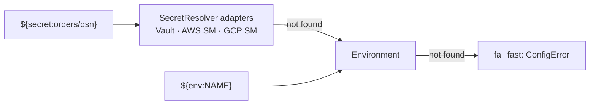

# 05 — Configuration

Requirement 2's second half: **no hard-coded values**. Every operational value is
externalized, typed, validated at boot, and fails fast when wrong.

## 5.1 Principles (inherited, kept)

1. **Typed, not stringly.** Config is validated into Pydantic models at startup;
   an invalid file stops the process with a clear message rather than failing on
   the first request.
2. **Secrets never inline.** DSNs are `SecretStr` — they do not appear in `repr`,
   logs, error payloads, or the OpenAPI document.
3. **Reference, don't embed.** `${env:NAME}` and `${secret:path}` are resolved
   through a provider chain; the file holds structure and tunables, not
   credentials.
4. **Documented defaults.** Every field has a default that is safe for local dev
   and explicit in the schema — so "not configured" never means "undefined
   behavior."

## 5.2 The config document

Existing sections are unchanged. New sections are marked **(new)**.

```yaml
# pgfoundation.yaml
datasources:
  - name: tsdb
    dsn: ${env:PGF_TSDB_DSN}            # or ${secret:tsdb/dsn}
    role: standalone                    # primary | replica | standalone
    read_only: false
    statement_timeout_ms: 5000
    pool:
      min_size: 2
      max_size: 20
      acquire_timeout_seconds: 3
      max_idle_seconds: 300
      max_lifetime_seconds: 1800
    stream:                             # (new) — was hard-coded itersize=1000
      itersize: 1000
      pipeline_enabled: true            # (new) psycopg pipeline mode for batches
    prepare:                            # (new)
      threshold: 5                      # psycopg prepared-statement threshold
      max_cached: 100

  - name: analytics                     # long scans get their own bulkhead
    dsn: ${env:PGF_ANALYTICS_DSN}
    role: replica
    read_only: true
    pool: { min_size: 1, max_size: 8 }
    stream: { itersize: 5000 }

resilience:
  retry:           { max_attempts: 3, base_backoff_ms: 20, max_backoff_ms: 1000, jitter: true }
  circuit_breaker: { enabled: true, failure_threshold: 5, reset_timeout_seconds: 30 }

concurrency:                            # (new) — see doc 06
  max_inflight_total: 128               # global cap on concurrent DB operations
  max_inflight_per_datasource: 32       # per-source cap (bulkhead)
  admission_timeout_ms: 2000            # wait for a slot, then 503 — never queue forever

batch:                                  # (new) — see doc 06
  enabled: true
  default_mode: parallel                # parallel | sequential | transactional
  max_items: 100
  max_concurrency: 16                   # per-request cap, clamped by concurrency.*
  item_timeout_ms: 10000
  total_timeout_ms: 30000
  fail_fast: false

api:                                    # (new) — was hard-coded in openapi.py / run_local.py
  title: pgfoundation-service
  version: "1.0.0"
  root_path: ""
  docs_enabled: true
  versions:                             # (new) which API versions this process mounts
    - name: v1
      enabled: true
      deprecated: false                 # true -> emit Deprecation + Sunset headers
      sunset_date: null                 # ISO date; never a hard-coded literal in code
  enable_raw_sql: false                 # gate the trusted /query and /execute surface
  default_row_format: dict              # dict | tuple
  max_response_rows: 50000              # refuse to materialize more; use /stream
  request_timeout_ms: 15000

server:                                 # (new)
  host: 127.0.0.1
  port: 8600
  workers: 1
  log_level: info

auth:                                   # CALLER identity, not end-user identity (ADR-008)
  enabled: false                        # MUST be true in the prod profile; fails closed with no provider
  provider: none                        # none | mtls | token — or an external adapter's name
  mtls:
    identity_header: x-client-cert-subject   # asserted by the mesh/ingress — never trusted from an untrusted hop
  token:
    issuer: ${env:PGF_TOKEN_ISSUER}
    jwks: ${secret:auth/jwks}
    leeway_seconds: 30
  policy:                               # (new) coarse INFRASTRUCTURE policy — never business rules
    default: deny
    callers:
      - subject: orders-api
        datasources: [main]
        actions: [read, write]
      - subject: analytics-api
        datasources: [analytics]
        actions: [read]

observability:                          # emission only — see doc 11 for every point
  provider: none                        # no-op default; external project binds the real adapter
  metrics_enabled: false
  tracing_enabled: false
  slow_query_ms: 250                    # (new) threshold for the query.slow log event
  trace_sample_ratio: 0.05              # (new) errors + slow queries always sampled
  log_level: info                       # (new)
  redact_sql: true                      # (new) log a fingerprint, never raw SQL text
  application_name: true                # (new) thread request_id into PG application_name
```

## 5.3 Two settings objects, one file

| Object | Owns | Consumed by | Layer |
|--------|------|-------------|-------|
| `AppSettings` | `datasources`, `resilience`, `observability` | the **core engine** | L0 |
| `ServiceSettings` | `api`, `server`, `concurrency`, `batch`, `auth` | the **FastAPI shell** only | L4 |

They are parsed from the same document but stay separate types, because the core
must remain usable as a library with no shell settings present. `ServiceSettings`
uses `pydantic-settings` so every field also has an env override
(`PGF_SERVER__PORT`, `PGF_BATCH__MAX_ITEMS`, …) with the documented precedence:

```
explicit argument  >  environment variable  >  config file  >  schema default
```

## 5.4 Provider chain (Chain of Responsibility)



Today the `secret:` resolver falls back to environment lookup — an honest Phase-0
placeholder. The chain is the seam: a real resolver is registered at the
composition root and needs no change anywhere else. **Unresolved references are a
hard error at boot, never a silent empty string.**

## 5.5 Validation rules (fail fast, at boot)

Inherited: at least one data source; unique names; `pool.max_size >= min_size`;
positive timeouts; `dsn` present.

Added for the new sections:

| Rule | Why |
|------|-----|
| `batch.max_concurrency <= concurrency.max_inflight_total` | A batch must not be able to exceed the global admission cap. |
| `sum(pool.max_size) >= concurrency.max_inflight_total` | Otherwise the global limiter admits work that can only wait for a connection — you would trade a fast 503 for a slow pool timeout. |
| `concurrency.max_inflight_per_datasource <= pool.max_size` for each source | Same reason, per bulkhead. |
| `batch.item_timeout_ms <= batch.total_timeout_ms` | A per-item budget larger than the whole-batch budget is meaningless. |
| `api.enable_raw_sql = false` when `auth.enabled = false` **in the prod profile** | Raw SQL on an unauthenticated surface is the one combination that must not ship by accident. Warn loudly in dev; refuse in prod. |
| `auth.enabled = true` with no registered provider | Refuse to start (inherited fail-closed rule). |
| `auth.enabled = true` with `auth.policy.callers` empty and `default: deny` | Refuse to start — an authenticated-but-authorizes-nobody service is a misconfiguration, not a lockdown ([ADR-008](./adr/ADR-008-auth-boundary.md)). |
| A `policy.callers[].datasources` entry naming an unconfigured data source | Fail fast — a policy referring to a source that does not exist is almost always a typo that silently grants nothing. |

## 5.5a The configured targets

Concrete hosts, ports, roles and their TLS and connection-budget consequences are
in [12 — Deployment Targets](./12-deployment-targets.md). The rule that governs
them is the one above: **the file holds a reference, the platform supplies the
secret.** No DSN, password or hostname credential is committed to this repository.

## 5.6 Profiles

`config/pgfoundation.yaml` (local) and `config/profiles/{dev,staging,prod}.yaml`
overlays, merged over the base document. The prod profile is where
`auth.enabled: true`, `api.docs_enabled: false`, and `api.enable_raw_sql: false`
are asserted — so "safe in production" is a config artifact that can be reviewed
and diffed, not a deployment convention someone has to remember.

## 5.7 Deferred (seams present)

- **Hot reload / secret rotation.** The registry can rebuild a pool behind its
  name; not built in v1.
- **Per-credential policy** (which data sources / operations a principal may
  reach) — the `AuthorizerPort` already receives `(principal, action, resource)`,
  so the policy document plugs in with the external auth project.
