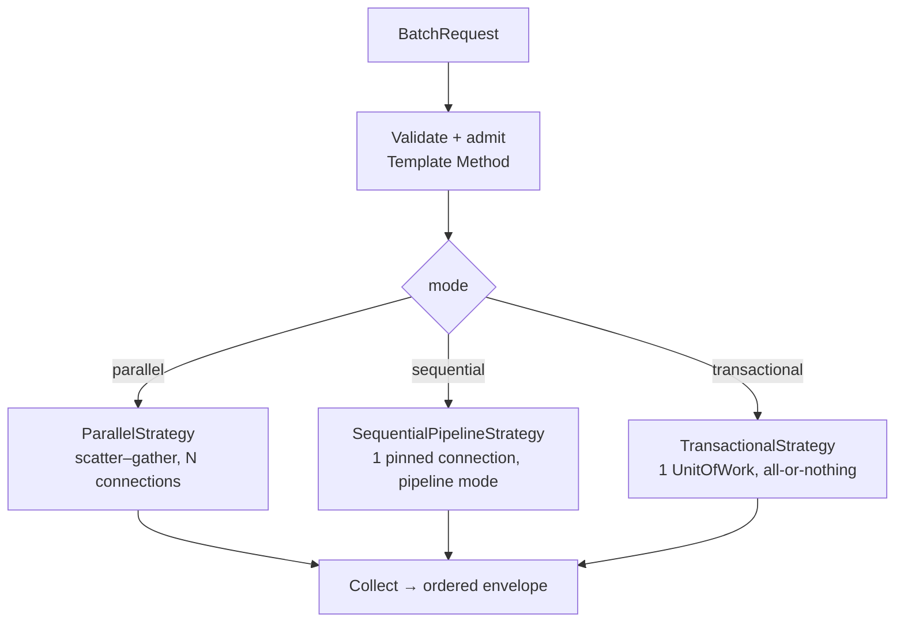
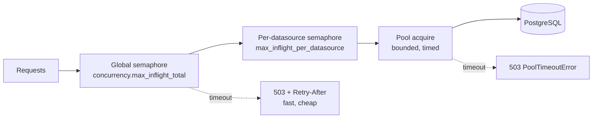

# 06 — Concurrency, Batch & Parallel Execution

**This is the answer to requirement 4.** The Django service is one query per HTTP
request, executed serially, with no batch surface and no admission control. This
document designs the concurrency layer.

## 6.1 What "high throughput" actually requires

Four independent things, often conflated:

| Lever | Mechanism | Where |
|-------|-----------|-------|
| **Concurrency** — many requests in flight on one process | async event loop + async pools (already true) | inherited |
| **Parallelism** — one *logical* request doing N things at once | batch `parallel` mode, scatter–gather over N pools | §6.3 |
| **Fewer round-trips** — N statements, ~1 network exchange | psycopg **pipeline mode**, `executemany`, `COPY` | §6.4, §07.3 |
| **Admission control** — refusing work you cannot serve | bounded semaphores + fast 503 | §6.6 |

The fourth is the one most systems skip. Without it, "more concurrency" just moves
the queue from the connection pool into the event loop, and every request pays a
pool-acquire timeout instead of a fast rejection. All four are designed here.

## 6.2 The batch API

One endpoint, because the *shape* of a batch is uniform and only its *semantics*
vary (ADR-004).

```jsonc
// POST /v1/batch
{
  "mode": "parallel",            // parallel | sequential | transactional
  "max_concurrency": 8,          // clamped by batch.max_concurrency
  "fail_fast": false,
  "timeout_ms": 20000,           // clamped by batch.total_timeout_ms
  "items": [
    { "id": "a", "datasource": "main",      "op": "view",
      "payload": {"name": "v_paid_orders", "filters": [{"column":"customer","op":"eq","value":"bob"}]} },
    { "id": "b", "datasource": "analytics", "op": "function",
      "payload": {"name": "fn_daily_totals", "args": {"day": "2026-08-13"}} },
    { "id": "c", "datasource": "main",      "op": "interval",
      "payload": {"source":"readings","time_column":"ts","start":"...","end":"...","every":"15 minutes",
                  "metrics":[{"column":"kwh","func":"sum"}],"group_by":["meter_id"]} }
  ]
}
```

```jsonc
// 200 OK — partial success is normal and explicit
{
  "mode": "parallel",
  "elapsed_ms": 41.7,
  "ok_count": 2, "error_count": 1,
  "results": [
    {"id":"a","status":"ok","rows":[…],"row_count":2,"elapsed_ms":11.4},
    {"id":"b","status":"ok","rows":[…],"row_count":1,"elapsed_ms":38.2},
    {"id":"c","status":"error","error":{"type":"QueryError","message":"unsafe SQL identifier: 'read;ings'"}}
  ]
}
```

**Design rules**

- Each item is a **Command**: `{id, datasource, op, payload}` — self-describing
  data dispatched through the *same* operation registry that generates the unary
  routes (§04.3). No parallel switch statement to keep in sync.
- Results are returned **in request order** regardless of completion order.
  Correlation is by `id`; the server does not reorder or dedupe.
- A failing item does **not** fail the batch in `parallel`/`sequential` mode
  unless `fail_fast` is set. HTTP stays `200`; per-item `status` carries the
  truth. (Returning `207` was considered and rejected: it is under-supported by
  clients and the envelope is unambiguous already.)
- The whole batch shares one request-id; each item gets `request-id/item-id` for
  log correlation.
- Items may target **different data sources** — that is the point. The parallel
  strategy then uses genuinely independent pools.

## 6.3 Execution strategies

Selected per request; adding a fourth mode is a new class, not a new branch.



### `parallel` — maximum throughput, no atomicity

```python
async def execute(self, items, db, limits):
    sem = asyncio.Semaphore(limits.effective_concurrency)
    # OBSERVE (METRIC): pgf_batch_concurrency_peak{mode} — track max simultaneous
    #                   runners. This is the signal that PROVES the fan-out is real;
    #                   a peak far below the cap means something upstream serializes.
    async def run(item):
        async with sem:                                   # bounded fan-out
            # OBSERVE (METRIC): pgf_admission_wait_seconds{scope="batch"} — time
            #                   spent waiting here, not executing
            async with per_datasource_slot(item.datasource):
                # OBSERVE (METRIC): pgf_admission_wait_seconds{scope="datasource"}
                async with asyncio.timeout(limits.item_timeout_s):
                    # OBSERVE (LOG): batch.item_timeout {item_id, op, budget_ms}
                    #                on TimeoutError
                    return await dispatch(item, db)       # own connection, own pool
    return await asyncio.gather(*(run(i) for i in items), return_exceptions=True)
    # OBSERVE (METRIC): pgf_batch_duration_seconds{mode}, pgf_batch_items{mode}
    # OBSERVE (LOG):    batch.completed {mode, items, ok, errors, elapsed_ms}
```

- One connection per in-flight item, acquired and released independently.
- Items on different data sources contend on different pools — a slow analytics
  query cannot stall the OLTP items in the same batch.
- `return_exceptions=True` so one failure never cancels the siblings; exceptions
  are mapped into per-item error envelopes by the same error table the HTTP
  handlers use.
- **Use when:** independent reads, dashboard panel fan-out, cross-database
  gathers. This is the default.

### `sequential` — ordered, few round-trips

- One connection pinned for the whole batch.
- Statements are issued in **psycopg pipeline mode**: send all, flush once, read
  results. N round-trips collapse toward 1, which dominates the cost on any
  non-local network.
- Order is guaranteed; later items may depend on earlier writes.
- **Use when:** ordered dependent statements, or a chatty client on a high-latency
  link where round-trips, not the database, are the bottleneck.

### `transactional` — atomic

- One `UnitOfWork` for all items: all commit or all roll back.
- Wrapped in the inherited `run_transaction(...)` runner, so a serialization
  failure (`40001`) or deadlock (`40P01`) re-runs **the entire body** with backoff
  and jitter — the correct granularity, per ADR-010.
- `fail_fast` is implicit: the first error aborts and rolls back.
- **Idempotency requirement** (inherited and re-stated in the API docs): the body
  may run more than once, so items must be free of non-DB side effects.
- **Use when:** the ordered atomic batch the Django docs specified as
  `POST .../transaction` but never built.

| | parallel | sequential | transactional |
|---|---|---|---|
| Connections | N (bounded) | 1 | 1 |
| Round-trips | N (concurrent) | ~1 (pipelined) | N (in one txn) |
| Order guaranteed | no (results ordered, execution not) | yes | yes |
| Atomic | no | no | **yes** |
| Partial success | yes | yes (until fail_fast) | no |
| Retry on 40001/40P01 | per item, if idempotent | no | **whole batch** |

## 6.4 Parallelism inside the core

Beyond the batch endpoint, three inherited operations are serial loops that should
be concurrent. These are core-side fixes:

| Today | Change |
|-------|--------|
| `ConnectionRegistry.health()` — `{name: await pool.health() …}` sequentially | `asyncio.gather` over pools. With 5 sources and a 3 s acquire timeout, a health check on a degraded cluster currently takes up to 15 s and can trip a readiness probe that would otherwise pass. |
| `ConnectionRegistry.start()` — opens pools one by one | `asyncio.gather`; startup latency becomes max(), not sum(). |
| `ConnectionRegistry.aclose()` — closes one by one | `asyncio.gather` with a bounded drain deadline, so SIGTERM shutdown is predictable. |

`health()` must also stop collapsing to two states: today
`all(healthy) ? "healthy" : "degraded"` can never report `down`, even though the
error model, the README, and the `HealthStatus` enum all define it. Policy:

- `healthy` — all sources healthy
- `degraded` — at least one healthy, at least one not
- `down` — none healthy

and `/v1/health` (liveness, always `200` if the process is up) is split from
`/v1/ready` (readiness, `503` when `down`) so Kubernetes probes mean the right
things.

## 6.5 Where parallelism must *not* be used

Worth stating, because it is the failure mode of naive fan-out:

- **Never** run two operations concurrently on one connection. A connection is
  single-threaded state; concurrency lives at the pool level, not below it.
- **Never** fan out inside a `UnitOfWork` — the transaction is pinned to one
  connection, so `transactional` mode is serial by construction.
- **Never** issue an unbounded `asyncio.gather` over client-supplied items.
  `batch.max_items` bounds the list, and the semaphore bounds concurrency.
- Streaming iterators pin a connection for their lifetime; a batch of streams
  would hold N connections for as long as the slowest client reads. Streams are
  therefore **not** batch-dispatchable — `streamable` operations get their own
  endpoint and are excluded from batch items.

## 6.6 Admission control & backpressure



Three nested bounds, each config-driven:

1. **Global in-flight cap** — total concurrent DB operations across the process.
2. **Per-datasource cap** — the bulkhead; one hot database cannot consume every
   slot.
3. **Pool `max_size` + acquire timeout** — the existing, innermost bound.

Waiting for admission is itself bounded (`admission_timeout_ms`). On expiry the
request gets `503` with `Retry-After` **before** touching a pool. That is the
difference between a system that sheds load and one that collapses: rejection
costs microseconds, a pool timeout costs the full acquire budget.

Config validation (§05.5) asserts `sum(pool.max_size) >= max_inflight_total`, so
the limiter can never admit more work than the pools can hold.

## 6.7 Streaming (constant memory, honest backpressure)

Streaming endpoints exist so that "fetch a lot of data" never means "materialize a
lot of data".

| Route | Format | Backing |
|-------|--------|---------|
| `POST /v1/datasources/{name}/{op}/stream` | NDJSON (`application/x-ndjson`), chunked | `handle.stream(...)` server-side cursor |
| `POST /v1/datasources/{name}/{op}/stream` with `Accept: text/event-stream` | SSE | same generator, SSE framing |
| `GET /v1/datasources/{name}/subscribe/{channel}` | SSE | `handle.listen(channel)` LISTEN/NOTIFY |
| `POST /v1/datasources/{name}/copy` | NDJSON request body | `handle.copy_stream(...)` streaming `COPY` ingest |

Mechanics:

- A `StreamingResponse` wraps the existing async generator. Because the generator
  yields per row-batch and the ASGI server awaits each send, a slow client
  throttles the database fetch — **end-to-end backpressure with no server-side
  buffer growth.**
- Each stream pins one connection until the iterator closes. Streams therefore
  count against the per-datasource semaphore, and long scans should target a
  dedicated `analytics`-style data source (its own pool = its own bulkhead).
- **Client disconnect must cancel the query.** The generator's `finally` closes
  the cursor and releases the connection; cancellation propagates so PostgreSQL
  stops work rather than filling a socket nobody reads.
- Errors mid-stream cannot change the HTTP status (headers are already sent), so
  the last NDJSON line is an error object: `{"error": {...}, "partial": true}`.
  This is documented as part of the contract.
- Unary endpoints refuse over-large results (`api.max_response_rows`) with a `413`
  pointing at the stream route, instead of silently OOM-ing the worker.

## 6.8 Timeouts, cancellation & deadlines

A per-request deadline that only exists client-side is not a timeout — the server
keeps working. So the deadline is enforced at three levels:

| Level | Mechanism |
|-------|-----------|
| HTTP request | `asyncio.timeout(request_timeout_ms)` around the handler |
| Batch item | `asyncio.timeout(item_timeout_ms)` inside the strategy |
| Database | `statement_timeout` set on the connection (per data source, and per request when `timeout_ms` is supplied) |

The database level is the one that matters: without it, cancelling the coroutine
abandons a query that PostgreSQL happily keeps running. `timeout_ms` in the
request body — present in the Django design docs, never implemented — is wired to
a `SET LOCAL statement_timeout` for the statement's transaction, so the cancel
reaches the server. Timeout maps to `503` (`TransientError`, since `57014` is
already mapped as transient).

## 6.9 Concurrency-correctness fixes to make while porting

Found while reading the current implementation. Each is a real race or hazard that
only shows up under the concurrency this project is now asking for.

| # | Issue | Consequence | Fix |
|---|-------|-------------|-----|
| 1 | `CircuitBreaker` mutates `_failures` / `_state` with no synchronization, from many coroutines | Under concurrent failures the threshold can be over- or under-counted; a half-open probe can be entered by several coroutines at once | Guard transitions with an `asyncio.Lock`, or restructure as a single-writer state machine. Also admit exactly **one** probe in `HALF_OPEN`. |
| 2 | Server-side cursor named `f"pgf_stream_{id(spec)}"` | `id()` is an address and is reused after GC. Two concurrent streams on the same connection can collide on cursor name | Monotonic counter or `uuid4().hex`, per connection |
| 3 | Module-global `_foundation` / `_auth_gate` mutated by setters | Cross-test leakage; no isolation; violates the project's own "no service locator" rule | `lifespan` → `app.state` → `Depends` (ADR-005) |
| 4 | `registry.health/start/aclose` serial | Slow, unbounded startup and probe latency (§6.4) | `asyncio.gather` + drain deadline |
| 5 | Pool warm-up swallows every exception (`except Exception: pass`) | A misconfigured DSN looks identical to a temporarily down database | Keep the graceful-degradation behavior, but record the failure and surface it in `/v1/ready` and metrics |
| 6 | `MeteredPool.release` reaches into `conn._inner` | Breaks if the decorator order changes | Give the decorators an explicit unwrap contract |
| 7 | Isolation level is set on the *connection* and restored in `finally` | Correct today only because the connection is pinned; fragile if pooling changes | Keep, but document the invariant and assert the connection is pinned |
| 8 | No admission control anywhere | Load collapses into pool timeouts rather than fast rejection | §6.6 |
| 9 | `execute()` on the handle routes writes through `query()` | Works, but write intent is lost before the pool — blocks future replica routing | Keep `Command` distinct all the way to the pool |

## 6.10 Traceability

| Requirement 4 aspect | Delivered by |
|----------------------|--------------|
| High performance | pipeline mode, prepared statements, orjson, tuple rows, `COPY` ([07](./07-performance.md)) |
| High throughput | connection concentrator, bounded fan-out, batch amortizing HTTP/TLS/auth over N ops |
| Concurrent | async-first core + per-datasource bulkheads + admission control (§6.6) |
| Parallel call | `parallel` batch strategy, scatter–gather across independent pools (§6.3) |
| Batch call | `/v1/batch`, `execute-many`, `COPY`, sequential pipeline mode (§6.2–6.4) |
