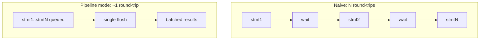

# 07 — Performance Engineering

Requirement 4's first word. [06](./06-concurrency-batch-parallel.md) covers
concurrency and batching; this covers the per-operation cost.

## 7.1 Principles

1. **Async-first.** Database work is I/O-bound; one event loop serves thousands of
   concurrent queries without thread-per-request cost.
2. **Reuse everything expensive.** Connections pooled, statements prepared,
   decorator chains built once at startup rather than per request.
3. **Pay only for enabled features.** Every decorator is optional and
   config-ordered; with observability off, the hot path is a Null Object attribute
   lookup away from bare psycopg.
4. **Move less data.** Stream large results; select only needed columns; binary
   protocol.
5. **Fewer round-trips.** Pipeline mode, `executemany`, and `COPY` collapse N
   network exchanges toward 1.

## 7.2 Where the time actually goes

For a simple point read on a warm pool, roughly:

```
client → HTTP parse → validate → auth → facade → pool acquire → SQL round-trip → row mapping → JSON serialize → response
         └── framework ──┘                        └── the real work ──┘        └── the other real work ──┘
```

Two of these are worth engineering because they scale with result size, not
request count: **row mapping** and **JSON serialization**. The rest is a fixed
per-request cost that FastAPI's routing plus Pydantic v2 (Rust-backed validation)
keeps small.

## 7.3 Reducing round-trips



| Technique | Where | Speedup source |
|-----------|-------|----------------|
| **Pipeline mode** | `sequential` batch strategy | Send many statements without waiting for each reply. Dominant win when RTT > query time — i.e. almost always across a network. |
| **`executemany`** | `POST .../execute-many` | One protocol exchange for many parameter sets. |
| **`COPY`** | `POST .../copy` | Bulk load bypasses per-row parse/plan/execute. Order-of-magnitude over row-by-row `INSERT`. |
| **Batch endpoint** | `/v1/batch` | Amortizes HTTP, TLS, auth and validation over N operations. |
| **Prepared statements** | every governed call | The compilers emit *deterministic SQL per call shape* (stable text, stable param names) — already true today and worth protecting with a test — so psycopg's prepare cache hits and PostgreSQL skips re-planning. |

The prepared-statement property is quietly the most valuable thing the existing
invocation compilers do. `prepare.threshold` and `prepare.max_cached` become
config (§05.2) instead of driver defaults.

## 7.4 Serialization (ADR-007)

Django's `JsonResponse` uses stdlib `json`. For row-heavy responses this is a
measurable share of total time.

- **`ORJSONResponse` as the default response class** — substantially faster
  encoding and lower allocation than stdlib `json`.
- **`Decimal` must stay a string.** The current service serializes `numeric` as
  `"42.00"` to preserve exact precision, and that is a **behavioral contract** —
  clients parse it. orjson does not serialize `Decimal` natively, so a `default=`
  hook renders `Decimal → str`. A parity test asserts `numeric` round-trips as a
  JSON string, because getting this wrong silently converts money to floats.
- Same rule for `datetime` (RFC 3339), `date`, `UUID`, `bytes` (base64) — one
  documented encoder table, tested.

## 7.5 Row format (Strategy)

The Django docs specify `row_format: dict | tuple`; it was never implemented.
Building a dict per row costs real time at volume.

| Format | Response shape | Use |
|--------|---------------|-----|
| `dict` (default) | `{"rows": [{"id": 1, "total": "9.90"}]}` | Ergonomics; unchanged from today |
| `tuple` | `{"columns": ["id","total"], "rows": [[1,"9.90"]]}` | Large exports, streaming, columnar consumers — fewer allocations and a smaller payload (no repeated keys) |

Implemented as a psycopg row-factory choice (`dict_row` vs `tuple_row`) selected
per call, plus the matching response model. Default is config
(`api.default_row_format`), overridable per request.

## 7.6 Connection pooling

The largest single lever, and already right in the core:

- One tuned `AsyncConnectionPool` per data source.
- `min_size` warm connections avoid connect latency on first hit.
- Bounded `max_size` + acquire timeout gives backpressure instead of collapse.
- `max_lifetime` recycling sheds connections with bloated plan caches.
- In service mode the shell is a **connection concentrator**: a fleet of app
  instances shares one bounded pool set rather than each opening its own — fewer
  PostgreSQL backend processes, each of which has a real memory cost.

## 7.7 Memory

- Stream rather than materialize; `api.max_response_rows` makes the unary path
  refuse (with `413` → use `/stream`) instead of OOM-ing.
- `itersize` per data source trades throughput against first-byte latency.
- No ORM identity map, no lazy loading, no implicit N+1 helpers — batch APIs are
  explicit.
- Decorator chains are built once at pool construction, not per call.

## 7.8 Process & runtime

| Choice | Rationale |
|--------|-----------|
| **uvicorn**, `workers` from config | One event loop cannot use more than one core; a few workers saturate a host's link to PostgreSQL. Each worker owns its own pools — so `total connections = workers × Σ pool.max_size`, and that arithmetic must be checked against the instance's connection limit ([12 §12.4](./12-deployment-targets.md)). Called out explicitly because it is the classic scaling mistake, and a managed instance's plan tier — not the config file — is the binding constraint. |
| **uvloop** on POSIX | Faster event loop; opt-in by config. |
| **Windows: `SelectorEventLoop`** | Async psycopg cannot use the Proactor loop. The inherited `WindowsSelectorEventLoopPolicy` guard is kept in the entry point — the project's primary dev environment is Windows, so this is not optional. |
| **`--http httptools`** | Faster HTTP parsing than the pure-Python fallback. |

## 7.9 Budgets & SLOs (design targets to validate)

| Metric | Target |
|--------|--------|
| Shell overhead above the library facade (features off) | < 5% p50, < 10% p99 |
| Pool acquire, warm and uncontended | < 1 ms p99 |
| Simple point read, warm pool, same AZ | within ~1.2× of raw psycopg |
| `COPY` bulk throughput | ≥ 80% of raw `COPY` |
| Batch of 20 independent reads, `parallel` | ≤ ~1.5× the slowest single item (not the sum) |
| Batch of 20 statements, `sequential` pipelined | ≤ ~2× a single statement's RTT |
| Streaming 10M rows | flat memory; steady-state RSS within a documented band |
| Load shedding | over-capacity requests get `503` in < 5 ms, not a pool timeout |

The last three are new and are the ones that prove requirement 4 rather than
assert it.

## 7.10 Anti-bloat rules

- No reflection or schema introspection on the hot path.
- No per-call object churn — reuse `QuerySpec` shapes so prepared-statement
  identity is stable.
- Feature decorators compile to Null Objects when disabled.
- No middleware that reads the request body (it forces buffering and defeats
  streaming ingest).

## 7.11 Measuring & guarding

- **Micro-benchmarks** (`pytest-benchmark`): facade + shell overhead vs raw
  psycopg, features off. CI gate on regression.
- **Load tests** (k6 or Locust) against the service; an asyncio harness for
  library mode. Assert p50/p95/p99 and behavior at saturation — including that
  saturation produces fast `503`s.
- **Soak test**: hours-long run watching for connection leaks, memory growth, and
  prepared-statement cache growth.
- Latency and pool-saturation metrics are already emitted through `MetricsPort`;
  the external observability project binds the exporter. The full catalogue of
  what to emit and where is [11](./11-observability-instrumentation-points.md) —
  in particular `pgf_pool_acquire_seconds` (saturation shows up there long before
  it becomes a timeout) and `pgf_batch_concurrency_peak` (the signal that the
  parallel fan-out is actually parallel).
