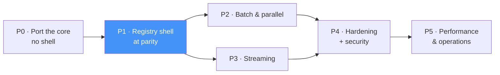

# 13 — Implementation Plan, Phase by Phase

The task-level expansion of the six phases in
[10 §10.8](./10-testing-and-delivery-plan.md). Every task names what it touches,
what it depends on, and what proves it done.

**Sizing is relative, not a schedule:** `S` ≈ under a day, `M` ≈ a few days,
`L` ≈ a week or more, for one experienced developer. Multiply by your own team and
context; nothing here assumes a date.

## 13.1 Phase map

P2 and P3 both depend only on P1 and touch mostly disjoint files — **they are the
one genuinely parallelizable pair** if two people are available. Everything else is
serial.

### Where the service becomes safe to expose

| After | Reachable by |
|-------|--------------|
| P0 | nothing — there is no service yet |
| P1–P3 | **a trusted network only.** Auth is still the inherited disabled-by-default seam |
| **P4** | more than one caller, once the caller-authentication work lands |
| P5 | production, once [12 §12.9](./12-deployment-targets.md) is signed off |

This matters for planning: **do not onboard a second consuming API before P4.**

## 13.2 Standing rules (all phases)

1. **CI is green from P0 onward** — ruff, mypy on the public surface,
   import-linter, and the full test suite. A phase does not end with a known-red
   gate.
2. **No hard-coded operational value** enters the code. If a task needs a number,
   it needs a config key and a validation rule ([05](./05-configuration.md)).
3. **Comments, not implementations, for telemetry.** Add
   `# OBSERVE (METRIC|TRACE|LOG):` markers as you go
   ([11](./11-observability-instrumentation-points.md)); they are implemented in
   P5.
4. **The invocation compilers are frozen.** `compile_view` / `compile_function` /
   `compile_procedure` / `compile_interval` / `safe_identifier` are the injection
   boundary ([ADR-002](./adr/ADR-002-core-ported-unchanged.md)).
5. **Every new endpoint is a registry row** unless it physically cannot be
   ([ADR-003](./adr/ADR-003-declarative-operation-registry.md)).

---

## P0 — Port the core engine

**Goal:** a green core test suite in the new repository, with no shell at all.
**Entry:** empty repo. **Risk:** lowest of any phase — this is the phase that buys
confidence for the rest.

| # | Task | Touches | Depends | Size | Done when |
|---|------|---------|---------|------|-----------|
| P0.1 | Repo skeleton: `postgresqlmodule/code/`, `pyproject.toml` (tooling only), `requirements.txt`, venv | root | — | S | `pytest` runs and collects zero tests |
| P0.2 | Copy `pgfoundation/core/` verbatim | `core/` | P0.1 | S | imports clean |
| P0.3 | Copy `pgfoundation/_internal/` verbatim (config, connection, access, api, drivers, resilience, observability, clock) | `_internal/` | P0.2 | S | imports clean |
| P0.4 | Copy `config/*.yaml` + add `profiles/{dev,staging,prod}.yaml` | `config/` | P0.1 | S | `load_settings()` parses each |
| P0.5 | Port core tests: `tests/unit/`, `tests/integration/`, `conftest.py` | `tests/` | P0.3 | M | 55 unit pass; 4 integration skip without `PGF_TEST_DSN` |
| P0.6 | `.importlinter` with 4 core contracts; swap forbidden `django` → `fastapi`,`starlette`,`uvicorn` | `.importlinter` | P0.3 | S | `lint-imports` → 4 kept, 0 broken |
| P0.7 | CI pipeline: ruff · mypy · import-linter · pytest | CI config | P0.5, P0.6 | M | pipeline green on a clean checkout |
| P0.8 | **Port-fidelity review:** diff the core against the Django repo | — | P0.3 | S | diff is near-empty; every deviation is justified in the PR |

**Exit:** core tests green · contracts green · core diff ≈ empty.

> **P0.8 is a real gate, not a formality.** [ADR-002](./adr/ADR-002-core-ported-unchanged.md)
> commits to porting the core unchanged so that requirement 1 holds by
> construction. A large diff here means that guarantee has quietly been traded
> away, and it is far cheaper to catch now than after P1 builds on it.
>
> **Deliberately *not* done in P0:** the [06 §6.9](./06-concurrency-batch-parallel.md)
> defect fixes. They land where they are needed — parallelism fixes in P2, the rest
> in P4 — so that a behaviour change is never mistaken for a port artifact.

---

## P1 — Registry-driven shell at feature parity

**Goal:** the five existing Django endpoints, generated from the descriptor table,
behaving identically. **This is the "same features" milestone** and the phase that
decides whether the low-code claim is real.

Ordered so a **walking skeleton runs after P1.4** — the service boots, connects to
the real database, and answers `/health` before any data-plane code exists.

| # | Task | Touches | Depends | Size | Done when |
|---|------|---------|---------|------|-----------|
| P1.1 | `ServiceSettings` + profile overlay + env precedence | `settings.py` | P0 | M | invalid config fails fast with a clear message |
| P1.2 | `create_app(settings)` factory + `bootstrap/lifespan.py` | `app.py`, `bootstrap/` | P1.1 | M | app starts, builds pools on the serving loop, drains on exit |
| P1.3 | `Depends` providers: foundation, settings | `bootstrap/deps.py` | P1.2 | S | no module-global state anywhere |
| P1.4 | `ops.py`: `/health`, `/ready` (unversioned) + tri-state health policy | `ops.py` | P1.3 | M | **walking skeleton** — real DB, `/ready` flips correctly |
| P1.5 | `errors.py`: status table + registered exception handlers | `errors.py` | P1.2 | M | error-mapping matrix from [08 §8.3](./08-api-surface.md) covered case by case |
| P1.6 | v1 DTOs, ported and extended | `api/v1/schemas/` | P1.1 | M | `schema` alias preserved; models validate |
| P1.7 | `OperationSpec` descriptor contract | `registry/spec.py` | — | S | typed, frozen dataclass |
| P1.8 | DTO → core mappers | `api/v1/mappers.py` | P1.6, P1.7 | M | one per operation, unit-tested |
| P1.9 | **The generic endpoint factory** | `registry/endpoints.py` | P1.7, P1.8 | **L** | one endpoint body holds all five steps; FastAPI introspects it correctly |
| P1.10 | `build_router(operations, prefix, settings)` | `registry/router.py` | P1.9 | M | no `/v1` literal in `registry/` |
| P1.11 | The v1 `OPERATIONS` table — 5 parity rows | `api/v1/operations.py` | P1.10 | S | pure data, no logic |
| P1.12 | Security ports + `AuthGate` ported; `authorize(action)` dependency | `security/` | P1.3 | M | fail-closed when enabled with no provider |
| P1.13 | `/v1/datasources`; `/v1/health`+`/v1/ready` aliases | `api/v1/routes/admin.py` | P1.4 | S | parity with the Django surface |
| P1.14 | **orjson response class + encoder table** | `transport/serialization.py` | P1.5 | M | `Decimal` → JSON **string**; datetime/UUID/bytes rules |
| P1.15 | `X-Request-Id` in/out | `middleware/correlation.py` | P1.2 | S | echoed if supplied, generated otherwise |
| P1.16 | Port the 14 Django service tests onto `httpx.AsyncClient` | `tests/service/` | P1.11 | M | same assertions, new client |
| P1.17 | **Registry invariant tests** (5, per [10 §10.3](./10-testing-and-delivery-plan.md)) | `tests/contract/` | P1.11 | M | route/batch/OpenAPI/stream/no-stray-route all enforced |
| P1.18 | **Parity harness** + frozen contract tests ([08 §8.2](./08-api-surface.md)) | `tests/contract/` | P1.16 | **L** | library mode and service mode agree on every operation |
| P1.19 | OpenAPI snapshot test | `tests/contract/` | P1.11 | S | committed snapshot; drift fails CI |
| P1.20 | `run_local.py` (Windows SelectorEventLoop guard) + VS Code launch target | `run_local.py` | P1.2 | S | `python -m pgfoundation_api.run_local` serves on the configured port |

**Exit:** parity harness green on all five endpoints · frozen contracts hold ·
`/docs` serves real Swagger UI · registry invariants pass · `enable_raw_sql:false`
removes the raw routes from both app and spec.

### The two tasks that can silently go wrong

- **P1.9 — dynamic endpoint signatures.** Building endpoints whose body type varies
  per spec requires setting annotations on the generated function, not merely
  closing over them, or FastAPI will not introspect and document them. **Spike this
  first, before P1.6–P1.8**, because the whole low-code design rests on it and the
  failure mode is a silently empty OpenAPI schema rather than an exception.
  P1.17's "every operation appears in OpenAPI with its request schema" is the
  detector.
- **P1.14 — the `Decimal` contract.** Swapping the JSON encoder is exactly how
  `"42.00"` silently becomes `42.0` and money becomes lossy. Write
  `test_numeric_serializes_as_string` **before** the encoder, not after.

---

## P2 — Batch & parallel execution

**Goal:** requirement 4's parallel and batch halves.
**Ordered by increasing risk:** parallel needs no core change, transactional reuses
the existing retry runner, sequential needs a new core seam.

| # | Task | Touches | Depends | Size | Done when |
|---|------|---------|---------|------|-----------|
| P2.1 | Core fix: `registry.health/start/aclose` → `asyncio.gather`; health tri-state (`healthy`/`degraded`/`down`) | core `connection/` | P1 | M | 5 sources × 100 ms ⇒ ~100 ms, not ~500 ms |
| P2.2 | `concurrency` + `batch` config blocks + the cross-field validation rules ([05 §5.5](./05-configuration.md)) | `settings.py`, `config/` | P1.1 | M | a limiter that outruns the pools fails at boot |
| P2.3 | Admission limiter: global + per-datasource semaphores, bounded wait | `batch/limits.py` | P2.2 | M | slot exhaustion raises before pool acquire |
| P2.4 | Admission middleware: fast `503` + `Retry-After` | `middleware/admission.py` | P2.3 | M | over-capacity rejected in < 5 ms |
| P2.5 | Batch DTOs | `api/v1/schemas/batch.py` | P1.6 | S | per-item envelope with `status` |
| P2.6 | Registry-driven item dispatch (Command) | `batch/dispatch.py` | P2.5 | M | receives the operations table; never imports it |
| P2.7 | `ExecutionStrategy` protocol + ordered envelope assembly | `batch/strategies/base.py` | P2.6 | M | results ordered by request position |
| P2.8 | **`ParallelStrategy`** — bounded scatter–gather | `strategies/parallel.py` | P2.7, P2.3 | **L** | items on different sources use different pools concurrently |
| P2.9 | `POST /v1/batch` | `api/v1/routes/batch.py` | P2.8 | S | partial success returns `200` with per-item status |
| P2.10 | `TransactionalStrategy` over the existing `run_transaction` | `strategies/transactional.py` | P2.7 | M | rollback-all on failure; whole body retried on 40001/40P01 |
| P2.11 | Core seam: `ConnectionPort.pipeline()` + psycopg implementation | core `ports.py`, `drivers/` | P1 | **L** | additive — existing signatures unchanged |
| P2.12 | `SequentialPipelineStrategy` | `strategies/sequential.py` | P2.11, P2.7 | M | N statements, one pinned connection, ~1 round-trip |
| P2.13 | Concurrency test suite ([10 §10.5](./10-testing-and-delivery-plan.md)) | `tests/` | P2.12 | **L** | peak-concurrency, partial-failure, rollback, admission, one-connection tests all pass |
| P2.14 | Load test: parallel vs sequential vs client-side N calls | `tests/load/` | P2.13 | M | parallel batch ≤ ~1.5× the slowest item, not the sum |

**Exit:** concurrency tests green · a 20-item parallel batch beats sequential by
roughly the expected factor under load.

> **P2.8 carries the phase.** The two ways it goes wrong are an unbounded
> `asyncio.gather` (a denial-of-service against your own database) and a `gather`
> without `return_exceptions=True` (one failed item cancels its siblings). Both are
> caught by P2.13, which is why that suite is sized `L` and is not optional.

---

## P3 — Streaming and the remaining operations

**Goal:** deliver the capabilities the Django docs designed but never built. Most
are registry rows once the framing adapter exists — this phase is the payoff for
P1.9.

| # | Task | Touches | Depends | Size | Done when |
|---|------|---------|---------|------|-----------|
| P3.1 | Core fix: unique server-side cursor names (replace `id(spec)`) | core `drivers/` | P1 | S | two concurrent streams on one connection never collide |
| P3.2 | NDJSON + SSE framing over `StreamingResponse` | `transport/streaming.py` | P1.14 | **L** | backpressure honoured end to end; memory flat |
| P3.3 | `streamable` rows generate `/stream` routes | `registry/router.py` | P3.2 | M | `Accept` negotiates NDJSON vs SSE |
| P3.4 | Client-disconnect cancellation + guaranteed connection release | `transport/streaming.py` | P3.2 | **L** | `released == acquired` after an aborted stream |
| P3.5 | In-band terminal error line (`{"error":…,"partial":true}`) | `transport/streaming.py` | P3.2 | S | documented in each stream route's OpenAPI description |
| P3.6 | `/subscribe/{channel}` LISTEN/NOTIFY over SSE | `api/v1/routes/subscribe.py` | P3.2 | M | events arrive; resubscribe on drop |
| P3.7 | Operation rows + DTOs: `interval`, `fetch-since`, `execute-many`, `copy` | `api/v1/` | P3.3 | M | four rows, four DTOs, no new endpoint code |
| P3.8 | `api.max_response_rows` → `413` pointing at `/stream` | `registry/endpoints.py` | P1.9 | S | large unary reads refuse instead of OOM |
| P3.9 | Exclude `streamable` ops from batch items | `batch/dispatch.py` | P2.6 | S | rejected with a clear error |
| P3.10 | Streaming test suite | `tests/` | P3.9 | **L** | flat memory over a large stream; disconnect releases; not batch-dispatchable |
| P3.11 | Integration tests against live PostgreSQL for all new paths | `tests/integration/` | P3.10 | M | green with `PGF_TEST_DSN` set |

**Exit:** a 10M-row stream at flat memory · disconnect releases the connection ·
live integration green.

> **P3.4 is the task people skip.** Cancelling the coroutine is not the same as
> cancelling the query — without propagation, PostgreSQL keeps working for a socket
> nobody is reading, and the connection stays pinned. The
> `released == acquired` assertion is the only cheap proof.

---

## P4 — Hardening: concurrency correctness and security

**Goal:** close the [06 §6.9](./06-concurrency-batch-parallel.md) defect list and
make the service safe for more than one caller.

| # | Task | Touches | Depends | Size | Done when |
|---|------|---------|---------|------|-----------|
| P4.1 | Circuit breaker: synchronize state; admit exactly one half-open probe | core `resilience/` | P2 | M | 50 concurrent failures with threshold 5 ⇒ opens once |
| P4.2 | Explicit decorator unwrap contract (drop `conn._inner` access) | core `observability/` | P0 | S | decorator order can change without breaking release |
| P4.3 | Surface pool warm-up failures instead of swallowing them | core `drivers/` | P0 | S | visible in `/ready` and in metrics |
| P4.4 | Deadline propagation: request → item → `SET LOCAL statement_timeout` | shell + core | P2, P3 | **L** | cancellation reaches PostgreSQL, not just the coroutine |
| P4.5 | Graceful drain on SIGTERM within a bounded deadline | `bootstrap/lifespan.py` | P4.4 | M | in-flight work completes; no dropped commits |
| P4.6 | Preserve write intent (`Command`) through to the pool | core `api/` | P0 | S | unblocks future replica routing |
| P4.7 | Document + assert the pinned-connection isolation invariant | core `drivers/` | P0 | S | asserted in a test, not just a comment |
| P4.8 | **Caller authentication** (mTLS or signed token/API key) | `security/` | P1.12 | **L** | anonymous callers rejected when enabled |
| P4.9 | **Authorization policy**: caller → {datasource} × {action}, from config | `security/policy.py` | P4.8 | M | `analytics-api` cannot write to `main` |
| P4.10 | Prod profile assertions: `auth.enabled:true`, `enable_raw_sql:false`, `docs_enabled:false` | `config/profiles/` | P4.9 | S | the unsafe combination cannot ship |
| P4.11 | Least-privilege DB role + `sslmode=verify-full` ([12 §12.3](./12-deployment-targets.md), [§12.5](./12-deployment-targets.md)) | deployment | P4.10 | M | service no longer connects as `tsdbadmin` |
| P4.12 | Chaos suite ([10 §10.6](./10-testing-and-delivery-plan.md)) | `tests/` | P4.5 | **L** | kill-DB, saturation, slow query, SIGTERM-under-load all behave |
| P4.13 | Redaction + cardinality suites ([11 §11.8](./11-observability-instrumentation-points.md), [§11.9](./11-observability-instrumentation-points.md)) | `tests/` | P4.9 | M | no credential in any log, span or error body |

**Exit:** chaos suite green · no leaks in a soak run · the service can face more
than one caller.

> **P4.8–P4.11 are scoped by [ADR-008](./adr/ADR-008-auth-boundary.md).** The
> split: **end-user** identity and row/tenant policy stay with the higher-level
> APIs; **caller** identity and coarse datasource × action policy belong here.
> The existing `AuthGate.check(request, action, resource)` signature fits that
> unchanged — the delta is a policy table and two small providers, not a redesign.
>
> ADR-008 also settles why this is not left to "a separate project, later": a
> fail-closed seam with no shipped provider stays disabled indefinitely. So the
> foundation ships mTLS-identity and signed-token authenticators itself, and the
> ports stay open for a richer external implementation.
>
> **Until P4.8 lands, do not onboard a second consuming API** — the present
> posture is safe only while the trusted network contains exactly one caller.
> Library-mode and 1:1-sidecar deployments are exempt (ADR-008 §4).

---

## P5 — Performance and operations

**Goal:** meet the [07 §7.9](./07-performance.md) budgets, and turn the `OBSERVE`
markers into signals.

| # | Task | Touches | Depends | Size | Done when |
|---|------|---------|---------|------|-----------|
| P5.1 | `row_format: dict \| tuple` via psycopg row factory | core + `registry/` | P4 | M | tuple format avoids per-row dict construction |
| P5.2 | Prepared-statement threshold + cache size from config | core `drivers/` | P4 | S | tunable per data source |
| P5.3 | `itersize` per data source from config | core `drivers/` | P4 | S | no hard-coded 1000 |
| P5.4 | **Implement the `OBSERVE` markers** — `grep -rn "OBSERVE"` is the work list | everywhere | P4.13 | **L** | no marker left unimplemented or unwaived |
| P5.5 | Bind the external observability adapters at the composition root | `bootstrap/providers.py` | P5.4 | M | metrics reach the external pipeline; default stays no-op |
| P5.6 | `/metrics` exporter binding | `ops.py` | P5.5 | S | scrapeable |
| P5.7 | Micro-benchmarks + CI regression gate | `tests/` | P5.1 | M | shell overhead within budget, gated |
| P5.8 | Load tests to SLO, including saturation behaviour | `tests/load/` | P5.7 | **L** | over-capacity yields fast `503`, not pool timeouts |
| P5.9 | Soak test | `tests/load/` | P5.8 | M | no connection or memory leak over hours |
| P5.10 | Execute the deployment checklist ([12 §12.9](./12-deployment-targets.md)) | deployment | P4.11 | M | all nine items signed off |

**Exit:** performance budgets met and CI-gated · every `OBSERVE` marker resolved ·
deployment checklist complete.

---

## 13.3 Risk register

| Risk | Surfaces in | Mitigation |
|------|-------------|-----------|
| Dynamic endpoint signatures defeat FastAPI introspection | P1.9 | Spike before building the DTO layer; P1.17 detects it |
| `Decimal` silently becomes a float | P1.14 | Write the contract test first |
| Core port drifts and requirement 1 is quietly traded away | P0.8 | Explicit diff-review gate |
| Unbounded fan-out DoSes the database | P2.8 | Semaphores + `max_items`; P2.13 asserts the peak |
| Streams leak connections on client disconnect | P3.4 | `released == acquired` assertion |
| Cancellation never reaches PostgreSQL | P4.4 | `SET LOCAL statement_timeout`, not just `asyncio.timeout` |
| Second consuming API onboarded before caller auth exists | P4.8 | Scoped by [ADR-008](./adr/ADR-008-auth-boundary.md); one caller only until P4.8 lands |
| Endpoint `32064` turns out to be a transaction pooler | P3 | **Verify before P3** — it would break streaming, LISTEN/NOTIFY and session `SET` ([12 §12.6](./12-deployment-targets.md)) |
| Connection budget exceeds the instance tier | P5.10 | `workers × Σ pool.max_size` checked in the checklist |

## 13.4 Fastest path to something demonstrable

If the goal is an early demo rather than an early release, **P0 + P1.1–P1.4** is
the walking skeleton: the service boots, builds real pools against the Timescale
target, and answers `/health` and `/ready`. Add **P1.6–P1.11** and one row in the
`OPERATIONS` table, and a real `POST /v1/datasources/main/view` works end to end —
before any of batch, streaming, auth or observability exists.

That ordering is deliberate: it puts the riskiest structural bet (the registry) in
front of a working endpoint as early as possible, while it is still cheap to
change.
