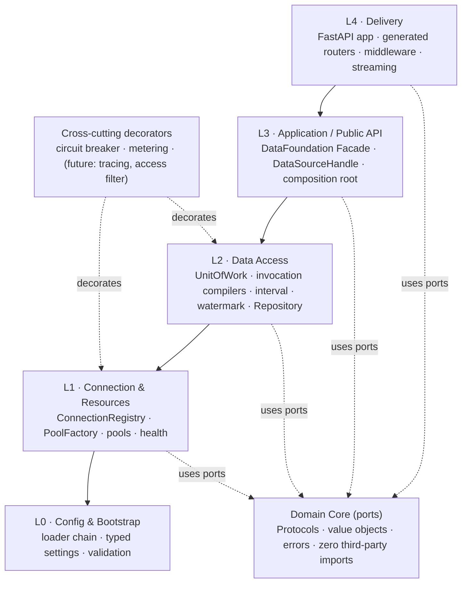
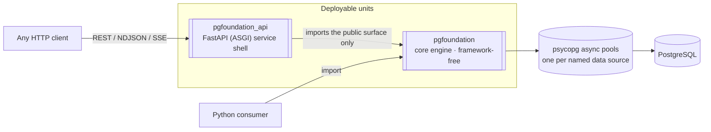
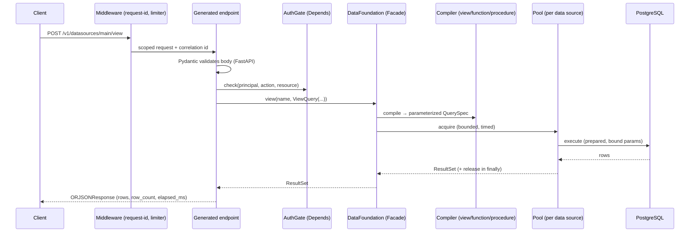
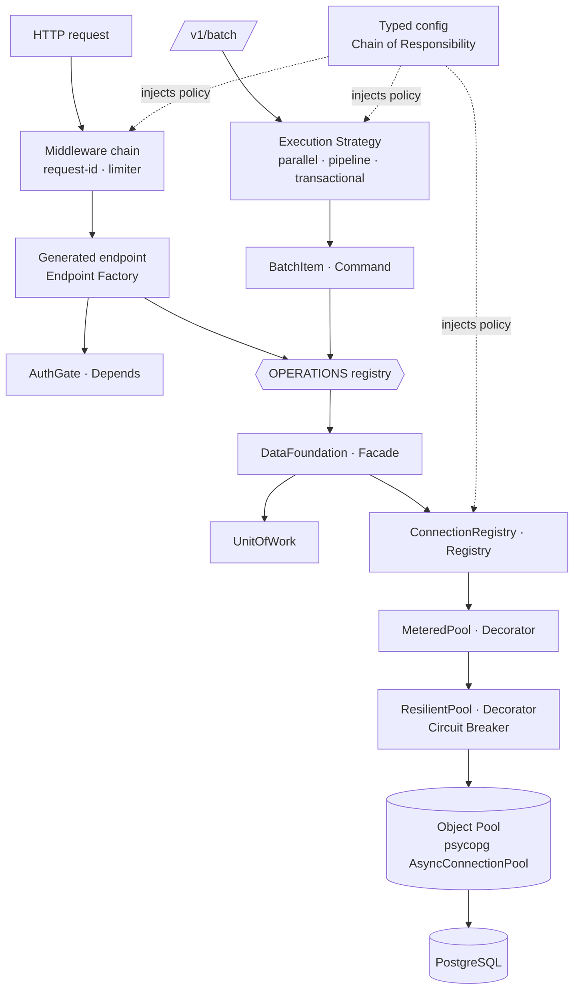
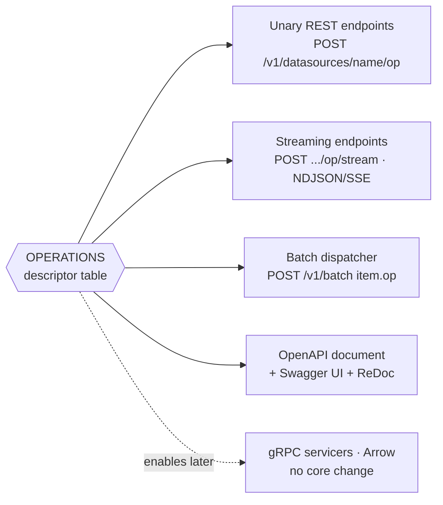
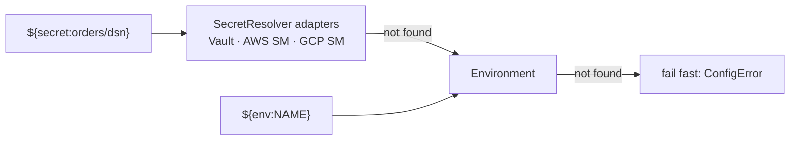
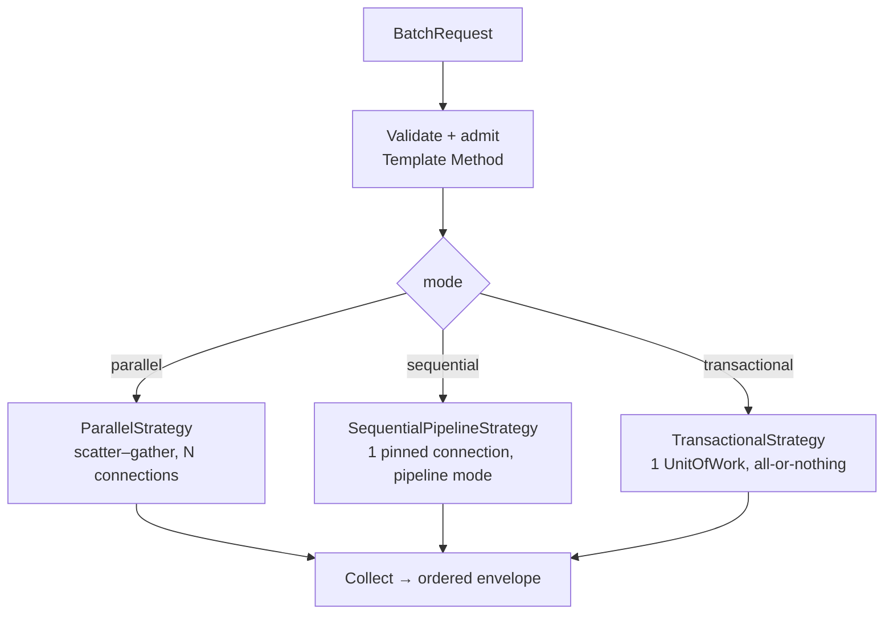
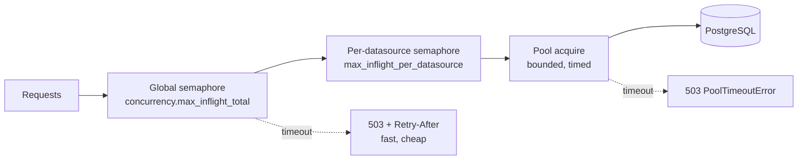
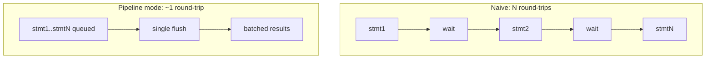
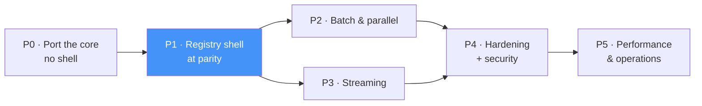

# pgfoundation on FastAPI — Complete Design Plan

**A design-only plan** for rebuilding the PostgreSQL Database Foundation Server
(`ZonicPostgresqlServer_DjangoApp`) on **FastAPI**.

> **Status: P0-P4 built, P5 in progress.** This plan is no longer design-only —
> see [Part I · 14](#doc-14) for what is implemented, what was corrected while
> building, and what is still open. Sections 01-13 describe the intended design;
> where the build diverged, 14 records why.
>
> *This file is generated. The source is the split files in this directory
> (`01-…md` … `11-…md`, `adr/ADR-00N-…md`); rebuild with `python build.py`.*

> **Instrumentation markers.** Code sketches carry `# OBSERVE (METRIC|TRACE|LOG):`
> comments marking where telemetry belongs — comments only, deliberately not
> implemented. [Part I · 11](#doc-11) is the full catalogue: the signal
> vocabulary, redaction rules and cardinality budget.

---

<a id="the-four-requirements"></a>

## The four requirements

| # | Requirement | Where it is answered |
|---|-------------|----------------------|
| 1 | **Same features & functionality** | [Part I · 01](#doc-01) — a line-by-line parity matrix; nothing is dropped, and several *designed-but-unbuilt* Django features are finally delivered. [ADR-002](#adr-002) — the core engine is ported, not reimplemented, so parity is structural rather than re-derived. |
| 2 | **Low code, no hard-coding** | [Part I · 04](#doc-04) — one table of operation descriptors drives the unary REST surface, the batch dispatcher, the streaming surface and OpenAPI. Adding a capability = adding a row. [Part I · 05](#doc-05) — every operational value is externalized and validated. |
| 3 | **Proper design patterns** | [Part I · 03](#doc-03) — the inherited catalog (Ports & Adapters, Facade, Registry, Unit of Work, Strategy, Decorator, Null Object…) plus the patterns the new concurrency work needs (Command, Scatter–Gather, Bulkhead, semaphore-bounded backpressure). Two anti-patterns present in the current code are removed. |
| 4 | **High performance, throughput, concurrency, parallel & batch calls** | [Part I · 06](#doc-06) and [Part I · 07](#doc-07) — the batch/parallel API, bounded fan-out, admission control, psycopg pipeline mode, prepared statements, `COPY`, streaming responses, and nine concurrency defects found in the current implementation. |

---

<a id="the-one-paragraph-version"></a>

## The one-paragraph version

The Django project already has the right shape: a **framework-free core engine**
(`pgfoundation`) behind ports & adapters, wrapped by a **thin transport shell**
(`pgfoundation_service`). That split is the reason this port is cheap — *the core
is kept essentially as-is* and only the shell is rewritten. The shell rewrite is
where all four requirements are won: FastAPI removes the hand-written OpenAPI
builder and hand-written routing table, a **declarative operation registry**
removes the hand-written per-endpoint view functions, `Depends` + `lifespan`
removes the global-singleton service locator, and a new **batch/parallel
execution layer** turns "one HTTP call = one query" into "one HTTP call = N
queries, executed with a chosen concurrency strategy against N pools."

---

<a id="contents"></a>

## Contents

**Part I — Design**

| § | Document | Contents |
|---|----------|----------|
| [01](#doc-01) | **Scope & Feature Parity** | What exists today, the feature-by-feature parity matrix, what is added, what stays out of scope. |
| [02](#doc-02) | **Architecture** | Layers, ports & adapters, the dependency rule, request path, what changes vs Django. |
| [03](#doc-03) | **Design Patterns** | Pattern catalog with the problem each solves, and pattern → requirement traceability. |
| [04](#doc-04) | **The Declarative Operation Registry** | **The low-code mechanism.** One descriptor table → routes + batch dispatch + streaming + OpenAPI. |
| [05](#doc-05) | **Configuration** | The config model, the provider chain, and the "no hard-coded value" audit. |
| [06](#doc-06) | **Concurrency, Batch & Parallel** | Batch API, execution strategies, bounded fan-out, backpressure, timeouts, cancellation, correctness fixes. |
| [07](#doc-07) | **Performance** | Round-trip reduction, serialization, row formats, pooling, prepared statements, budgets. |
| [08](#doc-08) | **API Surface** | Every endpoint, request/response shape, frozen contracts, error mapping. |
| [09](#doc-09) | **Project Structure** | Directory layout, packaging, architecture contracts. |
| [10](#doc-10) | **Testing & Delivery** | Test strategy, parity harness, six-phase delivery plan. |
| [11](#doc-11) | **Observability: Instrumentation Points** | **Comments only, no code.** Every point that must emit a metric, span or log event; the signal vocabulary; redaction and cardinality rules. |
| [12](#doc-12) | **Deployment Targets & Environments** | The Timescale Cloud (AWS) target, DSN handling, TLS, the connection budget, least-privilege roles, and the deployment checklist. |
| [13](#doc-13) | **Implementation Plan, Phase by Phase** | The six phases expanded to ~60 tasks: what each touches, what it depends on, what proves it done, and where the plan can silently go wrong. |
| [14](#doc-14) | **Build Status** | What is actually implemented, corrections made while building, and the known gaps. |

**Part II — Decisions (ADRs)**

| ADR | Decision |
|-----|----------|
| [ADR-001](#adr-001) | Service shell is **FastAPI** (reinstating the original ADR-002 direction, superseding Django ADR-012). |
| [ADR-002](#adr-002) | The core engine is **ported unchanged**; only the shell is rewritten. |
| [ADR-003](#adr-003) | Endpoints are **generated from a descriptor table**, not hand-written per operation. |
| [ADR-004](#adr-004) | Batch is **one endpoint with pluggable execution strategies**, not one endpoint per mode. |
| [ADR-005](#adr-005) | Wiring uses **lifespan + `app.state` + `Depends`**; module-global singletons are removed. |
| [ADR-006](#adr-006) | Streaming delivery is **NDJSON + SSE over `StreamingResponse`**, content-negotiated. |
| [ADR-007](#adr-007) | **orjson** with an explicit `Decimal → string` rule, and a selectable `row_format`. |
| [ADR-008](#adr-008) | **Caller** authN + coarse datasource×action authZ belong here; **end-user** authN/authZ stays with the higher-level APIs. Amends the inherited ADR-013. |

---

<a id="delivery-at-a-glance"></a>

## Delivery at a glance

| Phase | Delivers | Exit |
|-------|----------|------|
| **P0** | Port the core engine | Ported core tests pass; architecture contracts green |
| **P1** | Registry-driven FastAPI shell at feature parity | Parity harness green on all five existing endpoints; real Swagger UI |
| **P2** | Batch & parallel execution | Concurrency tests green; parallel batch beats sequential under load |
| **P3** | Streaming (NDJSON/SSE), interval, fetch-since, copy, execute-many | Flat memory over a 10M-row stream; disconnect releases the connection |
| **P4** | Concurrency hardening | Chaos suite green; no leaks in a soak run |
| **P5** | Performance & operations | Performance budgets ([07](#doc-07) §7.9) met and CI-gated |

---


## Part I — Design


<a id="doc-01"></a>

### 01 — Scope & Feature Parity

#### 1.1 What the Django project is

`ZonicPostgresqlServer_DjangoApp` is a **PostgreSQL infrastructure layer**, not an
application. It owns no tables, ships no migrations, and has no business logic.
It exists so every downstream project shares one correct implementation of
connection handling, pooling, transactions, retries, streaming and configuration.

It is ~3,900 lines across two internal layers:

| Layer | Package | Role |
|-------|---------|------|
| **Core engine** | `pgfoundation` | Framework-free. Ports (`Protocol`s), value objects, error hierarchy, config, connection registry, psycopg adapter, access layer (UoW, invocation compilers, interval, watermark), resilience, observability. |
| **Service shell** | `pgfoundation_service` | Plain Django on ASGI. Async views, Pydantic DTOs, hand-built `apispec` OpenAPI document, error translation, auth seam, bootstrap singletons. |

The **cardinal rule** — the shell holds no data-access logic — is respected in the
existing code and is respected here. It is also what makes this port low-risk.

#### 1.2 What is being rebuilt, and what is not

```
Core engine  ─────────────────────────►  ported ~unchanged  (see ADR-002)
                                          + additive extensions for batch/streaming
Service shell ────────────────────────►  rewritten on FastAPI  (see ADR-001)
                                          + declarative registry, batch layer
```

The core is already framework-free and passes an `import-linter` contract that
forbids Django anywhere inside it. So there is nothing Django-shaped to remove
from it — it moves across as-is. All of the rewrite budget goes to the shell,
where all four requirements are actually decided.

#### 1.3 Feature parity matrix

Every capability of the Django project, and its disposition here. **Nothing is
dropped.**

##### Core engine — reusable API

| Capability | Django (today) | FastAPI plan |
|------------|----------------|--------------|
| `query` / `one` / `scalar` | ✅ | ✅ ported |
| `execute` / `execute_many` | ✅ | ✅ ported; `execute_many` also exposed over HTTP (new) |
| `transaction(...)` Unit of Work + savepoints | ✅ | ✅ ported |
| `run_transaction(fn, retry=…)` (retry on 40001/40P01) | ✅ | ✅ ported; now reachable over HTTP via the transactional batch mode (new) |
| `stream(spec)` server-side cursor | ✅ core only | ✅ ported; now reachable over HTTP (new) |
| `listen(channel)` LISTEN/NOTIFY | ✅ core only | ✅ ported; now reachable over HTTP as SSE (new) |
| `interval(IntervalQuery)` time bucketing | ✅ core only | ✅ ported; now reachable over HTTP (new) |
| `fetch_since(spec, cursor)` keyset watermark | ✅ core only | ✅ ported; now reachable over HTTP (new) |
| `copy_stream(table, rows)` COPY ingest | ✅ core only | ✅ ported; now reachable over HTTP (new) |
| `datasource` / `names` / `health` | ✅ | ✅ ported; `health` fan-out parallelized |
| Governed invocation: `view` / `function` / `procedure` | ✅ | ✅ ported unchanged (the compilers are the security boundary — do not touch) |
| Error hierarchy + SQLSTATE mapping | ✅ | ✅ ported |
| Multi-datasource registry, per-source pools (bulkhead) | ✅ | ✅ ported |
| Circuit breaker per data source | ✅ | ✅ ported + made concurrency-safe (§06.9) |
| Metrics/log/trace ports with no-op defaults | ✅ | ✅ ported |
| `Repository` base | ✅ | ✅ ported |
| `FakeDriver` for DB-less tests | ✅ | ✅ ported |
| Config: dict / YAML / JSON, `${env:}` / `${secret:}` | ✅ | ✅ ported + extended (§05) |

##### Service shell — HTTP surface

| Endpoint | Django | FastAPI plan |
|----------|--------|--------------|
| `POST /v1/datasources/{name}/view` | ✅ | ✅ generated from the registry |
| `POST /v1/datasources/{name}/function` | ✅ | ✅ generated |
| `POST /v1/datasources/{name}/procedure` | ✅ | ✅ generated |
| `POST /v1/datasources/{name}/query` (raw SQL, trusted) | ✅ | ✅ generated, gated behind config |
| `POST /v1/datasources/{name}/execute` (raw SQL, trusted) | ✅ | ✅ generated, gated behind config |
| `GET /v1/datasources` | ✅ | ✅ |
| `GET /v1/health` | ✅ | ✅ + `GET /v1/ready` split |
| `GET /openapi.json` | ✅ hand-built with `apispec` (75 LOC) | ✅ **free** from FastAPI |
| `GET /docs` | ✅ placeholder HTML page, no real UI | ✅ **real** Swagger UI + ReDoc, built in |
| Auth seam (disabled by default, fails closed) | ✅ | ✅ ported, moved to a `Depends` |
| Error → HTTP status mapping | ✅ | ✅ ported as exception handlers |
| Request-ID header | ✅ | ✅ ported as middleware |

##### Designed in the Django docs but never built — now delivered

These are listed in the Django `documentations/08-service-shell.md` REST table and
in doc 16, but have **no implementation** in `views.py` / `urls.py`. The FastAPI
shell delivers them, because the registry makes each one a table row rather than a
new hand-written view:

| Capability | Status in Django | Plan |
|------------|------------------|------|
| `POST .../stream` (chunked NDJSON) | designed, not built | **built** (§06.7, ADR-006) |
| `POST .../interval` | designed, not built | **built** |
| `POST .../fetch-since` | designed, not built | **built** |
| `POST .../copy` (bulk ingest) | designed, not built | **built** |
| `GET .../subscribe/{channel}` (SSE) | designed, not built | **built** (ADR-006) |
| `POST .../transaction` (ordered atomic batch) | designed, not built | **built** as batch `mode: transactional` |
| Batch job API | designed, not built | **built** as the synchronous `/v1/batch` (async job queue stays deferred — §1.5) |
| `GET /metrics` Prometheus | designed, not built | **seam built**; exporter binding stays external per ADR-014 |
| `timeout_ms` per request | in the doc's example body, unimplemented | **built** (§06.8) |
| `row_format: dict \| tuple` | in the doc's example body, unimplemented | **built** (ADR-007) |
| Rate limiting | designed, not built | **built** as a config-driven concurrency limiter (§06.6) |

##### New, driven by requirement 4

| Capability | Why |
|------------|-----|
| `POST /v1/batch` — N operations, one request | Removes per-call HTTP + TLS + auth overhead; lets the server choose the cheapest execution strategy. |
| Execution strategies: `parallel` / `sequential` / `transactional` | One endpoint, three concurrency semantics, chosen per request (§06.3). |
| Bounded fan-out with a global semaphore | Concurrency without moving the queue from the pool to the event loop (§06.6). |
| psycopg **pipeline mode** for sequential batches | N statements, ~1 round-trip (§07.3). |
| Cross-datasource parallelism | A batch touching 3 data sources uses 3 independent pools — natural bulkhead. |
| `POST .../execute-many` | Batched parameterized writes over HTTP. |

#### 1.4 Non-goals (unchanged from the Django project)

Carried over verbatim, because they are still right:

- **Not an ORM, not a schema owner.** No models, no migrations, no DDL, no tables.
  The consuming project owns all schema.
- **Not a business-domain service.** No domain entities.
- **Not multi-engine.** PostgreSQL only. The `DriverPort` seam exists; a second
  engine is not a goal.
- **Semantic layer: deferred.** The foundation ships only the generic seams
  (composable `QuerySpec`, safe parameterization, materialized-view lifecycle via
  plain SQL, access-filter hook).
- **Time-series / TimescaleDB: deferred** behind the pluggable bucketing Strategy.
  Note that the named deployment target *is* Timescale Cloud
  ([12 §12.7](#doc-12)) — everything in this plan runs against
  it unchanged, and the seam stays a seam until measurement says otherwise.
- **End-user authN/authZ, tenancy and row-level policy stay with the higher-level
  APIs.** *Amended by [ADR-008](#adr-008):* **caller**
  authentication and coarse datasource × action authorization are now **in scope**
  for the shared-service deployment shape — the seam stays, and ships with default
  providers so it can actually be switched on.
- **Observability is integrated, not built.** Ports with no-op defaults.
- **CDC / logical replication: reserved port only.**

#### 1.5 Deliberately still deferred

| Item | Why |
|------|-----|
| **Asynchronous batch *job* API** (`202` + `job_id` + polling/webhook) | Needs durable job state, which means a table — and the foundation owns no tables. The synchronous `/v1/batch` plus streaming covers the realistic cases; the job API belongs to a consumer that owns its own job table. |
| **gRPC surface** | Real value for internal hot paths, but it is a second transport to keep at parity. The registry (§04) is transport-agnostic by construction, so gRPC servicers can be generated from the same table later without touching the core. |
| **Arrow / Arrow Flight** | Heavy optional dependency; the delivery-format Strategy seam is in place for it. |
| **Read/write routing (primary/replica)** | `role` is already in the config model but unused. Routing stays a Phase-5 item behind a `RoutingStrategy` seam. |

#### 1.6 Traceability

| Requirement | Primary answer |
|-------------|----------------|
| **1 · Same features** | This document's parity matrix; the core is ported, not reimplemented; a parity test harness runs the same operation through library mode and service mode ([10 §10.4](#doc-10)). |
| **2 · Low code, no hard-coding** | [04](#doc-04) (one table → three surfaces) + [05](#doc-05) (every operational value externalized, validated, fail-fast). |
| **3 · Design patterns** | [03](#doc-03). |
| **4 · Performance / throughput / concurrency / parallel / batch** | [06](#doc-06) + [07](#doc-07). |

---


<a id="doc-02"></a>

### 02 — Architecture

#### 2.1 Style (unchanged, and deliberately so)

Two complementary styles, inherited from the Django project because they are
correct and because they are what makes the port cheap:

- **Hexagonal (Ports & Adapters)** — the core defines `Protocol` ports; psycopg,
  the HTTP transport, config sources, and metrics backends are adapters.
- **Layered / Clean** — dependencies point **inward only**. The core imports
  stdlib only.

> **The dependency rule:** `psycopg`, `fastapi`, `pydantic-settings`, and the
> process environment are *details at the edges*. They never appear in the core.

The one architectural change is at L4: the delivery framework. That is exactly the
layer the hexagonal design declares swappable, so the change is contained.

#### 2.2 Layer stack



| Layer | Responsibility | May import | Must not know about |
|-------|----------------|------------|---------------------|
| **Core** | Ports, value objects, errors | stdlib only | psycopg, fastapi, env |
| **L0 Config** | Load & validate settings | Core, pydantic | data-access details |
| **L1 Connection** | Own pools, registry, health | Core, L0 | HTTP, use cases |
| **L2 Access** | Execute, transact, compile, map | Core, L1 | HTTP, config sources |
| **L3 Facade** | Public API, orchestration, DI wiring | Core, L0–L2, the driver | HTTP framework |
| **L4 Delivery** | FastAPI transport, batch orchestration, streaming | **L3 Facade only** | L1/L2 internals |

L4 talking only to L3 is what guarantees library-mode/service-mode parity. The
batch layer (§06) lives at L4 and is built strictly from public Facade calls — it
adds *scheduling*, never data access.

#### 2.3 Containers



The shell is *just another consumer* of the core. In service mode it doubles as a
**connection concentrator**: a fleet of app instances shares one bounded pool set
instead of each opening its own connections — a real reduction in PostgreSQL
backend processes.

#### 2.4 Request path (unary call)



Note what the endpoint *does not* do: build SQL, touch a pool, or catch driver
exceptions. It validates, delegates, serializes. That is why the endpoint can be
generated rather than written (§04).

#### 2.5 What changes vs the Django shell

| Concern | Django today | FastAPI plan | Effect |
|---------|--------------|--------------|--------|
| Routing | Hand-written `urlpatterns` list, one line per view | Generated from the operation registry | Fewer places to edit; routes cannot drift from DTOs |
| Endpoint bodies | 9 hand-written `async def` views, each repeating *check auth → validate → map DTO → call facade → wrap result* | One generic endpoint factory + one descriptor per operation | The repeated 5 steps exist once |
| Request validation | Manual `Model.model_validate_json(request.body)` in every view | Declared parameter type; FastAPI validates | Removes a line per view and a `try/except` branch |
| OpenAPI | 75-line hand-built `apispec` document listing paths, params, responses by hand | Generated by FastAPI from the same DTOs and route table | Spec cannot drift; `/docs` becomes a real UI |
| Error translation | `@api` decorator wrapping every view | `app.add_exception_handler` per error family, driven by the same status map | Cross-cutting concern leaves the call sites |
| Wiring | Module-global `_foundation` / `_auth_gate` mutated by setters | `lifespan` builds it into `app.state`; endpoints receive it via `Depends` | Removes the service-locator anti-pattern the project's own doc 04 §4.6 forbids; makes per-test isolation trivial |
| Lifecycle | Hand-written ASGI `lifespan` loop reimplementing the protocol (~30 lines) | `@asynccontextmanager` lifespan | Protocol handling is the framework's job |
| Streaming | Not possible without a second `StreamingHttpResponse` code path | `StreamingResponse` over the existing async generators | Streaming endpoints become table rows |
| Concurrency | One query per request; no batch, no fan-out | Batch layer with pluggable strategies | Requirement 4 |

#### 2.6 The seams that stay open

Unchanged from the Django design — these are the reason future work is additive:

| Future need | Seam | Core change? |
|-------------|------|--------------|
| New secret backend | Config resolver in the provider chain | none |
| New observability backend | `MetricsPort` / `LoggerPort` / `TracerPort` adapter | none |
| Read/write routing | `RoutingStrategy` at L1 | none |
| Caching | New decorator in the pool/connection chain | none |
| Another PostgreSQL-compatible driver | New `DriverPort` adapter | none |
| TimescaleDB bucketing | Interval bucketing Strategy | none |
| gRPC / Arrow surface | New transport reading the **same operation registry** | none |
| Semantic layer | Consumes the L3 Facade | none |
| Access filters (row-level policy) | Decorator around compilation | none |

---


<a id="doc-03"></a>

### 03 — Design Patterns

Every pattern here earns its place by solving a stated requirement. Patterns are
the *mechanism* by which "low code," "no hard-coding," and "high throughput"
become real rather than aspirational.

#### 3.1 Inherited from the core engine (kept, unchanged)

| Pattern | Where | Problem solved |
|---------|-------|----------------|
| **Ports & Adapters** | `core/ports.py` — `ConnectionPort`, `PoolPort`, `DriverPort`, `Logger/Metrics/Tracer/ClockPort` | Isolates the core from psycopg, the web framework, config sources, and wall-clock time. The primary decoupling mechanism and the reason the whole stack is testable without a database. |
| **Layered / Clean Architecture** | whole system | One-directional dependencies, enforced by `import-linter` contracts. |
| **Facade** | `DataFoundation` | One small public surface; everything under `_internal` is private. |
| **Adapter** | `PsycopgDriver` / `PsycopgPool` / `PsycopgConnection`, `errors_map` | Wraps psycopg behind core ports; psycopg exceptions never escape. |
| **Abstract Factory** | `PoolFactory`, `DriverPort.build_pool` | Builds pools without the caller knowing the concrete driver, and applies the configured decorator stack. |
| **Registry** | `ConnectionRegistry` | O(1) `name → pool` lookup for N named data sources. |
| **Object Pool** | `AsyncConnectionPool` behind `PoolPort` | Connection reuse — the single biggest performance lever. |
| **Unit of Work** | `UnitOfWork` | One atomic transaction boundary; pins a connection, commits on clean exit, rolls back on exception, nests as savepoints. |
| **Repository** | `Repository[T]` | Collection-like access with a pluggable row mapper; deliberately *not* an ORM (no identity map, no lazy loading). |
| **Decorator** | `ResilientPool` (circuit breaker), `MeteredPool` / `MeteredConnection` (metrics) | Cross-cutting behavior added without touching data-access logic; stackable and config-ordered. |
| **Strategy** | Interval bucketing, retry policy, row mapping, config resolvers | Swap algorithms by config, not by editing branches. |
| **Chain of Responsibility** | Config reference resolution (`${env:}` → `${secret:}` → default) | Resolve a value across sources with a documented precedence. |
| **Circuit Breaker** | `CircuitBreaker`, one per data source | Stop hammering an unhealthy database; fail fast instead of queueing. |
| **Null Object** | `NoopMetrics` / `NoopLogger` / `NoopTracer` | Observability is optional with zero `if metrics is not None` noise and ~zero cost. |
| **Context Manager (RAII)** | pools, transactions, streams, the app lifespan | Deterministic acquire/release even on error or cancellation. |
| **Command / CQRS-lite** | `Query` vs `Command` value objects | Intent is explicit: reads are retry-safe and replica-routable; writes are not retried unless idempotent. |
| **Builder** | The invocation compilers (`compile_view` / `compile_function` / `compile_procedure`) and `compile_interval` | Assemble parameterized SQL from validated identifiers + bound values. No string-formatted user input, ever. |
| **Bulkhead** | One pool + one breaker per data source | One overloaded database cannot starve the others. |
| **Iterator / Generator** | `stream()`, `interval()`, `listen()` | Lazy, constant-memory pull over large or continuous sets. |
| **Memento / Checkpoint** | `WatermarkCursor` | Resumable, gap-free incremental fetch. |
| **Keyset / Cursor pagination** | `fetch_since` | Constant-cost deep pagination; never `OFFSET`. |

#### 3.2 Patterns the FastAPI shell adds

These are the new ones, and each maps to requirement 2 (low code) or 4
(throughput/concurrency).

| Pattern | Where | Problem solved | Req |
|---------|-------|----------------|-----|
| **Descriptor table + Endpoint Factory** (a Registry of operations feeding a generic factory) | `OPERATIONS` tuple → `build_router()` | The nine near-identical Django views collapse to one generic endpoint plus one data row per operation. New capability = new row. | 2 |
| **Command** | `BatchItem` — a self-describing `{datasource, op, payload}` | A batch item is *data*, not a function call, so it can be queued, dispatched, reordered, retried, and logged uniformly. The batch dispatcher looks each item up in the same operation registry that generates the routes. | 2, 4 |
| **Strategy** (execution) | `ParallelStrategy` / `SequentialPipelineStrategy` / `TransactionalStrategy` | The *semantics* of a batch (fan-out, pipelined, atomic) are selected per request; adding a fourth mode adds a class, not an `if`-chain. | 3, 4 |
| **Scatter–Gather** | `ParallelStrategy` | Fan N independent operations across N pools concurrently, gather into one ordered response. | 4 |
| **Semaphore-bounded pool (backpressure)** | Global + per-datasource `asyncio.Semaphore` | Bounds in-flight DB work so concurrency doesn't just relocate the queue from the pool to the event loop and turn into acquire timeouts. | 4 |
| **Dependency Injection (framework-native)** | `lifespan` → `app.state` → `Depends` | Removes the module-global service locator; each test gets an isolated app. | 2, 3 |
| **Middleware / Interceptor chain** | request-id, concurrency limiter, timing | Cross-cutting concerns declared once, outside every endpoint. | 2 |
| **Exception handler map** | `{error type → HTTP status}` registered with the app | Error translation leaves the call sites entirely; the mapping stays a single table. | 2 |
| **Producer–Consumer (bounded queue)** | Streaming endpoints | DB fetch rate is governed by client consumption rate; memory stays flat. | 4 |
| **Content negotiation Strategy** | NDJSON / SSE (Arrow reserved) | One internal async generator, several wire formats, selected by `Accept`. | 4 |
| **Template Method** | Batch execution skeleton (validate → admit → dispatch → collect → envelope) with strategy-varying dispatch | Fixed, auditable batch lifecycle; only the dispatch step varies. | 3 |

#### 3.3 How they interlock



The important edge is `BATCH → STRAT → CMD → REG`: **the batch layer reuses the
same registry the routes are generated from.** That is why adding one operation
descriptor gives you a unary endpoint, a batch-dispatchable command, and (if
marked streamable) a streaming endpoint — three surfaces, one row.

#### 3.4 Anti-patterns explicitly avoided

Carried from the Django design, plus two the port fixes:

- **Service Locator / global mutable singletons** — the Django shell's
  `bootstrap._foundation` global (mutated by `set_foundation`) violates the
  project's own doc 04 §4.6. Replaced by lifespan + `app.state` + `Depends`.
- **Copy-paste endpoints** — nine views repeating the same five steps. Replaced by
  the endpoint factory.
- **God object** — no "Manager"; responsibilities split by layer. The batch layer
  schedules and never executes SQL itself.
- **Leaky abstractions** — psycopg types never cross the Facade; FastAPI types
  never enter the core.
- **Stringly-typed config** — all config validated into typed models at boot;
  invalid config fails fast and loudly.
- **Hidden hard-coding** — no magic numbers for pool sizes, timeouts, retry
  counts, batch limits, concurrency caps, or `itersize`. All config, with
  documented defaults (§05).
- **Unbounded concurrency** — `asyncio.gather` over an unbounded list is a
  denial-of-service against your own database. Every fan-out is semaphore-bounded.

#### 3.5 Pattern → requirement traceability

| Requirement | Patterns serving it |
|-------------|---------------------|
| **1 · Same features** | Facade, Ports & Adapters (the core is ported, not rewritten); Command + Registry (every operation reachable through one uniform mechanism) |
| **2 · Low code, no hard-coding** | Descriptor table + Endpoint Factory, Command, DI, Middleware, Exception-handler map, Strategy, Chain of Responsibility |
| **3 · Design patterns** | this whole document |
| **4 · Performance / concurrency / parallel / batch** | Object Pool, Bulkhead, Scatter–Gather, Semaphore backpressure, Producer–Consumer, Strategy (pipeline mode), Iterator, Keyset, Decorator (pay only for enabled features) |

---


<a id="doc-04"></a>

### 04 — The Declarative Operation Registry

**This is the answer to requirement 2 (low code, no hard-coding).** It is a single
mechanism, so it is worth stating precisely.

#### 4.1 The problem in the Django shell

`pgfoundation_service/views.py` contains nine `async def` views. Structurally they
are the same five steps:

```python
@api
async def function_view(request, name: str):
    await get_auth_gate().check(request, action="read", resource=name)   # 1 authorize
    dto = FunctionIn.model_validate_json(request.body)                   # 2 validate
    spec = FunctionQuery(name=dto.name, args=dto.args,                   # 3 map DTO → core
                         schema=dto.db_schema, scalar=dto.scalar)
    return _result(await get_foundation().function(name, spec))          # 4 call  5 serialize
```

Every operation repeats all five. Then the same operation is repeated a **third**
and **fourth** time: once in `urls.py` as a route line, once in `openapi.py` as a
hand-written path + parameter + response block. Adding one capability means
editing four files, and nothing keeps them consistent — the OpenAPI document can
describe a route that does not exist, or miss one that does.

Two of those four repetitions are pure framework tax that FastAPI simply deletes
(routing is a decorator; OpenAPI is generated). The registry deletes the other
two.

#### 4.2 The mechanism

**One descriptor per operation; everything else is generated from it.**

```python
@dataclass(frozen=True)
class OperationSpec:
    """One row = one capability. The single source of truth for that capability."""
    op: str                                  # stable id: "view", "function", …
    suffix: str                              # URL segment under /v1/datasources/{name}
    request_model: type[BaseModel]           # Pydantic DTO — also the OpenAPI schema
    response_model: type[BaseModel]
    to_core: Callable[[BaseModel], Any]      # DTO → core value object
    handle_method: str                       # method name on DataSourceHandle
    action: Literal["read", "write", "list"] # what AuthGate authorizes
    streamable: bool = False                 # also expose /{suffix}/stream
    trusted_only: bool = False               # raw-SQL ops, gated by config
    summary: str = ""

OPERATIONS: tuple[OperationSpec, ...] = (
    OperationSpec("view",      "view",      ViewIn,      QueryOut,   to_view_query,   "view",      "read",  streamable=True),
    OperationSpec("function",  "function",  FunctionIn,  QueryOut,   to_function_query,"function", "read",  streamable=True),
    OperationSpec("procedure", "procedure", ProcedureIn, QueryOut,   to_procedure_call,"procedure","write"),
    OperationSpec("interval",  "interval",  IntervalIn,  QueryOut,   to_interval_query,"interval",  "read",  streamable=True),
    OperationSpec("fetch_since","fetch-since",FetchSinceIn,PageOut,  to_fetch_since,  "fetch_since","read"),
    OperationSpec("execute_many","execute-many",ExecuteManyIn,ExecuteOut,to_many,     "execute_many","write"),
    OperationSpec("copy",      "copy",      CopyIn,      ExecuteOut, to_copy,         "copy_stream","write"),
    OperationSpec("query",     "query",     QueryIn,     QueryOut,   to_query,        "query",     "read",  streamable=True, trusted_only=True),
    OperationSpec("execute",   "execute",   QueryIn,     ExecuteOut, to_command,      "execute",   "write", trusted_only=True),
)
```

One generic endpoint factory consumes it:

```python
def make_endpoint(spec: OperationSpec):
    async def endpoint(
        name: str,
        body: spec.request_model,                        # FastAPI validates + documents
        db: DataFoundation = Depends(get_foundation),
        _: Principal = Depends(authorize(spec.action)),  # auth is a dependency, not a line
    ) -> spec.response_model:
        # OBSERVE (TRACE):  span "pgf.operation" {op: spec.op, datasource: name}
        # OBSERVE (METRIC): pgf_http_requests_inflight{route} +1 / -1 around this body
        handle = db.datasource(name)
        result = await getattr(handle, spec.handle_method)(spec.to_core(body))
        # OBSERVE (METRIC): pgf_query_rows{datasource, op} <- result.rowcount
        # OBSERVE (LOG):    query.slow {datasource, op, object, elapsed_ms}
        #                   when result.elapsed_ms > observability.slow_query_ms
        # OBSERVE (METRIC): pgf_response_truncated_total{route} + LOG response.too_large
        #                   when rowcount > api.max_response_rows (413 path)
        return spec.response_model.from_result(result)
    return endpoint

def build_router(operations, settings) -> APIRouter:
    router = APIRouter(prefix="/v1/datasources")
    for spec in operations:
        if spec.trusted_only and not settings.api.enable_raw_sql:
            continue                                      # config decides the surface
        router.add_api_route(f"/{{name}}/{spec.suffix}", make_endpoint(spec),
                             methods=["POST"], response_model=spec.response_model,
                             summary=spec.summary, tags=[spec.tag])
        if spec.streamable:
            router.add_api_route(f"/{{name}}/{spec.suffix}/stream", make_stream_endpoint(spec),
                                 methods=["POST"], tags=[spec.tag])
    return router
```

#### 4.3 One table, four surfaces



The batch dispatcher is the point that matters most. `/v1/batch` does **not** get
its own hand-written switch over operation kinds:

```python
async def dispatch(item: BatchItem, db: DataFoundation) -> Any:
    spec = OPERATION_BY_ID[item.op]                     # same table
    # OBSERVE (TRACE):  child span "pgf.batch.item" {item_id, op, datasource}
    #                   — siblings must OVERLAP in parallel mode (doc 11 §11.4)
    payload = spec.request_model.model_validate(item.payload)
    handle = db.datasource(item.datasource)
    # OBSERVE (METRIC): pgf_batch_item_duration_seconds{mode, op}
    # OBSERVE (METRIC): pgf_batch_items_total{mode, status} on both return and raise
    return await getattr(handle, spec.handle_method)(spec.to_core(payload))
```

So a new capability written as one descriptor row is *immediately*: a REST
endpoint, a documented OpenAPI operation, a batch-dispatchable command, and — if
`streamable` — a streaming endpoint. That is the "low code" claim, stated as a
falsifiable invariant rather than a slogan.

#### 4.4 The invariant, and how it is tested

> **Invariant.** Adding a capability touches exactly one data row plus its DTO.
> No route file, no OpenAPI file, no batch switch, no auth call site.

Enforced by tests, not by discipline ([10 §10.3](#doc-10)):

| Test | Asserts |
|------|---------|
| `test_every_operation_has_a_route` | For each `OperationSpec`, a matching route exists on the app. |
| `test_every_operation_is_batch_dispatchable` | Each `op` id resolves in `OPERATION_BY_ID` and dispatches against the fake driver. |
| `test_openapi_covers_every_operation` | The generated `/openapi.json` documents each path and request schema. |
| `test_streamable_ops_have_stream_routes` | `streamable=True` ⇒ `/stream` route exists and yields NDJSON. |
| `test_no_route_outside_the_registry` | The route table contains no data-plane path that isn't registry-derived (admin/docs routes are an explicit allow-list). |

That last test is what stops the mechanism from quietly decaying back into
hand-written views.

#### 4.5 Estimated code impact

Indicative targets, not measurements — the point is the *direction* and the fact
that the added features come with fewer lines, not more.

| Shell concern | Django (actual LOC) | FastAPI (target) | Why |
|---------------|--------------------:|-----------------:|-----|
| Endpoint bodies | 134 (`views.py`) | ~60 (factory + descriptors) | Five repeated steps exist once |
| Routing | 21 (`urls.py`) | 0 | Generated |
| OpenAPI | 75 (`openapi.py`) | 0 | Framework-generated |
| Error translation | 75 (`http_errors.py`) | ~45 | Status map kept; the per-view decorator goes |
| Wiring / lifecycle | 49 + 65 (`bootstrap.py`, `asgi.py`) | ~40 | `lifespan` replaces the hand-rolled ASGI protocol loop |
| DTOs | 105 (`schemas.py`) | ~140 | *Grows* — new DTOs for interval, fetch-since, copy, batch |
| Auth seam | 88 (`auth.py`) | ~85 | Ported; call sites become one `Depends` |
| **Batch + streaming (new)** | — | ~180 | The new capability |
| **Total shell** | **~635** | **~550** | Fewer lines, with streaming, interval, fetch-since, copy, execute-many, batch and real docs added |

Two caveats on that table. It counts the **parity** surface only; with batch
strategies, admission control, streaming adapters and the auth policy the realistic
whole-shell figure is nearer **1,200–1,500 lines**. And "fewer lines" does not mean
"fewer files" — those lines are spread across ~30 modules grouped by role
([09 §9.1a](#doc-09)), because the win being claimed here is
*less repetition*, not *less structure*.

#### 4.6 Where the registry deliberately stops

The registry generates **transport**. It never generates **SQL**. The invocation
compilers (`compile_view` / `compile_function` / `compile_procedure` /
`compile_interval`) stay hand-written, reviewed, and unit-tested, because they are
the security boundary: identifiers validated against a strict regex, values always
bound. Metaprogramming near a SQL boundary is how injection bugs get built, so
that boundary stays explicit and boring.

Similarly, the registry is a **closed set defined in code**, not a config file
that lets an operator invent operations at runtime. Config decides *whether* a
listed operation is exposed (`enable_raw_sql`), never *what* it does.

#### 4.7 No hard-coding, concretely

The Django shell's residual hard-codings, and their fate:

| Hard-coded today | Where | Plan |
|------------------|-------|------|
| Port `8600` default | `run_local.py` | `ServiceSettings.port`, env-overridable |
| Host `127.0.0.1` | `run_local.py` | `ServiceSettings.host` |
| `itersize=1000` | `handle.py` signature defaults | `datasources[].stream.itersize` in config, per data source |
| OpenAPI title/version/description | `openapi.py` literals | `ServiceSettings.api.*` |
| `"healthy"`/`"degraded"` roll-up rule | `views.py` inline expression | Explicit health policy with `healthy` / `degraded` / `down`, thresholds from config |
| Error → status map | dict literal in `http_errors.py` | Kept as a table (correct already), but registered once as exception handlers |
| Allowed filter operators | `FilterOp` enum | Kept in code — it is a security whitelist, not a tunable |
| Retry / breaker / pool numbers | already config | unchanged |
| Batch limits, concurrency caps, timeouts | *did not exist* | all config (§05, §06) |

---


<a id="doc-05"></a>

### 05 — Configuration

Requirement 2's second half: **no hard-coded values**. Every operational value is
externalized, typed, validated at boot, and fails fast when wrong.

#### 5.1 Principles (inherited, kept)

1. **Typed, not stringly.** Config is validated into Pydantic models at startup;
   an invalid file stops the process with a clear message rather than failing on
   the first request.
2. **Secrets never inline.** DSNs are `SecretStr` — they do not appear in `repr`,
   logs, error payloads, or the OpenAPI document.
3. **Reference, don't embed.** `${env:NAME}` and `${secret:path}` are resolved
   through a provider chain; the file holds structure and tunables, not
   credentials.
4. **Documented defaults.** Every field has a default that is safe for local dev
   and explicit in the schema — so "not configured" never means "undefined
   behavior."

#### 5.2 The config document

Existing sections are unchanged. New sections are marked **(new)**.

```yaml
# pgfoundation.yaml
datasources:
  - name: main
    dsn: ${env:PGF_MAIN_DSN}            # or ${secret:main/dsn}
    role: standalone                    # primary | replica | standalone
    read_only: false
    statement_timeout_ms: 5000
    pool:
      min_size: 2
      max_size: 20
      acquire_timeout_seconds: 3
      max_idle_seconds: 300
      max_lifetime_seconds: 1800
    stream:                             # (new) — was hard-coded itersize=1000
      itersize: 1000
      pipeline_enabled: true            # (new) psycopg pipeline mode for batches
    prepare:                            # (new)
      threshold: 5                      # psycopg prepared-statement threshold
      max_cached: 100

  - name: analytics                     # long scans get their own bulkhead
    dsn: ${env:PGF_ANALYTICS_DSN}
    role: replica
    read_only: true
    pool: { min_size: 1, max_size: 8 }
    stream: { itersize: 5000 }

resilience:
  retry:           { max_attempts: 3, base_backoff_ms: 20, max_backoff_ms: 1000, jitter: true }
  circuit_breaker: { enabled: true, failure_threshold: 5, reset_timeout_seconds: 30 }

concurrency:                            # (new) — see doc 06
  max_inflight_total: 128               # global cap on concurrent DB operations
  max_inflight_per_datasource: 32       # per-source cap (bulkhead)
  admission_timeout_ms: 2000            # wait for a slot, then 503 — never queue forever

batch:                                  # (new) — see doc 06
  enabled: true
  default_mode: parallel                # parallel | sequential | transactional
  max_items: 100
  max_concurrency: 16                   # per-request cap, clamped by concurrency.*
  item_timeout_ms: 10000
  total_timeout_ms: 30000
  fail_fast: false

api:                                    # (new) — was hard-coded in openapi.py / run_local.py
  title: pgfoundation-service
  version: "1.0.0"
  root_path: ""
  docs_enabled: true
  versions:                             # (new) which API versions this process mounts
    - name: v1
      enabled: true
      deprecated: false                 # true -> emit Deprecation + Sunset headers
      sunset_date: null                 # ISO date; never a hard-coded literal in code
  enable_raw_sql: false                 # gate the trusted /query and /execute surface
  default_row_format: dict              # dict | tuple
  max_response_rows: 50000              # refuse to materialize more; use /stream
  request_timeout_ms: 15000

server:                                 # (new)
  host: 127.0.0.1
  port: 8600
  workers: 1
  log_level: info

auth:                                   # CALLER identity, not end-user identity (ADR-008)
  enabled: false                        # MUST be true in the prod profile; fails closed with no provider
  provider: none                        # none | mtls | token — or an external adapter's name
  mtls:
    identity_header: x-client-cert-subject   # asserted by the mesh/ingress — never trusted from an untrusted hop
  token:
    issuer: ${env:PGF_TOKEN_ISSUER}
    jwks: ${secret:auth/jwks}
    leeway_seconds: 30
  policy:                               # (new) coarse INFRASTRUCTURE policy — never business rules
    default: deny
    callers:
      - subject: orders-api
        datasources: [main]
        actions: [read, write]
      - subject: analytics-api
        datasources: [analytics]
        actions: [read]

observability:                          # emission only — see doc 11 for every point
  provider: none                        # no-op default; external project binds the real adapter
  metrics_enabled: false
  tracing_enabled: false
  slow_query_ms: 250                    # (new) threshold for the query.slow log event
  trace_sample_ratio: 0.05              # (new) errors + slow queries always sampled
  log_level: info                       # (new)
  redact_sql: true                      # (new) log a fingerprint, never raw SQL text
  application_name: true                # (new) thread request_id into PG application_name
```

#### 5.3 Two settings objects, one file

| Object | Owns | Consumed by | Layer |
|--------|------|-------------|-------|
| `AppSettings` | `datasources`, `resilience`, `observability` | the **core engine** | L0 |
| `ServiceSettings` | `api`, `server`, `concurrency`, `batch`, `auth` | the **FastAPI shell** only | L4 |

They are parsed from the same document but stay separate types, because the core
must remain usable as a library with no shell settings present. `ServiceSettings`
uses `pydantic-settings` so every field also has an env override
(`PGF_SERVER__PORT`, `PGF_BATCH__MAX_ITEMS`, …) with the documented precedence:

```
explicit argument  >  environment variable  >  config file  >  schema default
```

#### 5.4 Provider chain (Chain of Responsibility)



Today the `secret:` resolver falls back to environment lookup — an honest Phase-0
placeholder. The chain is the seam: a real resolver is registered at the
composition root and needs no change anywhere else. **Unresolved references are a
hard error at boot, never a silent empty string.**

#### 5.5 Validation rules (fail fast, at boot)

Inherited: at least one data source; unique names; `pool.max_size >= min_size`;
positive timeouts; `dsn` present.

Added for the new sections:

| Rule | Why |
|------|-----|
| `batch.max_concurrency <= concurrency.max_inflight_total` | A batch must not be able to exceed the global admission cap. |
| `sum(pool.max_size) >= concurrency.max_inflight_total` | Otherwise the global limiter admits work that can only wait for a connection — you would trade a fast 503 for a slow pool timeout. |
| `concurrency.max_inflight_per_datasource <= pool.max_size` for each source | Same reason, per bulkhead. |
| `batch.item_timeout_ms <= batch.total_timeout_ms` | A per-item budget larger than the whole-batch budget is meaningless. |
| `api.enable_raw_sql = false` when `auth.enabled = false` **in the prod profile** | Raw SQL on an unauthenticated surface is the one combination that must not ship by accident. Warn loudly in dev; refuse in prod. |
| `auth.enabled = true` with no registered provider | Refuse to start (inherited fail-closed rule). |
| `auth.enabled = true` with `auth.policy.callers` empty and `default: deny` | Refuse to start — an authenticated-but-authorizes-nobody service is a misconfiguration, not a lockdown ([ADR-008](#adr-008)). |
| A `policy.callers[].datasources` entry naming an unconfigured data source | Fail fast — a policy referring to a source that does not exist is almost always a typo that silently grants nothing. |

#### 5.5a The configured targets

Concrete hosts, ports, roles and their TLS and connection-budget consequences are
in [12 — Deployment Targets](#doc-12). The rule that governs
them is the one above: **the file holds a reference, the platform supplies the
secret.** No DSN, password or hostname credential is committed to this repository.

#### 5.6 Profiles

`config/pgfoundation.yaml` (local) and `config/profiles/{dev,staging,prod}.yaml`
overlays, merged over the base document. The prod profile is where
`auth.enabled: true`, `api.docs_enabled: false`, and `api.enable_raw_sql: false`
are asserted — so "safe in production" is a config artifact that can be reviewed
and diffed, not a deployment convention someone has to remember.

#### 5.7 Deferred (seams present)

- **Hot reload / secret rotation.** The registry can rebuild a pool behind its
  name; not built in v1.
- **Per-credential policy** (which data sources / operations a principal may
  reach) — the `AuthorizerPort` already receives `(principal, action, resource)`,
  so the policy document plugs in with the external auth project.

---


<a id="doc-06"></a>

### 06 — Concurrency, Batch & Parallel Execution

**This is the answer to requirement 4.** The Django service is one query per HTTP
request, executed serially, with no batch surface and no admission control. This
document designs the concurrency layer.

#### 6.1 What "high throughput" actually requires

Four independent things, often conflated:

| Lever | Mechanism | Where |
|-------|-----------|-------|
| **Concurrency** — many requests in flight on one process | async event loop + async pools (already true) | inherited |
| **Parallelism** — one *logical* request doing N things at once | batch `parallel` mode, scatter–gather over N pools | §6.3 |
| **Fewer round-trips** — N statements, ~1 network exchange | psycopg **pipeline mode**, `executemany`, `COPY` | §6.4, §07.3 |
| **Admission control** — refusing work you cannot serve | bounded semaphores + fast 503 | §6.6 |

The fourth is the one most systems skip. Without it, "more concurrency" just moves
the queue from the connection pool into the event loop, and every request pays a
pool-acquire timeout instead of a fast rejection. All four are designed here.

#### 6.2 The batch API

One endpoint, because the *shape* of a batch is uniform and only its *semantics*
vary (ADR-004).

```jsonc
// POST /v1/batch
{
  "mode": "parallel",            // parallel | sequential | transactional
  "max_concurrency": 8,          // clamped by batch.max_concurrency
  "fail_fast": false,
  "timeout_ms": 20000,           // clamped by batch.total_timeout_ms
  "items": [
    { "id": "a", "datasource": "main",      "op": "view",
      "payload": {"name": "v_paid_orders", "filters": [{"column":"customer","op":"eq","value":"bob"}]} },
    { "id": "b", "datasource": "analytics", "op": "function",
      "payload": {"name": "fn_daily_totals", "args": {"day": "2026-08-13"}} },
    { "id": "c", "datasource": "main",      "op": "interval",
      "payload": {"source":"readings","time_column":"ts","start":"...","end":"...","every":"15 minutes",
                  "metrics":[{"column":"kwh","func":"sum"}],"group_by":["meter_id"]} }
  ]
}
```

```jsonc
// 200 OK — partial success is normal and explicit
{
  "mode": "parallel",
  "elapsed_ms": 41.7,
  "ok_count": 2, "error_count": 1,
  "results": [
    {"id":"a","status":"ok","rows":[…],"row_count":2,"elapsed_ms":11.4},
    {"id":"b","status":"ok","rows":[…],"row_count":1,"elapsed_ms":38.2},
    {"id":"c","status":"error","error":{"type":"QueryError","message":"unsafe SQL identifier: 'read;ings'"}}
  ]
}
```

**Design rules**

- Each item is a **Command**: `{id, datasource, op, payload}` — self-describing
  data dispatched through the *same* operation registry that generates the unary
  routes (§04.3). No parallel switch statement to keep in sync.
- Results are returned **in request order** regardless of completion order.
  Correlation is by `id`; the server does not reorder or dedupe.
- A failing item does **not** fail the batch in `parallel`/`sequential` mode
  unless `fail_fast` is set. HTTP stays `200`; per-item `status` carries the
  truth. (Returning `207` was considered and rejected: it is under-supported by
  clients and the envelope is unambiguous already.)
- The whole batch shares one request-id; each item gets `request-id/item-id` for
  log correlation.
- Items may target **different data sources** — that is the point. The parallel
  strategy then uses genuinely independent pools.

#### 6.3 Execution strategies

Selected per request; adding a fourth mode is a new class, not a new branch.



##### `parallel` — maximum throughput, no atomicity

```python
async def execute(self, items, db, limits):
    sem = asyncio.Semaphore(limits.effective_concurrency)
    # OBSERVE (METRIC): pgf_batch_concurrency_peak{mode} — track max simultaneous
    #                   runners. This is the signal that PROVES the fan-out is real;
    #                   a peak far below the cap means something upstream serializes.
    async def run(item):
        async with sem:                                   # bounded fan-out
            # OBSERVE (METRIC): pgf_admission_wait_seconds{scope="batch"} — time
            #                   spent waiting here, not executing
            async with per_datasource_slot(item.datasource):
                # OBSERVE (METRIC): pgf_admission_wait_seconds{scope="datasource"}
                async with asyncio.timeout(limits.item_timeout_s):
                    # OBSERVE (LOG): batch.item_timeout {item_id, op, budget_ms}
                    #                on TimeoutError
                    return await dispatch(item, db)       # own connection, own pool
    return await asyncio.gather(*(run(i) for i in items), return_exceptions=True)
    # OBSERVE (METRIC): pgf_batch_duration_seconds{mode}, pgf_batch_items{mode}
    # OBSERVE (LOG):    batch.completed {mode, items, ok, errors, elapsed_ms}
```

- One connection per in-flight item, acquired and released independently.
- Items on different data sources contend on different pools — a slow analytics
  query cannot stall the OLTP items in the same batch.
- `return_exceptions=True` so one failure never cancels the siblings; exceptions
  are mapped into per-item error envelopes by the same error table the HTTP
  handlers use.
- **Use when:** independent reads, dashboard panel fan-out, cross-database
  gathers. This is the default.

##### `sequential` — ordered, few round-trips

- One connection pinned for the whole batch.
- Statements are issued in **psycopg pipeline mode**: send all, flush once, read
  results. N round-trips collapse toward 1, which dominates the cost on any
  non-local network.
- Order is guaranteed; later items may depend on earlier writes.
- **Use when:** ordered dependent statements, or a chatty client on a high-latency
  link where round-trips, not the database, are the bottleneck.

##### `transactional` — atomic

- One `UnitOfWork` for all items: all commit or all roll back.
- Wrapped in the inherited `run_transaction(...)` runner, so a serialization
  failure (`40001`) or deadlock (`40P01`) re-runs **the entire body** with backoff
  and jitter — the correct granularity, per ADR-010.
- `fail_fast` is implicit: the first error aborts and rolls back.
- **Idempotency requirement** (inherited and re-stated in the API docs): the body
  may run more than once, so items must be free of non-DB side effects.
- **Use when:** the ordered atomic batch the Django docs specified as
  `POST .../transaction` but never built.

| | parallel | sequential | transactional |
|---|---|---|---|
| Connections | N (bounded) | 1 | 1 |
| Round-trips | N (concurrent) | ~1 (pipelined) | N (in one txn) |
| Order guaranteed | no (results ordered, execution not) | yes | yes |
| Atomic | no | no | **yes** |
| Partial success | yes | yes (until fail_fast) | no |
| Retry on 40001/40P01 | per item, if idempotent | no | **whole batch** |

#### 6.4 Parallelism inside the core

Beyond the batch endpoint, three inherited operations are serial loops that should
be concurrent. These are core-side fixes:

| Today | Change |
|-------|--------|
| `ConnectionRegistry.health()` — `{name: await pool.health() …}` sequentially | `asyncio.gather` over pools. With 5 sources and a 3 s acquire timeout, a health check on a degraded cluster currently takes up to 15 s and can trip a readiness probe that would otherwise pass. |
| `ConnectionRegistry.start()` — opens pools one by one | `asyncio.gather`; startup latency becomes max(), not sum(). |
| `ConnectionRegistry.aclose()` — closes one by one | `asyncio.gather` with a bounded drain deadline, so SIGTERM shutdown is predictable. |

`health()` must also stop collapsing to two states: today
`all(healthy) ? "healthy" : "degraded"` can never report `down`, even though the
error model, the README, and the `HealthStatus` enum all define it. Policy:

- `healthy` — all sources healthy
- `degraded` — at least one healthy, at least one not
- `down` — none healthy

and `/v1/health` (liveness, always `200` if the process is up) is split from
`/v1/ready` (readiness, `503` when `down`) so Kubernetes probes mean the right
things.

#### 6.5 Where parallelism must *not* be used

Worth stating, because it is the failure mode of naive fan-out:

- **Never** run two operations concurrently on one connection. A connection is
  single-threaded state; concurrency lives at the pool level, not below it.
- **Never** fan out inside a `UnitOfWork` — the transaction is pinned to one
  connection, so `transactional` mode is serial by construction.
- **Never** issue an unbounded `asyncio.gather` over client-supplied items.
  `batch.max_items` bounds the list, and the semaphore bounds concurrency.
- Streaming iterators pin a connection for their lifetime; a batch of streams
  would hold N connections for as long as the slowest client reads. Streams are
  therefore **not** batch-dispatchable — `streamable` operations get their own
  endpoint and are excluded from batch items.

#### 6.6 Admission control & backpressure



Three nested bounds, each config-driven:

1. **Global in-flight cap** — total concurrent DB operations across the process.
2. **Per-datasource cap** — the bulkhead; one hot database cannot consume every
   slot.
3. **Pool `max_size` + acquire timeout** — the existing, innermost bound.

Waiting for admission is itself bounded (`admission_timeout_ms`). On expiry the
request gets `503` with `Retry-After` **before** touching a pool. That is the
difference between a system that sheds load and one that collapses: rejection
costs microseconds, a pool timeout costs the full acquire budget.

Config validation (§05.5) asserts `sum(pool.max_size) >= max_inflight_total`, so
the limiter can never admit more work than the pools can hold.

#### 6.7 Streaming (constant memory, honest backpressure)

Streaming endpoints exist so that "fetch a lot of data" never means "materialize a
lot of data".

| Route | Format | Backing |
|-------|--------|---------|
| `POST /v1/datasources/{name}/{op}/stream` | NDJSON (`application/x-ndjson`), chunked | `handle.stream(...)` server-side cursor |
| `POST /v1/datasources/{name}/{op}/stream` with `Accept: text/event-stream` | SSE | same generator, SSE framing |
| `GET /v1/datasources/{name}/subscribe/{channel}` | SSE | `handle.listen(channel)` LISTEN/NOTIFY |
| `POST /v1/datasources/{name}/copy` | NDJSON request body | `handle.copy_stream(...)` streaming `COPY` ingest |

Mechanics:

- A `StreamingResponse` wraps the existing async generator. Because the generator
  yields per row-batch and the ASGI server awaits each send, a slow client
  throttles the database fetch — **end-to-end backpressure with no server-side
  buffer growth.**
- Each stream pins one connection until the iterator closes. Streams therefore
  count against the per-datasource semaphore, and long scans should target a
  dedicated `analytics`-style data source (its own pool = its own bulkhead).
- **Client disconnect must cancel the query.** The generator's `finally` closes
  the cursor and releases the connection; cancellation propagates so PostgreSQL
  stops work rather than filling a socket nobody reads.
- Errors mid-stream cannot change the HTTP status (headers are already sent), so
  the last NDJSON line is an error object: `{"error": {...}, "partial": true}`.
  This is documented as part of the contract.
- Unary endpoints refuse over-large results (`api.max_response_rows`) with a `413`
  pointing at the stream route, instead of silently OOM-ing the worker.

#### 6.8 Timeouts, cancellation & deadlines

A per-request deadline that only exists client-side is not a timeout — the server
keeps working. So the deadline is enforced at three levels:

| Level | Mechanism |
|-------|-----------|
| HTTP request | `asyncio.timeout(request_timeout_ms)` around the handler |
| Batch item | `asyncio.timeout(item_timeout_ms)` inside the strategy |
| Database | `statement_timeout` set on the connection (per data source, and per request when `timeout_ms` is supplied) |

The database level is the one that matters: without it, cancelling the coroutine
abandons a query that PostgreSQL happily keeps running. `timeout_ms` in the
request body — present in the Django design docs, never implemented — is wired to
a `SET LOCAL statement_timeout` for the statement's transaction, so the cancel
reaches the server. Timeout maps to `503` (`TransientError`, since `57014` is
already mapped as transient).

#### 6.9 Concurrency-correctness fixes to make while porting

Found while reading the current implementation. Each is a real race or hazard that
only shows up under the concurrency this project is now asking for.

> **Implementation note (P4).** Eight of the nine were closed while building;
> `PORT-FINDINGS.md` in the code root tracks each one to the phase that fixed it.
> **Item 1 below was stated imprecisely in this design and is corrected in place.**

| # | Issue | Consequence | Fix |
|---|-------|-------------|-----|
| 1 | ~~`CircuitBreaker` mutates `_failures` / `_state` with no synchronization~~ → **corrected:** unbounded probes admitted in `HALF_OPEN` | The counter was **never** at risk: those methods contain no `await`, so on a single event loop they run to completion without interleaving. The real defect is one level up — `allow()` and the outcome are separated by an `await` in `ResilientPool.acquire`, so every coroutine arriving during a probe *also* saw `HALF_OPEN` and *also* proceeded, sending the whole backlog at a database just declared unhealthy | Admit exactly **one** probe in `HALF_OPEN`; release the slot on the probe's outcome. No lock needed — the state transitions were already atomic. |
| 2 | Server-side cursor named `f"pgf_stream_{id(spec)}"` | `id()` is an address and is reused after GC. Two concurrent streams on the same connection can collide on cursor name | Monotonic counter or `uuid4().hex`, per connection |
| 3 | Module-global `_foundation` / `_auth_gate` mutated by setters | Cross-test leakage; no isolation; violates the project's own "no service locator" rule | `lifespan` → `app.state` → `Depends` (ADR-005) |
| 4 | `registry.health/start/aclose` serial | Slow, unbounded startup and probe latency (§6.4) | `asyncio.gather` + drain deadline |
| 5 | Pool warm-up swallows every exception (`except Exception: pass`) | A misconfigured DSN looks identical to a temporarily down database | Keep the graceful-degradation behavior, but record the failure and surface it in `/v1/ready` and metrics |
| 6 | `MeteredPool.release` reaches into `conn._inner` | Breaks if the decorator order changes | Give the decorators an explicit unwrap contract |
| 7 | Isolation level is set on the *connection* and restored in `finally` | Correct today only because the connection is pinned; fragile if pooling changes | Keep, but document the invariant and assert the connection is pinned |
| 8 | No admission control anywhere | Load collapses into pool timeouts rather than fast rejection | §6.6 |
| 9 | `execute()` on the handle routes writes through `query()` | Works, but write intent is lost before the pool — blocks future replica routing | Keep `Command` distinct all the way to the pool |

#### 6.10 Traceability

| Requirement 4 aspect | Delivered by |
|----------------------|--------------|
| High performance | pipeline mode, prepared statements, orjson, tuple rows, `COPY` ([07](#doc-07)) |
| High throughput | connection concentrator, bounded fan-out, batch amortizing HTTP/TLS/auth over N ops |
| Concurrent | async-first core + per-datasource bulkheads + admission control (§6.6) |
| Parallel call | `parallel` batch strategy, scatter–gather across independent pools (§6.3) |
| Batch call | `/v1/batch`, `execute-many`, `COPY`, sequential pipeline mode (§6.2–6.4) |

---


<a id="doc-07"></a>

### 07 — Performance Engineering

Requirement 4's first word. [06](#doc-06) covers
concurrency and batching; this covers the per-operation cost.

#### 7.1 Principles

1. **Async-first.** Database work is I/O-bound; one event loop serves thousands of
   concurrent queries without thread-per-request cost.
2. **Reuse everything expensive.** Connections pooled, statements prepared,
   decorator chains built once at startup rather than per request.
3. **Pay only for enabled features.** Every decorator is optional and
   config-ordered; with observability off, the hot path is a Null Object attribute
   lookup away from bare psycopg.
4. **Move less data.** Stream large results; select only needed columns; binary
   protocol.
5. **Fewer round-trips.** Pipeline mode, `executemany`, and `COPY` collapse N
   network exchanges toward 1.

#### 7.2 Where the time actually goes

For a simple point read on a warm pool, roughly:

```
client → HTTP parse → validate → auth → facade → pool acquire → SQL round-trip → row mapping → JSON serialize → response
         └── framework ──┘                        └── the real work ──┘        └── the other real work ──┘
```

Two of these are worth engineering because they scale with result size, not
request count: **row mapping** and **JSON serialization**. The rest is a fixed
per-request cost that FastAPI's routing plus Pydantic v2 (Rust-backed validation)
keeps small.

#### 7.3 Reducing round-trips



| Technique | Where | Speedup source |
|-----------|-------|----------------|
| **Pipeline mode** | `sequential` batch strategy | Send many statements without waiting for each reply. Dominant win when RTT > query time — i.e. almost always across a network. |
| **`executemany`** | `POST .../execute-many` | One protocol exchange for many parameter sets. |
| **`COPY`** | `POST .../copy` | Bulk load bypasses per-row parse/plan/execute. Order-of-magnitude over row-by-row `INSERT`. |
| **Batch endpoint** | `/v1/batch` | Amortizes HTTP, TLS, auth and validation over N operations. |
| **Prepared statements** | every governed call | The compilers emit *deterministic SQL per call shape* (stable text, stable param names) — already true today and worth protecting with a test — so psycopg's prepare cache hits and PostgreSQL skips re-planning. |

The prepared-statement property is quietly the most valuable thing the existing
invocation compilers do. `prepare.threshold` and `prepare.max_cached` become
config (§05.2) instead of driver defaults.

#### 7.4 Serialization (ADR-007)

Django's `JsonResponse` uses stdlib `json`. For row-heavy responses this is a
measurable share of total time.

- **`ORJSONResponse` as the default response class** — substantially faster
  encoding and lower allocation than stdlib `json`.
- **`Decimal` must stay a string.** The current service serializes `numeric` as
  `"42.00"` to preserve exact precision, and that is a **behavioral contract** —
  clients parse it. orjson does not serialize `Decimal` natively, so a `default=`
  hook renders `Decimal → str`. A parity test asserts `numeric` round-trips as a
  JSON string, because getting this wrong silently converts money to floats.
- Same rule for `datetime` (RFC 3339), `date`, `UUID`, `bytes` (base64) — one
  documented encoder table, tested.

#### 7.5 Row format (Strategy)

The Django docs specify `row_format: dict | tuple`; it was never implemented.
Building a dict per row costs real time at volume.

| Format | Response shape | Use |
|--------|---------------|-----|
| `dict` (default) | `{"rows": [{"id": 1, "total": "9.90"}]}` | Ergonomics; unchanged from today |
| `tuple` | `{"columns": ["id","total"], "rows": [[1,"9.90"]]}` | Large exports, streaming, columnar consumers — fewer allocations and a smaller payload (no repeated keys) |

Implemented as a psycopg row-factory choice (`dict_row` vs `tuple_row`) selected
per call, plus the matching response model. Default is config
(`api.default_row_format`), overridable per request.

#### 7.6 Connection pooling

The largest single lever, and already right in the core:

- One tuned `AsyncConnectionPool` per data source.
- `min_size` warm connections avoid connect latency on first hit.
- Bounded `max_size` + acquire timeout gives backpressure instead of collapse.
- `max_lifetime` recycling sheds connections with bloated plan caches.
- In service mode the shell is a **connection concentrator**: a fleet of app
  instances shares one bounded pool set rather than each opening its own — fewer
  PostgreSQL backend processes, each of which has a real memory cost.

#### 7.7 Memory

- Stream rather than materialize; `api.max_response_rows` makes the unary path
  refuse (with `413` → use `/stream`) instead of OOM-ing.
- `itersize` per data source trades throughput against first-byte latency.
- No ORM identity map, no lazy loading, no implicit N+1 helpers — batch APIs are
  explicit.
- Decorator chains are built once at pool construction, not per call.

#### 7.8 Process & runtime

| Choice | Rationale |
|--------|-----------|
| **uvicorn**, `workers` from config | One event loop cannot use more than one core; a few workers saturate a host's link to PostgreSQL. Each worker owns its own pools — so `total connections = workers × Σ pool.max_size`, and that arithmetic must be checked against the instance's connection limit ([12 §12.4](#doc-12)). Called out explicitly because it is the classic scaling mistake, and a managed instance's plan tier — not the config file — is the binding constraint. |
| **uvloop** on POSIX | Faster event loop; opt-in by config. |
| **Windows: `SelectorEventLoop`** | Async psycopg cannot use the Proactor loop. The inherited `WindowsSelectorEventLoopPolicy` guard is kept in the entry point — the project's primary dev environment is Windows, so this is not optional. |
| **`--http httptools`** | Faster HTTP parsing than the pure-Python fallback. |

#### 7.9 Budgets & SLOs (design targets to validate)

| Metric | Target |
|--------|--------|
| Shell overhead above the library facade (features off) | < 5% p50, < 10% p99 |
| Pool acquire, warm and uncontended | < 1 ms p99 |
| Simple point read, warm pool, same AZ | within ~1.2× of raw psycopg |
| `COPY` bulk throughput | ≥ 80% of raw `COPY` |
| Batch of 20 independent reads, `parallel` | ≤ ~1.5× the slowest single item (not the sum) |
| Batch of 20 statements, `sequential` pipelined | ≤ ~2× a single statement's RTT |
| Streaming 10M rows | flat memory; steady-state RSS within a documented band |
| Load shedding | over-capacity requests get `503` in < 5 ms, not a pool timeout |

The last three are new and are the ones that prove requirement 4 rather than
assert it.

#### 7.10 Anti-bloat rules

- No reflection or schema introspection on the hot path.
- No per-call object churn — reuse `QuerySpec` shapes so prepared-statement
  identity is stable.
- Feature decorators compile to Null Objects when disabled.
- No middleware that reads the request body (it forces buffering and defeats
  streaming ingest).

#### 7.11 Measuring & guarding

- **Micro-benchmarks** (`pytest-benchmark`): facade + shell overhead vs raw
  psycopg, features off. CI gate on regression.
- **Load tests** (k6 or Locust) against the service; an asyncio harness for
  library mode. Assert p50/p95/p99 and behavior at saturation — including that
  saturation produces fast `503`s.
- **Soak test**: hours-long run watching for connection leaks, memory growth, and
  prepared-statement cache growth.
- Latency and pool-saturation metrics are already emitted through `MetricsPort`;
  the external observability project binds the exporter. The full catalogue of
  what to emit and where is [11](#doc-11) —
  in particular `pgf_pool_acquire_seconds` (saturation shows up there long before
  it becomes a timeout) and `pgf_batch_concurrency_peak` (the signal that the
  parallel fan-out is actually parallel).

---


<a id="doc-08"></a>

### 08 — API Surface

Every route, its origin, and its contract. Routes marked **generated** come from
one `OperationSpec` row ([04](#doc-04)); nothing
about them is hand-written.

#### 8.1 Route table

##### Governed, name-based invocation (the recommended surface)

Clients name a database object and pass parameters. **No SQL crosses the wire.**

| Method & path | Origin | Purpose |
|---------------|--------|---------|
| `POST /v1/datasources/{name}/view` | generated | Query a view/table by name + structured filters |
| `POST /v1/datasources/{name}/function` | generated | Call a function by name + args |
| `POST /v1/datasources/{name}/procedure` | generated | `CALL` a stored procedure by name |
| `POST /v1/datasources/{name}/interval` | generated **(new)** | Time-bucketed fetch (`IntervalQuery`) |
| `POST /v1/datasources/{name}/fetch-since` | generated **(new)** | Resumable keyset/watermark page |
| `POST /v1/datasources/{name}/execute-many` | generated **(new)** | Batched parameterized writes |
| `POST /v1/datasources/{name}/copy` | generated **(new)** | Streaming `COPY` ingest (NDJSON body) |

##### Streaming (`streamable=True` rows)

| Method & path | Origin | Purpose |
|---------------|--------|---------|
| `POST /v1/datasources/{name}/view/stream` | generated **(new)** | Constant-memory NDJSON / SSE stream |
| `POST /v1/datasources/{name}/function/stream` | generated **(new)** | as above |
| `POST /v1/datasources/{name}/interval/stream` | generated **(new)** | as above |
| `GET  /v1/datasources/{name}/subscribe/{channel}` | explicit **(new)** | `LISTEN/NOTIFY` change stream over SSE |

##### Batch

| Method & path | Origin | Purpose |
|---------------|--------|---------|
| `POST /v1/batch` | explicit **(new)** | N operations, one request, chosen execution strategy ([06 §6.2](#doc-06)) |

##### Advanced / trusted (raw parameterized SQL)

Off by default (`api.enable_raw_sql: false`). When disabled the routes are not
registered at all — they do not appear in OpenAPI and return `404`, rather than
existing-but-forbidden.

| Method & path | Origin | Purpose |
|---------------|--------|---------|
| `POST /v1/datasources/{name}/query` | generated | Raw parameterized read |
| `POST /v1/datasources/{name}/execute` | generated | Raw parameterized write |
| `POST /v1/datasources/{name}/query/stream` | generated | Raw parameterized streaming read |

##### Admin & docs

| Method & path | Purpose |
|---------------|---------|
| `GET /v1/datasources` | List configured data-source names + roles |
| `GET /v1/health` · `GET /v1/ready` | Versioned aliases, kept for parity with the Django surface |
| `GET /health` | **Unversioned.** Liveness — `200` while the process is up; body reports per-source status |
| `GET /ready` | **Unversioned.** Readiness — `503` when overall status is `down` |
| `GET /metrics` | **Unversioned.** Prometheus scrape seam (no-op until an exporter is bound) |
| `GET /v1/openapi.json` | Generated by FastAPI from the v1 DTOs — one document per version |
| `GET /docs` · `GET /redoc` | Swagger UI · ReDoc (config-gated) |

The unversioned trio is deliberate: probes and scrapers should not have to be
edited the day an API version is retired ([09 §9.1b](#doc-09)).

#### 8.2 Contracts that must not change

These are behavioral guarantees clients already depend on. The parity harness
([10 §10.4](#doc-10)) asserts each one.

| Guarantee | Detail |
|-----------|--------|
| **Response envelope** | `{"rows": [...], "row_count": N, "elapsed_ms": F}` — field names and types unchanged |
| **`numeric` → JSON string** | `"42.00"`, never a float. Exact precision preserved (ADR-007) |
| **Identifier validation** | `{"name": "v_paid_orders; DROP TABLE x"}` → `400`, never executed |
| **Values always bound** | No user value is ever string-formatted into SQL |
| **Filter operators** | `eq ne lt le gt ge in not_in like ilike between is_null is_not_null` — a closed whitelist |
| **`schema` alias** | Request field is `schema` (aliased to `db_schema` internally, since `schema` shadows a Pydantic member) |
| **Function args** | Named mapping (`cust => %(cust)s`) or positional list; `scalar: true` for scalar functions |
| **Procedure args** | Positional; `null` placeholders for `OUT`/`INOUT`; outputs come back as a row |
| **Unknown data source** | `404` |
| **Error body** | `{"error": str, "type": str, "request_id": str}` — never SQL internals, credentials, or stack traces |
| **`X-Request-Id`** | Echoed if supplied, generated otherwise, present on every response |

#### 8.3 Error mapping

Unchanged from the Django shell, moved from a per-view decorator to registered
exception handlers over the same table.

| Core error | HTTP | Notes |
|------------|------|-------|
| `QueryError` | 400 | Bad SQL, undefined object, unsafe identifier, bad filter |
| Request validation (Pydantic) | 400 | Generic message; field internals stay out of the body |
| `AuthenticationError` | 401 | Only when `auth.enabled` |
| `AuthorizationError` | 403 | Only when `auth.enabled` |
| `ConfigError` | 404 | Unknown data source is a `ConfigError` |
| `IntegrityError` | 409 | Constraint violation; not retryable |
| Result too large | 413 **(new)** | `api.max_response_rows` exceeded; body points at the `/stream` route |
| Batch too large | 422 **(new)** | `batch.max_items` exceeded |
| `PoolTimeoutError` / `ConnectionError` / `TransientError` / circuit open / admission timeout | 503 | With `Retry-After` where meaningful |
| Any other `PgFoundationError` | 500 | |

**Batch semantics:** per-item failures are reported inside a `200` envelope with
`status: "error"` and the same `type` names. Only whole-batch failures (validation,
admission, `transactional` rollback, total timeout) produce a non-`200` status.

**Stream semantics:** headers are sent before the first row, so a mid-stream
failure cannot change the status. The final NDJSON line is
`{"error": {...}, "partial": true}` — documented, not improvised.

#### 8.4 Worked examples

```bash
# 1) View by name — no SQL from the client
curl -X POST localhost:8600/v1/datasources/main/view \
  -H 'content-type: application/json' \
  -d '{"name":"v_paid_orders","columns":["id","customer","amount"],
       "filters":[{"column":"customer","op":"eq","value":"bob"}],
       "order_by":[{"column":"id"}]}'
# → {"rows":[{"id":3,"customer":"bob","amount":"42.00"}, …],"row_count":2,"elapsed_ms":11.4}

# 2) Parallel batch across two data sources
curl -X POST localhost:8600/v1/batch \
  -H 'content-type: application/json' \
  -d '{"mode":"parallel","items":[
        {"id":"orders","datasource":"main","op":"view","payload":{"name":"v_paid_orders"}},
        {"id":"daily","datasource":"analytics","op":"function",
         "payload":{"name":"fn_daily_totals","args":{"day":"2026-08-13"}}}]}'

# 3) Atomic ordered batch (all-or-nothing, auto-retried on 40001/40P01)
curl -X POST localhost:8600/v1/batch \
  -d '{"mode":"transactional","items":[
        {"id":"1","datasource":"main","op":"procedure","payload":{"name":"sp_debit","args":["acct-1",100]}},
        {"id":"2","datasource":"main","op":"procedure","payload":{"name":"sp_credit","args":["acct-2",100]}}]}'

# 4) Stream a large view at flat memory
curl -N -X POST localhost:8600/v1/datasources/analytics/view/stream \
  -H 'accept: application/x-ndjson' \
  -d '{"name":"readings","filters":[{"column":"day","op":"eq","value":"2026-08-13"}],
       "row_format":"tuple"}'

# 5) Live change feed
curl -N localhost:8600/v1/datasources/main/subscribe/orders_changed \
  -H 'accept: text/event-stream'
```

#### 8.5 Versioning

`/v1` is the stable contract. The parity harness plus the OpenAPI snapshot test
make an accidental breaking change a failing test rather than a support ticket.

| Change | Ships as |
|--------|----------|
| New operation, new optional request field, new response field | **Additive, within `v1`** |
| Renamed or removed field; changed serialization (e.g. `numeric` no longer a string); changed error mapping; changed default | **`v2`** |
| New data source, new pool tuning, new limits | **Config** — not an API change at all |

A `v2` is a **shell** concern only: both versions run in one process against one
`DataFoundation` and one set of pools, sharing the registry engine, the batch
layer and the security model. The mechanics — what forks, what never forks, how a
v2 is written as a delta over v1, and how the old version is sunset — are in
[09 §9.1b](#doc-09).

Deprecation is announced in-band: the outgoing version emits `Deprecation` and
`Sunset` headers with dates from config, and `pgf_http_requests_total` carries a
`version` label so remaining callers can be identified *before* the switch-off
rather than discovered after it.

---


<a id="doc-09"></a>

### 09 — Project Structure & Packaging

#### 9.1 Layout

Mirrors the Django repo's shape so the two are diffable side by side, with the
shell package renamed to reflect its framework.

```
ZonicPostgresqlServer_FastAPI/
├─ documentations/                    # ← this design plan
│  ├─ 01..14 *.md
│  └─ adr/
└─ postgresqlmodule/
   ├─ venv314/                        # Python 3.14 virtualenv
   └─ code/                           # the import root
      ├─ config/
      │  ├─ pgfoundation.example.yaml
      │  ├─ pgfoundation.yaml         # local dev (gitignored for real secrets)
      │  └─ profiles/{dev,staging,prod}.yaml
      ├─ pgfoundation/                # === CORE ENGINE (ported, framework-free) ===
      │  ├─ __init__.py               #   the public surface — the only import path
      │  ├─ py.typed
      │  ├─ core/
      │  │  ├─ ports.py               #   Protocols: Connection/Pool/Driver/Logger/Metrics/Tracer/Clock
      │  │  ├─ models.py              #   value objects (Query, Command, ViewQuery, IntervalQuery, …)
      │  │  └─ errors.py              #   driver-agnostic error hierarchy
      │  └─ _internal/                #   PRIVATE — no stability promise
      │     ├─ config/                #   L0 loader chain + typed AppSettings
      │     ├─ connection/            #   L1 ConnectionRegistry + PoolFactory
      │     ├─ access/                #   L2 uow, transactions, invocation, interval, watermark, sql, repository
      │     ├─ api/                   #   L3 DataFoundation facade + DataSourceHandle (composition root)
      │     ├─ drivers/               #   psycopg adapter + errors_map + FakeDriver
      │     ├─ resilience/            #   circuit breaker + ResilientPool decorator
      │     ├─ observability/         #   MeteredPool/Connection + Null Objects
      │     └─ clock.py
      ├─ pgfoundation_api/            # === SERVICE SHELL (FastAPI, ASGI) ===
      │  ├─ app.py                    #   create_app(settings) — assembles everything below
      │  ├─ settings.py               #   ServiceSettings (pydantic-settings) + profile overlay
      │  ├─ errors.py                 #   error→status table + registered exception handlers
      │  ├─ run_local.py              #   dev launcher (Windows SelectorEventLoop guard)
      │  │
      │  ├─ bootstrap/                #   COMPOSITION ROOT — what gets built, and when
      │  │  ├─ lifespan.py            #     build the foundation on the serving loop; drain on exit
      │  │  ├─ deps.py                #     Depends providers: foundation, settings, limiter, principal
      │  │  └─ providers.py           #     plug points: bind external observability + auth adapters
      │  │
      │  ├─ registry/                 # ★ THE LOW-CODE ENGINE — version-AGNOSTIC machinery
      │  │  ├─ spec.py                #     OperationSpec — the descriptor contract
      │  │  ├─ endpoints.py           #     the generic endpoint factory (5 repeated steps, once)
      │  │  └─ router.py              #     build_router(operations, prefix, settings)
      │  │
      │  ├─ api/                      #   VERSIONED SURFACE — one package per API version
      │  │  ├─ versions.py            #     VERSIONS = {"v1": v1.build}; app.py mounts each
      │  │  ├─ v1/
      │  │  │  ├─ __init__.py         #       build(settings) -> APIRouter(prefix="/v1")
      │  │  │  ├─ operations.py       #     ★ the OPERATIONS table for v1 (pure data)
      │  │  │  ├─ mappers.py          #       to_core(): DTO → core value object, v1 semantics
      │  │  │  ├─ schemas/            #       the v1 wire contract — frozen once shipped
      │  │  │  │  ├─ common.py        #         Filter, OrderBy, RowFormat, shared field types
      │  │  │  │  ├─ invocation.py    #         ViewIn, FunctionIn, ProcedureIn, IntervalIn, FetchSinceIn
      │  │  │  │  ├─ bulk.py          #         ExecuteManyIn, CopyIn, QueryIn (raw SQL — trusted)
      │  │  │  │  ├─ batch.py         #         BatchRequest, BatchItem, BatchResult, BatchItemResult
      │  │  │  │  └─ responses.py     #         QueryOut, PageOut, ExecuteOut, HealthOut, ErrorOut
      │  │  │  └─ routes/             #       the ONLY hand-written v1 routes
      │  │  │     ├─ admin.py         #         /v1/datasources, /v1/health, /v1/ready
      │  │  │     ├─ batch.py         #         POST /v1/batch
      │  │  │     └─ subscribe.py     #         GET /v1/datasources/{name}/subscribe/{channel}
      │  │  └─ (v2/ lands here later, same shape — see §9.1b)
      │  │
      │  ├─ batch/                    #   ORCHESTRATION ONLY — version-agnostic, no pool access
      │  │  ├─ dispatch.py            #     item dispatch (Command); receives the table, never imports it
      │  │  ├─ limits.py              #     semaphores, admission, per-item + total deadlines
      │  │  └─ strategies/            #     Strategy — one file each, selected by `mode`
      │  │     ├─ base.py             #       protocol + shared envelope assembly
      │  │     ├─ parallel.py         #       bounded scatter–gather across N pools
      │  │     ├─ sequential.py       #       one pinned connection, psycopg pipeline mode
      │  │     └─ transactional.py    #       one UnitOfWork, retried whole on 40001/40P01
      │  │
      │  ├─ transport/                #   how results become bytes
      │  │  ├─ serialization.py       #     ORJSONResponse + encoder table (Decimal → string)
      │  │  └─ streaming.py           #     NDJSON + SSE framing over the core's async generators
      │  │
      │  ├─ middleware/               #   cross-cutting; one concern per file, order set in app.py
      │  │  ├─ correlation.py         #     X-Request-Id in/out; thread into PG application_name
      │  │  ├─ admission.py           #     global + per-datasource limiter; fast 503 + Retry-After
      │  │  └─ timing.py              #     duration + in-flight metrics
      │  │
      │  ├─ security/                 #   the auth boundary
      │  │  ├─ ports.py               #     AuthenticatorPort, AuthorizerPort, Principal
      │  │  ├─ gate.py                #     AuthGate — fail-closed; AllowAll defaults
      │  │  └─ policy.py              #     caller → {datasource} × {action}, from config
      │  │
      │  └─ ops.py                    #   UNVERSIONED: /health, /ready, /metrics — probe targets
      │                               #   that must not be pinned to an API version (§9.1b)
      ├─ tests/
      │  ├─ unit/                     #   FakeDriver; no database
      │  ├─ service/                  #   httpx.AsyncClient against the app; no database
      │  ├─ contract/                 #   library-mode vs service-mode parity + OpenAPI snapshot
      │  ├─ integration/              #   live PostgreSQL (skipped without PGF_TEST_DSN)
      │  └─ load/                     #   k6 / locust scripts + asyncio harness
      ├─ .importlinter
      ├─ pyproject.toml
      └─ requirements.txt
```

★ = the package that makes requirement 2 real.

#### 9.1a Why the shell is shaped this way

The shell is grouped **by architectural role**, and every subpackage answers one
question:

| Subpackage | Answers |
|------------|---------|
| `bootstrap/` | *What is built, when, and what plugs into it?* |
| `registry/` | *How does a descriptor become a route?* — the machinery, shared by every API version |
| `api/vN/` | *What capabilities exist in version N, and what is their wire contract?* |
| `api/vN/routes/` | *What could not be generated?* |
| `batch/` | *How are N operations scheduled?* |
| `transport/` | *How do results become bytes?* |
| `middleware/` | *What happens to every request regardless of route?* |
| `security/` | *Who is calling, and may they?* |
| `ops.py` | *Is the process alive?* — unversioned, for probes and scrapers |

Three of these groupings do real work beyond tidiness:

- **The low-code machinery is split from the low-code data.** `registry/` holds
  the descriptor contract, the endpoint factory and the router builder — none of
  which know anything about a version. `api/v1/operations.py` holds the table
  itself: pure data, no logic. That separation is what makes "adding a capability
  is adding a row" true rather than aspirational, and it is also what lets a
  future `v2` reuse the entire engine (§9.1b).
- **`api/v1/routes/` holds only what could not be generated.** Three files. If a
  fourth appears, that is a design smell worth a conversation — someone bypassed
  the registry. The directory listing itself is the review signal, and the
  `test_no_route_outside_the_registry` check in
  [10 §10.3](#doc-10) is its enforcement.
- **`batch/strategies/` makes the Strategy pattern physical.** One file per mode,
  each ~50–80 lines of genuinely different logic. A fourth mode is a fourth file,
  not a fourth branch in a growing `strategies.py`.

##### The splitting rule

So the structure can be extended consistently rather than by taste:

> **One subpackage per architectural role. A module splits only when it holds
> independent variation** — a Strategy, a middleware, a DTO family, a pluggable
> provider — **or would otherwise exceed ~150 lines.**

By that rule `errors.py` stays a single module (~45 lines, one table plus its
handlers) while `middleware/` is a package (three concerns that are enabled,
ordered and tested independently).

##### A word on granularity

This is ~30 modules for a shell estimated at roughly 1,200–1,500 lines, so the
average module is small. That is deliberate for a *declarative* shell — most files
are tables, DTOs, or one small class — but it is a real trade-off, and if it reads
as ceremony to the team the merges to make first are: fold `registry/spec.py` into
`operations.py`, `registry/mappers.py` into `registry/endpoints.py`, and
`schemas/common.py` into `schemas/invocation.py`. That drops three files without
touching the architecture. Do **not** flatten `registry/`, `batch/strategies/` or
`routes/` — those three carry meaning, not just files.

##### The alternative that was rejected (structure)

The other legitimate organization is **vertical slices** — `capabilities/view.py`
holding that operation's DTO, mapper and registry row together, so a capability
lives in exactly one file. It was rejected because it fragments the two things
that most benefit from being read whole: the `OPERATIONS` table (a 15-line
inventory of the entire data plane) and the DTO set (the OpenAPI contract). The
horizontal split keeps both readable in one place; the cost is that adding a
capability touches a row plus a DTO plus a mapper in three files, which the
registry tests already keep honest.

#### 9.1b API versioning — what a `v2` actually costs

The surface is mounted under `/v1`, so a `v2` must be possible without a rewrite.
The structural answer is the `api/vN/` package above, but the reasoning matters
more than the folder, because **the obvious version boundary is the wrong one.**

##### Why versioning `routes/` alone would be a trap

`routes/` holds three hand-written endpoints. Everything else — view, function,
procedure, interval, fetch-since, execute-many, copy, raw query/execute, plus all
their `/stream` variants — is **generated from the registry**, and its URL prefix
came from a hard-coded `APIRouter(prefix="/v1/datasources")`. Versioning only the
folder would leave the generated majority pinned to v1 forever.

Worse, `routes/` is not even where breakage lives. A new major version is caused by
a **wire-contract** change, and the wire contract is `schemas/` — renaming a
response field, dropping a DTO field, or changing `numeric` from a JSON string to a
number. So the version boundary has to enclose the DTOs, the table, the mappers
**and** the routes. That is exactly what `api/v1/` does.

##### What forks, and what never does

| Forks per version | Never forks |
|-------------------|-------------|
| `api/vN/schemas/` — the wire contract | `registry/` — spec, endpoint factory, router builder |
| `api/vN/operations.py` — which capabilities exist | `batch/` — strategies, limits, dispatch |
| `api/vN/mappers.py` — DTO → core semantics | `transport/`, `middleware/`, `security/`, `errors.py`, `bootstrap/` |
| `api/vN/routes/` — hand-written endpoints | `ops.py` — unversioned by design |
| | **The core engine.** `pgfoundation` has its own SemVer and no concept of an HTTP version |

That last row is the important one: **a new API version is a shell concern only.**
v1 and v2 are two mappings onto the same Facade, sharing one process, one
`DataFoundation`, and one set of connection pools. Two API versions must never
mean two deployments or two pool sets.

Three consequences to keep true while building v1, so v2 stays cheap:

1. **`build_router(operations, prefix, settings)` takes its prefix and table as
   arguments.** No `/v1` string anywhere in `registry/`.
2. **`batch/dispatch.py` receives the operations table**; it never imports it.
   Otherwise the version-agnostic batch layer would be pinned to v1's capabilities.
3. **`ops.py` is unversioned.** `/health`, `/ready` and `/metrics` are probe and
   scrape targets. A Kubernetes liveness probe pinned to `/v1/health` has to be
   edited the day v1 is retired — precisely the day you least want to be touching
   probes. `/v1/health` and `/v1/ready` remain as documented aliases for parity
   with the Django surface ([01](#doc-01)).

##### When a v2 is justified

Per [08 §8.5](#doc-08), additive changes — a new operation, a new
optional field — ship **within v1**. A v2 exists only for a breaking change:
a renamed or removed response field, changed serialization semantics, a changed
error mapping, or a changed default. The registry invariant tests and the OpenAPI
snapshot make an accidental break a failing test rather than a surprise v2.

##### How a v2 would actually be written

Not by copying v1. It starts as a delta:

```python
# api/v2/operations.py
from ..v1.operations import OPERATIONS as V1
from .schemas.responses import QueryOutV2

OPERATIONS = tuple(
    replace(spec, response_model=QueryOutV2) if spec.op in CHANGED else spec
    for spec in V1
)
```

Only the rows that actually change are overridden. The engine, the batch layer and
the security model are reused untouched — which is the whole point of having split
machinery from data.

##### Running two versions at once

- `app.py` mounts each entry in `api/versions.py`, so adding v2 is one dict entry.
- **Separate OpenAPI documents per version** — `/v1/openapi.json`,
  `/v2/openapi.json`. A merged spec containing two conflicting `QueryOut` schemas
  is unusable for client generation.
- **Deprecation is data, not lore.** The old version emits `Deprecation` and
  `Sunset` headers, with the dates in config — no hard-coded date, per
  [05](#doc-05).
- **Add a `version` label to `pgf_http_requests_total`** ([11](#doc-11)).
  It is a bounded label, and it is the only way to answer "is anyone still on v1?"
  before switching v1 off. Retiring a version on a guess is how you find your
  remaining callers the hard way.

#### 9.2 What moves, what is written fresh

| Source (Django repo) | Disposition |
|----------------------|-------------|
| `pgfoundation/**` | **Copied**, plus the fixes in [06 §6.9](#doc-06) and the additive `pipeline()` / row-factory seams |
| `pgfoundation_service/views.py`, `urls.py`, `openapi.py` | **Replaced** by `registry/` (the descriptor table generates all three) |
| `pgfoundation_service/asgi.py`, `bootstrap.py` | **Replaced** by `app.py` + `bootstrap/` — the hand-rolled ASGI lifespan loop and the global singletons both go ([ADR-005](#adr-005)) |
| `pgfoundation_service/settings.py` | **Replaced** by `settings.py` (`ServiceSettings`, no Django settings module) |
| `pgfoundation_service/schemas.py` | **Ported and extended**, split into `api/v1/schemas/` (interval, fetch-since, copy, execute-many, batch DTOs) |
| `pgfoundation_service/http_errors.py` | **Ported** to `errors.py` — the status table is kept; the per-view decorator becomes exception handlers |
| `pgfoundation_service/auth.py` | **Ported ~verbatim** into `security/ports.py` + `security/gate.py`; call sites become one `Depends`. `security/policy.py` is new |
| `config/*.yaml` | **Ported and extended** ([05](#doc-05)) |
| `tests/**` | **Ported**; Django-specific fixtures (`django.setup()`, `AsyncRequestFactory`) replaced by an app factory + `httpx.AsyncClient` |
| `.importlinter` | **Ported**, with the forbidden web framework changed from `django` to `fastapi`/`starlette` |

#### 9.3 Architecture contracts (import-linter, CI-enforced)

Carried over, updated for the new package names, plus one new contract for the
registry:

```ini
[importlinter:contract:layers]
type = layers
layers =
    _internal.api
    _internal.access
    _internal.connection
    _internal.config
    core
containers = pgfoundation

[importlinter:contract:core-purity]
type = forbidden
source_modules = pgfoundation.core
forbidden_modules = psycopg, psycopg_pool, fastapi, starlette, pydantic

[importlinter:contract:driver-isolation]
type = forbidden
source_modules =
    pgfoundation.core
    pgfoundation._internal.config
    pgfoundation._internal.connection
    pgfoundation._internal.access
    pgfoundation._internal.resilience
    pgfoundation._internal.observability
forbidden_modules = psycopg, psycopg_pool
# _internal.api is the composition root — the one place allowed to select a driver.

[importlinter:contract:no-web-framework-in-core]
type = forbidden
source_modules = pgfoundation
forbidden_modules = fastapi, starlette, uvicorn

[importlinter:contract:shell-uses-public-surface-only]   # NEW
type = forbidden
source_modules = pgfoundation_api
forbidden_modules = pgfoundation._internal
# The shell must go through the public Facade — this is what guarantees
# library/service parity. Test fixtures are the only exception, and they live in
# tests/, not in the shell.

[importlinter:contract:shell-layers]                     # NEW
name = The shell's own layering — dependencies point down
type = layers
layers =
    api
    batch
    registry
containers =
    pgfoundation_api
# A version package may use batch; batch may use the registry; nothing points back
# up. Concretely this forbids the two mistakes that would quietly dissolve the
# structure — and with it any hope of a cheap v2:
#   * the registry importing a version package (it must stay version-agnostic), and
#   * batch importing a version package (it receives the operations table instead).

[importlinter:contract:version-independence]             # NEW — add v2 when it lands
name = API versions never import each other's runtime
type = independence
modules =
    pgfoundation_api.api.v1
#   pgfoundation_api.api.v2
# Deliberate exception: a new version's `operations.py` may import the PREVIOUS
# version's table to express itself as a delta (§9.1b). Whitelist that one edge
# explicitly rather than dropping the contract — an unrestricted import path
# between versions is how "two versions" quietly becomes "one version with
# branches".

[importlinter:contract:cross-cutting-are-leaves]         # NEW
type = forbidden
source_modules =
    pgfoundation_api.middleware
    pgfoundation_api.security
    pgfoundation_api.transport
forbidden_modules =
    pgfoundation_api.api
    pgfoundation_api.batch
    pgfoundation_api.registry
# Cross-cutting packages are used BY the request path, never the reverse.
```

That last contract is new and important: today `pgfoundation_service`'s test
conftest imports `pgfoundation._internal.drivers.fake` and
`pgfoundation._internal.config.loader`. That is fine in tests; it must not be
possible in the shell itself.

#### 9.4 Dependencies

```
# --- core engine ---
psycopg[binary,pool]>=3.2
pydantic>=2.7
pyyaml>=6.0

# --- service shell ---
fastapi>=0.115
pydantic-settings>=2.3
orjson>=3.10
uvicorn[standard]>=0.30       # brings httptools + uvloop (POSIX)

# --- dev / test ---
pytest>=8.0
pytest-asyncio>=0.23
httpx>=0.27                   # ASGI test client
import-linter>=2.0
pytest-benchmark>=4.0
```

**Dropped:** `django`, `apispec` (OpenAPI is generated). Net dependency count goes
down while the feature set goes up.

#### 9.5 Not an installable package

Unchanged from today: `pgfoundation` and `pgfoundation_api` are **not**
pip-installable distributions. They are imported from `postgresqlmodule/code`,
which the entry points put on `sys.path` themselves. `pyproject.toml` carries
tooling config only (pytest, ruff, mypy). The service is consumed over HTTP.

#### 9.6 Running it

```bash
cd postgresqlmodule/code
export PGF_CONFIG="$PWD/config/pgfoundation.yaml"
export PGF_SERVER__PORT=8600
../venv314/Scripts/python.exe -m pgfoundation_api.run_local
```

or any ASGI server:

```bash
python -m uvicorn pgfoundation_api.app:create_app --factory --port 8600 --workers 4
```

`--factory` matters: `create_app(settings)` builds the application per worker, so
no app object exists at import time and each worker's pools bind to its own event
loop ([ADR-005](#adr-005)).

Two properties are preserved from the current runner:

- **Windows needs a `SelectorEventLoop`** — async psycopg cannot run on the
  Proactor loop. `run_local.py` builds the loop itself rather than letting uvicorn
  choose.
- **Pools are built on the serving loop** via the lifespan, never at import time —
  otherwise they bind to the wrong loop and fail at first use.

#### 9.7 Tooling baseline

| Concern | Tool |
|---------|------|
| Lint / format | Ruff |
| Types | mypy or pyright, strict on the public surface |
| Architecture rules | import-linter |
| Tests | pytest, pytest-asyncio, httpx, pytest-benchmark |
| Load | k6 or Locust |
| Security | pip-audit, bandit, secret scanning |

---


<a id="doc-10"></a>

### 10 — Testing & Delivery Plan

#### 10.1 What the current suite covers

69 tests: 65 pass without a database (in-memory `FakeDriver`), 4 live-PostgreSQL
tests skip unless `PGF_TEST_DSN` is set. Plus 4 import-linter contracts.

| Area | Tests |
|------|-------|
| Config validation, secret redaction, env interpolation, fail-fast | 7 |
| Facade walking skeleton, handle, lifecycle, health, unknown source | 6 |
| Invocation compilers (view/function/procedure), injection rejection, determinism | 14 |
| Circuit breaker state machine, resilient pool, metering | 6 |
| Streaming, interval compilation, keyset/watermark, `COPY` | 12 |
| Transactions, savepoints, retry, `execute_many`, repository | 8 |
| Service API, error mapping, OpenAPI, auth enabled/disabled/fail-closed | 14 |
| Live smoke (transactions, `execute_many`, streaming, interval, watermark) | 4 |

**All of these port.** The core tests move unchanged. The 14 service tests are
rewritten against `httpx.AsyncClient` instead of Django's `AsyncRequestFactory` —
same assertions, different client.

#### 10.2 Test pyramid

| Level | Scope | DB? |
|-------|-------|-----|
| **Unit** | Compilers, UoW, retry, breaker, config chain, batch strategies against `FakeDriver` | no |
| **Service** | The full app over ASGI with a fake-driver foundation — routes, validation, error mapping, auth, batch envelopes | no |
| **Contract** | Library-mode ↔ service-mode parity; OpenAPI snapshot; registry invariants | no |
| **Integration** | Real psycopg against real PostgreSQL — pooling, transactions, isolation, cursors, `COPY`, pipeline mode, SQLSTATE mapping | yes |
| **Load / soak** | Throughput, latency SLOs, saturation behavior, leak detection | yes |

#### 10.3 New tests requirement 2 needs

The registry invariant is only real if a test enforces it ([04 §4.4](#doc-04)):

- every `OperationSpec` has a route;
- every `OperationSpec` is batch-dispatchable;
- every `OperationSpec` appears in `/openapi.json` with its request schema;
- every `streamable` spec has a `/stream` route that emits NDJSON;
- no data-plane route exists outside the registry (admin/docs on an allow-list);
- `enable_raw_sql: false` removes the raw-SQL routes from both the app **and** the
  OpenAPI document.

#### 10.4 New tests requirement 1 needs — the parity harness

The single most valuable test in this port. For each operation, run the *same*
logical call through both paths and assert identical results:

```python
@pytest.mark.parametrize("spec", OPERATIONS, ids=lambda s: s.op)
async def test_library_and_service_agree(spec, foundation, client, sample_payload):
    lib = await getattr(foundation.datasource("main"), spec.handle_method)(
        spec.to_core(spec.request_model.model_validate(sample_payload[spec.op])))
    api = await client.post(f"/v1/datasources/main/{spec.suffix}",
                            json=sample_payload[spec.op])
    assert api.json()["rows"] == jsonable(lib.rows)
```

Plus the frozen behavioral contracts from [08 §8.2](#doc-08):

| Test | Guards |
|------|--------|
| `test_numeric_serializes_as_string` | `Decimal("42.00")` → `"42.00"`, not `42.0`. The orjson switch is exactly where this breaks. |
| `test_injection_in_object_name_rejected` | `"v_paid_orders; DROP TABLE x"` → `400` |
| `test_response_envelope_field_names` | `rows` / `row_count` / `elapsed_ms` unchanged |
| `test_schema_alias_accepted` | request field `schema` still works |
| `test_error_body_leaks_nothing` | no SQL text, DSN, or traceback in any error body |
| `test_openapi_snapshot` | diff against a committed snapshot; changes must be intentional |
| `test_compilation_is_deterministic_for_same_shape` | ported — protects prepared-statement reuse |

#### 10.5 New tests requirement 4 needs

| Test | Asserts |
|------|---------|
| `test_parallel_batch_runs_concurrently` | With a fake driver that sleeps 50 ms per item, 10 items complete in ~50–100 ms, not ~500 ms |
| `test_parallel_batch_respects_max_concurrency` | Peak observed in-flight count never exceeds the configured cap |
| `test_batch_partial_failure_does_not_cancel_siblings` | One failing item ⇒ 200, one `error`, the rest `ok` |
| `test_transactional_batch_rolls_back_all_on_failure` | Fake driver records 1 begin, 0 commits, 1 rollback |
| `test_transactional_batch_retries_on_transient` | Transient on attempt 1, success on 2 ⇒ one result, two attempts |
| `test_sequential_batch_uses_one_connection` | `acquired == 1` for an N-item batch |
| `test_batch_exceeding_max_items_rejected` | `422` before any database work |
| `test_admission_timeout_returns_503_fast` | Over-capacity request rejected in < 5 ms, never a pool timeout |
| `test_stream_releases_connection_on_client_disconnect` | Pool `released == acquired` after an aborted stream |
| `test_stream_memory_is_flat` | RSS stays within a band while streaming a large fake result |
| `test_streams_are_not_batch_dispatchable` | A `streamable` op inside a batch item is rejected ([06 §6.5](#doc-06)) |
| `test_health_gathers_in_parallel` | 5 sources × 100 ms ⇒ ~100 ms, not ~500 ms |
| `test_batch_concurrency_peak_metric` | The recorded peak approaches the configured cap — the metric that proves the fan-out ([11 §11.3](#doc-11)) |
| `test_no_secret_appears_in_any_signal` | Recording `MetricsPort`/`LoggerPort` spies see no DSN, password, parameter value or row value ([11 §11.8](#doc-11)) |
| `test_metric_labels_are_bounded` | Every emitted label value comes from a closed set — no `request_id`, SQL text, or object name as a metric label ([11 §11.9](#doc-11)) |
| `test_circuit_breaker_under_concurrent_failures` | 50 concurrent failures with threshold 5 ⇒ opens exactly once; one probe in half-open |
| `test_unique_cursor_names_under_concurrency` | Two concurrent streams never collide |

#### 10.6 Chaos / resilience (ported, extended)

| Scenario | Expectation |
|----------|-------------|
| Kill the database mid-test | Breaker opens, `/v1/ready` flips to 503, calls fast-fail; recovers when the DB returns |
| Inject transient errors | Retry succeeds within `max_attempts`; non-idempotent writes are not retried |
| Saturate the pool | `PoolTimeoutError` → 503, never a hang; metrics record it |
| Saturate the **limiter** (new) | Fast 503 + `Retry-After` *before* pool acquire |
| Slow query | `statement_timeout` fires; connection returns to the pool clean |
| Client disconnects mid-stream (new) | Query cancelled server-side; connection released |
| SIGTERM under load | In-flight work drains within the deadline; no dropped commits |

#### 10.7 CI gates

1. Ruff lint + format
2. mypy/pyright strict on the public surface
3. **import-linter** contracts (7 — including shell-uses-public-surface-only and the two intra-shell layering contracts, [09 §9.3](#doc-09))
4. Unit + service + contract suites green
5. Integration suite green when `PGF_TEST_DSN` is set
6. Parity harness green
7. Registry-invariant tests green
8. Perf micro-benchmark within budget
9. `pip-audit` / `bandit` clean

#### 10.8 Delivery phases

Each phase is independently shippable and verifiable.


##### P0 — Port the core (lowest risk, highest confidence)
Copy `pgfoundation` verbatim; port all core tests; wire import-linter.
**Exit:** every ported core test passes, contracts green. No shell yet.

##### P1 — Registry-driven shell at feature parity
`app.py`, `settings.py`, `errors.py`, `ops.py`, `bootstrap/`, `registry/`,
`security/`, and `api/v1/` (operations table, mappers, schemas, `routes/admin.py`).
Only the five Django endpoints, generated from the table.
**Exit:** the parity harness passes for all five; the frozen contracts of
[08 §8.2](#doc-08) hold; `/docs` serves real Swagger UI; the
registry-invariant tests pass. **This is the "same features" milestone.**

##### P2 — Batch & parallel (requirement 4, part 1)
`batch/` package: models, dispatch, three strategies, limits. Core-side fixes for
parallel `health`/`start`/`aclose`. Admission control middleware.
**Exit:** the §10.5 concurrency tests pass; a 20-item parallel batch beats
sequential by roughly the expected factor under load test.

##### P3 — Streaming (delivers the designed-but-unbuilt features)
NDJSON + SSE `StreamingResponse`; `/stream` variants; `subscribe`; `copy`;
`interval`; `fetch-since`; `execute-many` — most of which are registry rows once
the streaming adapter exists.
**Exit:** flat memory over a 10M-row stream; disconnect releases the connection;
live integration tests green.

##### P4 — Concurrency hardening
The [06 §6.9](#doc-06) defect list: breaker locking,
cursor naming, decorator unwrap contract, warm-up error visibility, timeout and
cancellation propagation to `statement_timeout`, graceful drain.
**Exit:** chaos suite green; no leaks in a soak run.

##### P5 — Performance & operations
orjson + `Decimal` rule, `row_format`, prepared-statement tuning, pipeline mode
tuning, `max_response_rows`, profiles, `/metrics` seam, load-test SLO validation.
**Also:** work through the `OBSERVE` markers from
[11](#doc-11) — `grep -rn "OBSERVE"` is the
work list — and bind the external observability project's adapters at the
composition root.
**Exit:** the [07 §7.9](#doc-07) budgets met and CI-gated; no `OBSERVE`
marker left unimplemented or unwaived; the redaction and cardinality suites green.

#### 10.9 Definition of done

- Every row of the [01 §1.3](#doc-01) parity matrix is delivered
  or explicitly deferred with a reason.
- Parity harness green: library mode and service mode agree on every operation.
- Registry invariants enforced by tests — adding a capability touches one row.
- Zero hard-coded operational values; the [04 §4.7](#doc-04)
  audit list is closed.
- Batch/parallel/streaming SLOs met and CI-gated.
- The [06 §6.9](#doc-06) concurrency defects closed.
- Every `OBSERVE` marker from [11](#doc-11)
  either implemented or explicitly waived; redaction and cardinality rules tested.
- Architecture contracts green, including shell-uses-public-surface-only.
- Prod profile asserts `auth.enabled: true`, `enable_raw_sql: false`,
  `docs_enabled: false`.

---


<a id="doc-11"></a>

### 11 — Observability: Instrumentation Points

**This document is comments only — no implementation.** It marks *where* the
system must emit signals and *what* those signals are called, so the
instrumentation can be added later without re-deciding any of it.

The inherited stance (ADR-014) is unchanged and worth restating, because it is
what keeps this document small:

> The foundation **instruments**; it does **not** build a telemetry pipeline.
> It emits through `LoggerPort` / `MetricsPort` / `TracerPort`, whose defaults are
> Null Objects. An external log/observability project binds the real adapters at
> the composition root and owns exporters, collectors, storage and dashboards.

So what the foundation owns is exactly this: **the instrumentation points and the
signal vocabulary**. That is a cross-project contract, which is why it is written
down before any code exists.

#### 11.1 The marker convention

Instrumentation points are marked in the design's code sketches with a greppable
comment:

```python
# OBSERVE (METRIC): pgf_query_rows{datasource,op} — observe result.rowcount
# OBSERVE (TRACE):  span "pgf.operation" {op, datasource}
# OBSERVE (LOG):    query.slow when elapsed_ms > observability.slow_query_ms
```

| Tag | Meaning | Port |
|-----|---------|------|
| `OBSERVE (METRIC)` | A counter, histogram or gauge | `MetricsPort` |
| `OBSERVE (TRACE)` | A span to open, or an attribute/event to attach | `TracerPort` |
| `OBSERVE (LOG)` | A structured log event | `LoggerPort` |

`grep -rn "OBSERVE" postgresqlmodule/code` should list every outstanding
instrumentation point once implementation starts.

#### 11.2 What is already emitted today

The ported core already meters through `MeteredPool` / `MeteredConnection`. These
four names are a **published contract — do not rename them**:

| Signal | Type | Labels | Emitted from |
|--------|------|--------|--------------|
| `pgf_query_duration_seconds` | histogram | `datasource` | `MeteredConnection.execute` |
| `pgf_query_errors_total` | counter | `datasource`, `type` | `MeteredConnection.execute` / `execute_many` |
| `pgf_pool_timeouts_total` | counter | `datasource` | `MeteredPool.acquire` |
| `pgf_pool_errors_total` | counter | `datasource` | `MeteredPool.acquire` |

Everything below is **additive**. One extension to an existing signal is proposed:
add an `op` label to `pgf_query_duration_seconds`, sourced from
`OperationSpec.op` ([04](#doc-04)). It is a bounded
set of ~9 values and it turns a single undifferentiated latency curve into a
per-capability one, which is the difference between "the database is slow" and
"`interval` is slow."

#### 11.3 Instrumentation points by layer

##### L4 · Delivery (FastAPI shell)

| Point | Signals |
|-------|---------|
| Request in / out (middleware) | `METRIC` `pgf_http_requests_total{route,method,status,version}`, `pgf_http_request_duration_seconds{route,method}`, `pgf_http_requests_inflight{route}` · `TRACE` root span `http.request`, continuing any inbound trace context. The `version` label is what answers "is anyone still on v1?" before it is switched off ([09 §9.1b](#doc-09)) |
| Correlation id | `LOG` every event carries `request_id`; echoed as `X-Request-Id` (§11.7) |
| Request validation failure | `METRIC` `pgf_http_requests_total{status="400"}` · `LOG` `request.invalid` — **field names only, never field values** |
| Auth check (`Depends(authorize(...))`) | `METRIC` `pgf_auth_checks_total{action,result}` where result ∈ `allow`/`deny`/`unauthenticated` · `TRACE` span `auth.check` · `LOG` `auth.denied {action, resource, subject}` |
| Admission control (§6.6) | `METRIC` `pgf_admission_wait_seconds{scope}`, `pgf_admission_rejected_total{scope,datasource}`, `pgf_admission_slots_inuse{scope,datasource}` · `LOG` `admission.rejected {scope, waited_ms}` |
| Generated endpoint | `TRACE` span `pgf.operation {op, datasource}` · `METRIC` `pgf_query_rows{datasource,op}` |
| Response too large (413) | `METRIC` `pgf_response_truncated_total{route}` · `LOG` `response.too_large {rows, limit}` — this is the signal that a client should be moved to `/stream` |
| Error translation | `METRIC` counter by mapped status · `LOG` `request.failed {type, status}` |

##### L4 · Batch ([06](#doc-06))

| Point | Signals |
|-------|---------|
| Batch admitted | `METRIC` `pgf_batch_requests_total{mode}`, `pgf_batch_items{mode}` · `TRACE` span `pgf.batch {mode, items}` |
| Per item | `METRIC` `pgf_batch_item_duration_seconds{mode,op}`, `pgf_batch_items_total{mode,status}` · `TRACE` child span `pgf.batch.item {item_id, op, datasource}` |
| Achieved parallelism | `METRIC` `pgf_batch_concurrency_peak{mode}` — **the signal that proves requirement 4**: if peak concurrency never approaches the cap, the fan-out is being throttled somewhere and the parallel mode is not paying for itself |
| Item timeout | `LOG` `batch.item_timeout {item_id, op, budget_ms}` |
| Batch complete | `LOG` `batch.completed {mode, items, ok, errors, elapsed_ms}` · `METRIC` `pgf_batch_duration_seconds{mode}` |
| Transactional rollback | `LOG` `batch.rolled_back {items, failed_item_id, reason}` |

##### L4 · Streaming ([ADR-006](#adr-006))

| Point | Signals |
|-------|---------|
| Stream opened / closed | `METRIC` `pgf_stream_active{datasource}` gauge · `TRACE` span `pgf.stream {op, datasource}` |
| Rows delivered | `METRIC` `pgf_stream_rows_total{datasource,op}` — **counter, not a span event per row** (§11.9) |
| Duration | `METRIC` `pgf_stream_duration_seconds{datasource,op}` |
| **Connection hold time** | `METRIC` `pgf_stream_connection_hold_seconds{datasource}` — the early-warning signal for pool starvation by long scans; a rising p99 here predicts `pgf_pool_timeouts_total` on the *other* routes sharing that pool |
| Termination | `METRIC` `pgf_stream_terminations_total{datasource,reason}` where reason ∈ `complete`/`client_disconnect`/`error`/`timeout` · `LOG` `stream.aborted {op, rows_sent, reason}` |
| Mid-stream error | `LOG` `stream.failed` — the client only sees the in-band final line, so this must be visible server-side |

##### L3 · Facade

| Point | Signals |
|-------|---------|
| Operation dispatch | `TRACE` span attributes: `op`, `datasource`, `object` (view/function/procedure name) |
| Unknown data source | `METRIC` `pgf_unknown_datasource_total{name}` — **bounded by config, safe to label** · `LOG` `datasource.unknown` |

##### L2 · Data access

| Point | Signals |
|-------|---------|
| Invocation compile | `TRACE` span `pgf.compile {op}` — normally negligible; worth a span only while validating the prepared-statement determinism claim ([07 §7.3](#doc-07)) |
| Identifier rejected | `METRIC` `pgf_unsafe_identifier_total{op}` · `LOG` `security.unsafe_identifier {op, field}` — **log the field name, never the offending value** (§11.8). This is a security signal: a spike means someone is probing the injection boundary |
| Statement execute | already covered by `pgf_query_duration_seconds` / `pgf_query_errors_total`; add `TRACE` span `pgf.db.execute` with `db.system=postgresql` |
| Slow statement | `LOG` `query.slow {datasource, op, object, elapsed_ms}` above `observability.slow_query_ms` |
| Transaction begin/commit/rollback | `METRIC` `pgf_transactions_total{datasource,outcome}`, `pgf_transaction_duration_seconds{datasource}` · `TRACE` span `pgf.transaction {isolation}` |
| Savepoint | `TRACE` span event `savepoint` — depth as an attribute |
| Retry (`run_transaction`) | `METRIC` `pgf_transaction_retries_total{datasource,reason}` (`serialization_failure` / `deadlock`), `pgf_transaction_attempts{datasource}` histogram · `LOG` `transaction.retried {attempt, reason, backoff_ms}` |
| Retry exhausted | `LOG` `transaction.retry_exhausted {attempts}` — distinct from a single failure; it means the retry budget is misconfigured or contention is real |
| `execute_many` | `METRIC` `pgf_batch_write_rows{datasource}` |
| `COPY` ingest | `METRIC` `pgf_copy_rows_total{datasource}`, `pgf_copy_duration_seconds{datasource}` |
| `LISTEN/NOTIFY` | `METRIC` `pgf_notify_events_total{datasource,channel}`, `pgf_listen_resubscribes_total{datasource,channel}` · `LOG` `listen.resubscribed` |
| Watermark fetch | `METRIC` `pgf_fetch_since_rows{datasource}` · `LOG` `fetch_since.page {rows, has_more}` — a page consistently at `limit` means the consumer is falling behind |

##### L1 · Connection & resources

| Point | Signals |
|-------|---------|
| **Pool acquire wait** | `METRIC` `pgf_pool_acquire_seconds{datasource}` histogram — **the single most valuable missing signal.** Saturation shows up here as rising p99 long before it shows up as a timeout counter | 
| Pool occupancy | `METRIC` `pgf_pool_size{datasource,state}` gauge, state ∈ `idle`/`in_use`/`total` |
| Connection lifecycle | `METRIC` `pgf_pool_connections_created_total{datasource}`, `pgf_pool_connections_recycled_total{datasource,reason}` (`max_idle`/`max_lifetime`/`error`) |
| Pool timeout | already `pgf_pool_timeouts_total`; add `LOG` `pool.timeout {datasource, waited_ms, pool_size}` |
| Circuit breaker transition | `METRIC` `pgf_breaker_state{datasource}` gauge (0 closed / 1 half-open / 2 open), `pgf_breaker_transitions_total{datasource,from,to}`, `pgf_breaker_rejected_total{datasource}` · `LOG` `breaker.opened {failures, threshold}` / `breaker.closed` — **state transitions are events, and belong in logs as well as metrics**, because a breaker that flaps between open and closed is invisible in a gauge sampled every 15 s |
| Health check | `METRIC` `pgf_datasource_health{datasource}` gauge (1 healthy / 0.5 degraded / 0 down), `pgf_health_check_duration_seconds{datasource}` · `LOG` `datasource.health_changed {from, to}` — **on change only, never per poll** |
| Warm-up failure | `LOG` `pool.warmup_failed {datasource, error}` — closes [06 §6.9 #5](#doc-06), where the current code silently swallows this |

##### L0 · Config & lifecycle

| Point | Signals |
|-------|---------|
| Startup | `LOG` `service.startup {version, profile, datasources:[names], workers}` · `METRIC` `pgf_startup_duration_seconds` |
| Config loaded | `LOG` `config.loaded {profile, datasource_count}` — **names yes, DSNs never** (§11.8) |
| Config invalid | `LOG` `config.invalid {error}` then exit — fail fast, and the log line is the only artifact the operator gets |
| Unresolved `${env:}` / `${secret:}` | `LOG` `config.unresolved {reference}` — **the reference name, not the resolved value** |
| Shutdown | `LOG` `service.shutdown {inflight, drained_ms, forced}` · `METRIC` `pgf_shutdown_drain_seconds` |

#### 11.4 Trace shape

The span tree a single batch request should produce:

```
http.request  {route, method, request_id}
├─ auth.check {action, result}
├─ admission.acquire {scope=global, waited_ms}
└─ pgf.batch {mode=parallel, items=3}
   ├─ pgf.batch.item {item_id=a, op=view, datasource=main}
   │  ├─ pgf.compile {op=view}
   │  ├─ pgf.pool.acquire {datasource=main, waited_ms}
   │  └─ pgf.db.execute {db.system=postgresql, rows}
   ├─ pgf.batch.item {item_id=b, op=function, datasource=analytics}
   │  └─ …                                    ← concurrent sibling, not nested
   └─ pgf.batch.item {item_id=c, op=interval, datasource=main}
```

Two notes that are easy to get wrong:

- In `parallel` mode the item spans are **siblings that overlap in time**. If they
  render as sequential, the fan-out is not actually running concurrently — the
  trace is the cheapest test of requirement 4 there is.
- A `transactional` batch has one `pgf.transaction` span wrapping all items, and
  the **whole subtree repeats on retry**. Retry attempts should be distinguishable
  by an `attempt` attribute rather than looking like duplicate work.

#### 11.5 Log events

Structured events, not sentences. Field names are stable; the event name is the
primary key.

| Event | Level | Key fields |
|-------|-------|-----------|
| `service.startup` / `service.shutdown` | info | version, profile, datasources, drained_ms |
| `config.loaded` / `config.invalid` / `config.unresolved` | info / error | profile, datasource_count, error, reference |
| `datasource.health_changed` | warn | datasource, from, to |
| `breaker.opened` / `breaker.half_open` / `breaker.closed` | warn / info | datasource, failures, threshold |
| `pool.timeout` / `pool.warmup_failed` | warn | datasource, waited_ms, pool_size |
| `query.slow` | warn | datasource, op, object, elapsed_ms |
| `query.failed` | warn | datasource, op, type, sqlstate_class |
| `transaction.retried` / `transaction.retry_exhausted` | info / warn | datasource, attempt, reason, backoff_ms |
| `batch.completed` / `batch.item_timeout` / `batch.rolled_back` | info / warn | mode, items, ok, errors, elapsed_ms |
| `stream.aborted` / `stream.failed` | info / warn | datasource, op, rows_sent, reason |
| `admission.rejected` | warn | scope, datasource, waited_ms |
| `auth.denied` | warn | action, resource, subject |
| `security.unsafe_identifier` | warn | op, field |
| `request.invalid` / `request.failed` | info / warn | route, status, type |

#### 11.6 Metric type summary

| Prefix | Type | Notes |
|--------|------|-------|
| `*_total` | counter | monotonic |
| `*_seconds` | histogram | never a gauge — percentiles are the point |
| `*_inflight`, `*_active`, `*_size`, `*_state`, `*_health`, `*_slots_inuse` | gauge | |
| `pgf_query_rows`, `pgf_batch_items`, `pgf_stream_rows_total` | histogram / counter | distribution matters more than the mean |

#### 11.7 Correlation

One id threaded end to end, so a slow dashboard panel can be traced to a specific
statement on a specific connection:

```
X-Request-Id  (client-supplied or generated)
   └─ every log event field `request_id`
   └─ trace id / root span attribute
   └─ batch item field `item_id`  →  logged as "<request_id>/<item_id>"
   └─ PostgreSQL `application_name`  ←  set per connection or per statement
```

The last hop is the valuable one and the one usually skipped: with `request_id`
in `application_name`, a row in `pg_stat_activity` can be tied back to the HTTP
request that caused it. Format and whether it is set per-connection or
per-statement is a config choice, since it costs a round-trip if done per
statement.

#### 11.8 Redaction — what must never be emitted

| Never | Instead |
|-------|---------|
| DSN, password, any resolved `${secret:}` value | The data-source **name**. `dsn` is already `SecretStr`; keep it out of logs, spans, error bodies and `/openapi.json` |
| Query parameter **values** | Parameter **names**, or the count |
| Row data | Row **counts** |
| Raw SQL text (from `/query`, `/execute`) | A stable `sql_fingerprint` hash. Governed calls log `op` + `object` instead, which is more useful anyway |
| The offending value in `security.unsafe_identifier` | The field name — logging the payload turns the log store into the injection surface |
| Auth tokens, `Authorization` headers, cookies | The `subject` from the `Principal` |
| Full exception tracebacks in HTTP responses | Traceback to logs, `request_id` to the client — already the current behavior |

The existing `test_dsn_is_secret_and_not_leaked_in_repr` test is the seed of this;
[10](#doc-10) should grow a redaction suite asserting no
credential appears in any log, span, error payload or response.

#### 11.9 Cardinality budget

Metric labels are a footgun; a single unbounded label can cost more than the
service it measures.

| Safe as a metric label | Why |
|------------------------|-----|
| `datasource` | Bounded by config, typically < 10 |
| `op` | Bounded by the operation registry, ~9 |
| `mode` | 3 |
| `status`, `outcome`, `result`, `reason`, `state`, `scope` | Small closed enums |
| `type` (error class) | Bounded by the error hierarchy |
| `route` | Bounded by the generated route table |
| `version` | Bounded by the mounted API versions, typically 1–2 |

| Never a metric label | Put it here instead |
|----------------------|---------------------|
| `request_id`, `item_id` | Log field / span attribute |
| Parameter values, row values | Nowhere |
| Raw SQL text | Log field as a fingerprint |
| `object` (view/function name) | **Span attribute and log field, not a label** — bounded by the database schema in principle, but that bound is outside our control |
| `channel` (LISTEN) | Label *only if* channels are enumerated in config; otherwise a log field |

Additional rules:

- **No per-row spans or span events.** A 10M-row stream would emit 10M events. Use
  counters, and at most one span event per fetch batch.
- **Traces are sampled** (`observability.trace_sample_ratio`), but errors and
  statements above `slow_query_ms` should be sampled at 100% — the interesting
  requests are exactly the rare ones.
- **Health is logged on change, polled as a gauge.** Logging every poll produces
  noise proportional to probe frequency and tells you nothing.

#### 11.10 Config keys this implies

Added to the `observability` block in [05](#doc-05) — no threshold
is hard-coded:

```yaml
observability:
  provider: none            # binds the external project's adapter; none = Null Objects
  metrics_enabled: false
  tracing_enabled: false
  slow_query_ms: 250        # threshold for the query.slow event
  trace_sample_ratio: 0.05  # errors and slow queries always sampled regardless
  log_level: info
  redact_sql: true          # log a fingerprint instead of raw SQL text
  application_name: true    # thread request_id into PostgreSQL application_name
```

#### 11.11 Where the seams already are

Nothing below needs inventing — the attachment points exist in the ported core:

| Seam | Location | What attaches |
|------|----------|---------------|
| `MetricsPort` / `LoggerPort` / `TracerPort` | `core/ports.py` | The external project's adapters, bound at the composition root |
| `NoopMetrics` / `NoopLogger` / `NoopTracer` | `_internal/observability/noop.py` | The zero-cost default (Null Object) |
| `MeteredPool` / `MeteredConnection` | `_internal/observability/metered.py` | Where L1/L2 metrics already live; most new signals belong here |
| `PoolFactory.build` | `_internal/connection/registry.py` | Where the decorator stack is assembled — a `TracedConnection` decorator slots in beside `MeteredConnection` with no change to callers |
| `ClockPort` | `core/ports.py` | Injectable time, so duration assertions in tests are deterministic |
| Middleware chain | `pgfoundation_api/middleware/` — `timing.py`, `correlation.py`, `admission.py` ([09](#doc-09)) | Request-level signals; one file per concern, so each can be enabled and tested on its own |
| Observability binding | `pgfoundation_api/bootstrap/providers.py` | The one place that knows the concrete provider — where the external project's adapters are registered |

#### 11.12 Explicitly not built here

Per ADR-014, and repeated because it bounds the work: **no exporters, no OTLP or
collector configuration, no dashboards, no alert rules, no log storage or
retention.** Those belong to the external observability project. The deliverable
here is the emission points, the names, the fields, and the redaction and
cardinality rules — a contract that project can consume.

---


<a id="doc-12"></a>

### 12 — Deployment Targets & Environments

Where the foundation actually connects. Structure and tunables live here; **no
credential appears in this repository** ([05](#doc-05)).

#### 12.1 Target inventory

| Env | Provider | Host | Port | Database | Login role | Notes |
|-----|----------|------|------|----------|-----------|-------|
| *(to be assigned)* | **Timescale Cloud** (AWS) | `aqy26lurzx.lhy6ly0as0.tsdb.cloud.timescale.com` | `32064` | `tsdb` | `tsdbadmin` (admin — see §12.5) | TLS required; reached over the public internet |
| local dev | Docker PostgreSQL | `localhost` | `5432` | developer's choice | developer's choice | |

The service URL as supplied:

```
postgres://tsdbadmin@aqy26lurzx.lhy6ly0as0.tsdb.cloud.timescale.com:32064/tsdb?sslmode=require
```

#### 12.2 How the DSN reaches the service

Never inline, never committed. The config file holds a **reference**; the loader
chain resolves it ([05 §5.4](#doc-05)):

```yaml
# config/pgfoundation.yaml — committed, no secrets
datasources:
  - name: main
    dsn: ${env:PGF_MAIN_DSN}          # or ${secret:main/dsn} once a resolver is bound
    role: standalone
    statement_timeout_ms: 30000        # cloud RTT — see §12.6
    pool:
      min_size: 2                      # keep connections warm; connect cost is high here
      max_size: 10                     # see the connection budget, §12.4
      acquire_timeout_seconds: 5
      max_lifetime_seconds: 1800
    stream:
      itersize: 5000                   # fewer, larger fetches across a WAN
```

```bash
# supplied by the platform / secret manager — never by a file in this repo
export PGF_MAIN_DSN="postgresql://<role>:<password>@aqy26lurzx.lhy6ly0as0.tsdb.cloud.timescale.com:32064/tsdb?sslmode=verify-full&application_name=pgfoundation"
```

`dsn` is a `SecretStr`, so it stays out of `repr`, logs, error payloads and the
OpenAPI document — asserted by
`test_dsn_is_secret_and_not_leaked_in_repr` and the redaction suite
([11 §11.8](#doc-11)).

#### 12.3 TLS: prefer `verify-full` over `require`

The supplied URL uses `sslmode=require`. That **encrypts the connection but does
not authenticate the server** — it accepts any certificate, so it does not defend
against an active man-in-the-middle. Over the public internet that gap is worth
closing:

| Mode | Encrypts | Verifies the server | Verdict |
|------|----------|--------------------|---------|
| `require` | yes | **no** | Works; acceptable only as a stopgap |
| `verify-ca` | yes | chain only, not hostname | Partial |
| `verify-full` | yes | chain **and** hostname | **Recommended** |

`verify-full` needs Timescale Cloud's CA bundle available to the process
(`sslrootcert=`, or the system trust store if the chain is publicly rooted). The
prod profile should assert `verify-full`; dev may relax it. Treat this as a
config change, not a code change — nothing in the foundation parses the DSN.

#### 12.4 Connection budget — the arithmetic that must be checked

The service is a **connection concentrator**, so its pools are the *only*
consumer of the database's connection slots. The number that matters:

```
total connections = uvicorn workers × Σ (datasource pool.max_size)
```

Each worker builds its **own** pools ([07 §7.8](#doc-07)), so 4
workers × `max_size: 10` is **40** connections, not 10. Managed instances cap
connections by plan tier, and Timescale Cloud is no exception.

**Before deploying:** read the instance's connection limit and confirm

```
workers × Σ pool.max_size  +  headroom for migrations/admin/monitoring  ≤  limit
```

[05 §5.5](#doc-05) already validates that the internal limiter can
never admit more work than the pools can hold; this is the outward-facing half of
the same check, and it belongs in the deployment checklist because the plan
tier — not the config file — is the binding constraint.

#### 12.5 Do not run the service as `tsdbadmin`

`tsdbadmin` is the instance's administrative role. Running the foundation as it
means any authorization bug, or anyone who reaches the port, gets full control of
the database.

Create a dedicated least-privilege role for the service and grant it only what the
exposed objects need:

```sql
-- run once, by an administrator; owned by the consuming project, not the foundation
CREATE ROLE pgfoundation_app LOGIN PASSWORD :'pw';
GRANT CONNECT ON DATABASE tsdb TO pgfoundation_app;
GRANT USAGE ON SCHEMA public TO pgfoundation_app;
GRANT SELECT ON v_paid_orders TO pgfoundation_app;      -- only what /view may read
GRANT EXECUTE ON FUNCTION fn_orders_by_customer(text) TO pgfoundation_app;
-- no CREATE, no DROP, no superuser
```

This is the control that **survives a bug in the service's own authorization**: if
the login role physically cannot write, an authZ defect degrades to a failed query
rather than data loss. For a read-only data source, set `read_only: true` as well
so the foundation issues `SET default_transaction_read_only = on` — belt and
braces. Reserve `tsdbadmin` for migrations run by the consuming project.

#### 12.6 Consequences of a cloud, cross-network target

Round-trip time to a managed cloud database dominates simple query time. Three
parts of the design stop being theoretical:

| Design element | Why it matters here |
|----------------|--------------------|
| **Pipeline mode** in the `sequential` batch strategy ([06 §6.3](#doc-06)) | Collapses N round-trips toward 1. When RTT ≫ query time — the normal case across a WAN — this is the single largest win available |
| **`/v1/batch`** ([08](#doc-08)) | Amortizes TLS handshake, HTTP, auth and validation over N operations |
| **Warm pools** (`min_size ≥ 2`) | Connecting involves a TLS handshake to a remote host; a cold pool pays it on the request path |
| **Prepared statements** ([07 §7.3](#doc-07)) | Saves a round-trip per repeated call shape |
| **Streaming** ([ADR-006](#adr-006)) | Large results over a WAN must not be materialized |

Timeouts should also be set with the network in mind: `statement_timeout_ms` and
`acquire_timeout_seconds` tuned for LAN latency will produce spurious failures
against a cloud endpoint.

##### ⚠ Verify whether port 32064 is a direct or pooled endpoint

Managed providers commonly offer both a direct (session-mode) endpoint and a
**transaction-mode connection pooler**. This matters more than usual here, because
a transaction-mode pooler breaks four things this design relies on:

| Feature | Under a transaction-mode pooler |
|---------|--------------------------------|
| Server-side cursors (`/stream`, `interval`, large reads) | **Break** — the cursor cannot outlive the transaction it was declared in |
| `LISTEN/NOTIFY` (`/subscribe`) | **Breaks** — session-scoped |
| Session `SET` (`statement_timeout`, `default_transaction_read_only`) | **Leaks or is lost** between clients |
| Prepared statements | Degraded or unavailable, depending on pooler protocol support |

The foundation **is itself a connection concentrator**, so stacking it behind a
transaction pooler is largely redundant and actively costs features. Recommendation:
**connect to the direct/session endpoint** and let the foundation own pooling. This
needs confirming with the provider's console before P1 — it is a one-line config
consequence but a multi-feature functional one.

#### 12.7 This target is TimescaleDB

Timescale is PostgreSQL, so **everything in this plan works against it unchanged** —
that is the point of `date_bin`-based interval compilation
([06](#doc-06), inherited doc 16). Nothing is blocked.

What changes is that the **deferred time-series capability now has a concrete
target** rather than a hypothetical one ([01 §1.4](#doc-01)):

| Available on this instance | Foundation's position today |
|---------------------------|----------------------------|
| Hypertables | Consumer-owned. The foundation creates no tables and no hypertables |
| `time_bucket`, `time_bucket_gapfill` | The **interval-bucketing Strategy seam** exists for exactly this. The foundation ships the generic `date_bin` implementation; a Timescale Strategy would plug in behind it with **no core change** and no caller change |
| Continuous aggregates | Refreshable through the plain-SQL execution API; scheduling and ownership belong to the consumer |
| Compression, retention policies | Out of scope — the consuming project's operational concern |

**Recommendation:** keep the generic `date_bin` Strategy for P0–P5 and measure. If
interval queries over hypertables become a hot path, implementing the `time_bucket`
Strategy is an additive change behind an existing seam — which is precisely the
outcome the seam was designed to allow. Do not pull time-series scope into the
foundation on the strength of the target alone.

#### 12.8 What does not change

- **The foundation still owns no tables and runs no migrations.** The `tsdb`
  schema — including any hypertables — is defined and owned by the consuming
  project.
- **No Timescale-specific dependency** enters `requirements.txt`.
- **No provider name is hard-coded.** Host, port, database and role are config;
  moving to a different instance or provider is a config change.

#### 12.9 Deployment checklist

1. [ ] Least-privilege login role created (**not** `tsdbadmin`) — §12.5
2. [ ] Password stored in the platform secret manager; `PGF_MAIN_DSN` injected at runtime — §12.2
3. [ ] `sslmode=verify-full` with the CA bundle reachable — §12.3
4. [ ] Direct vs pooled endpoint confirmed for port `32064` — §12.6
5. [ ] `workers × Σ pool.max_size + headroom ≤ instance connection limit` — §12.4
6. [ ] Timeouts sized for WAN latency, not LAN — §12.6
7. [ ] `auth.enabled: true` and `enable_raw_sql: false` in the prod profile — [05 §5.6](#doc-05)
8. [ ] `GET /ready` wired to the platform's readiness probe (unversioned) — [09 §9.1b](#doc-09)
9. [ ] `application_name` carries the request id, so `pg_stat_activity` ties back to callers — [11 §11.7](#doc-11)

#### 12.10 Runbook — adding a data source

Managing N databases from one process is the foundation's core job
([G1 / Requirement 1](#doc-01)), so **a new database does not
mean a new deployment.** But "new database" has three levels, and the cheapest one
that meets the isolation requirement is usually the right one.

| | New **schema** in `tsdb` | New **database**, same service | New **Timescale service** |
|---|---|---|---|
| Provider change | none | `CREATE DATABASE` | provision an instance |
| Foundation change | **none at all** | one `datasources:` entry | one `datasources:` entry |
| New connection pool | no — reuses `main` | yes | yes |
| Connection budget | free | **same** instance limit | own limit |
| SQL-joinable with existing data | **yes** | **no** | **no** |
| Resource / blast-radius isolation | shared | shared CPU, RAM, disk | isolated |
| Cost | none | none | another instance |

##### The deciding question

**Does the new data need to be joined with the existing data in SQL?**
PostgreSQL cannot query across databases without `dblink` / `postgres_fdw`, so:

- **Needs joining** → use a **schema** in `tsdb`. No config change whatsoever —
  `/view`, `/function` and `/procedure` already accept a `"schema"` field
  ([08 §8.2](#doc-08)).
- **Independent data** → a separate **database** is fine, and it buys a real
  bulkhead: its own pool and its own circuit breaker, so it cannot starve `main`.
  Fetch from both in a single call with `POST /v1/batch` in `parallel` mode —
  cross-datasource fan-out is exactly what that strategy is for
  ([06 §6.3](#doc-06)).
- **Needs its own CPU/RAM, region, plan tier, or compliance boundary** → a new
  **service**.

##### The change itself

```yaml
datasources:
  - name: main
    dsn: ${env:PGF_MAIN_DSN}
  - name: analytics                 # ← the entire change
    dsn: ${env:PGF_ANALYTICS_DSN}
    role: replica
    read_only: true
    pool: { min_size: 1, max_size: 8 }
```

Config only. The source is then immediately reachable at
`/v1/datasources/analytics/…`, is batch-dispatchable, and appears in
`GET /v1/datasources` and in health.

##### Two things to check before doing it

1. **It requires a restart.** The registry is built once at startup and **hot
   reload is deferred** ([05 §5.7](#doc-05)) — a rolling restart
   across replicas, so no downtime, but it is not live-applied. Known deferred
   item, not an oversight.
2. **Connection budget.** A new source on the *same* instance draws from the same
   limit: 4 workers × `max_size: 8` is **32** more connections (§12.4). Being near
   the tier cap is on its own a reason to provision a separate service.

Also confirm with the provider whether `CREATE DATABASE` is permitted on an
existing service, and remember that **extensions are per-database in PostgreSQL** —
a newly created database does not automatically have TimescaleDB enabled.

##### Recommendation

Default to a **schema in `tsdb`** unless there is a specific reason not to: free,
joinable, no restart. Step up to a separate **database** when the data is genuinely
independent and the pool-level bulkhead is wanted. Provision a new **service** only
for resource or compliance isolation.

In every case the foundation creates nothing — the database, schema and any
hypertables are the consuming project's to define (§12.8).

---


<a id="doc-13"></a>

### 13 — Implementation Plan, Phase by Phase

The task-level expansion of the six phases in
[10 §10.8](#doc-10). Every task names what it touches,
what it depends on, and what proves it done.

**Sizing is relative, not a schedule:** `S` ≈ under a day, `M` ≈ a few days,
`L` ≈ a week or more, for one experienced developer. Multiply by your own team and
context; nothing here assumes a date.

#### 13.1 Phase map



P2 and P3 both depend only on P1 and touch mostly disjoint files — **they are the
one genuinely parallelizable pair** if two people are available. Everything else is
serial.

##### Where the service becomes safe to expose

| After | Reachable by |
|-------|--------------|
| P0 | nothing — there is no service yet |
| P1–P3 | **a trusted network only.** Auth is still the inherited disabled-by-default seam |
| **P4** | more than one caller, once the caller-authentication work lands |
| P5 | production, once [12 §12.9](#doc-12) is signed off |

This matters for planning: **do not onboard a second consuming API before P4.**

#### 13.2 Standing rules (all phases)

1. **CI is green from P0 onward** — ruff, mypy on the public surface,
   import-linter, and the full test suite. A phase does not end with a known-red
   gate.
2. **No hard-coded operational value** enters the code. If a task needs a number,
   it needs a config key and a validation rule ([05](#doc-05)).
3. **Comments, not implementations, for telemetry.** Add
   `# OBSERVE (METRIC|TRACE|LOG):` markers as you go
   ([11](#doc-11)); they are implemented in
   P5.
4. **The invocation compilers are frozen.** `compile_view` / `compile_function` /
   `compile_procedure` / `compile_interval` / `safe_identifier` are the injection
   boundary ([ADR-002](#adr-002)).
5. **Every new endpoint is a registry row** unless it physically cannot be
   ([ADR-003](#adr-003)).

---

#### P0 — Port the core engine

**Goal:** a green core test suite in the new repository, with no shell at all.
**Entry:** empty repo. **Risk:** lowest of any phase — this is the phase that buys
confidence for the rest.

| # | Task | Touches | Depends | Size | Done when |
|---|------|---------|---------|------|-----------|
| P0.1 | Repo skeleton: `postgresqlmodule/code/`, `pyproject.toml` (tooling only), `requirements.txt`, venv | root | — | S | `pytest` runs and collects zero tests |
| P0.2 | Copy `pgfoundation/core/` verbatim | `core/` | P0.1 | S | imports clean |
| P0.3 | Copy `pgfoundation/_internal/` verbatim (config, connection, access, api, drivers, resilience, observability, clock) | `_internal/` | P0.2 | S | imports clean |
| P0.4 | Copy `config/*.yaml` + add `profiles/{dev,staging,prod}.yaml` | `config/` | P0.1 | S | `load_settings()` parses each |
| P0.5 | Port core tests: `tests/unit/`, `tests/integration/`, `conftest.py` | `tests/` | P0.3 | M | 55 unit pass; 4 integration skip without `PGF_TEST_DSN` |
| P0.6 | `.importlinter` with 4 core contracts; swap forbidden `django` → `fastapi`,`starlette`,`uvicorn` | `.importlinter` | P0.3 | S | `lint-imports` → 4 kept, 0 broken |
| P0.7 | CI pipeline: ruff · mypy · import-linter · pytest | CI config | P0.5, P0.6 | M | pipeline green on a clean checkout |
| P0.8 | **Port-fidelity review:** diff the core against the Django repo | — | P0.3 | S | diff is near-empty; every deviation is justified in the PR |

**Exit:** core tests green · contracts green · core diff ≈ empty.

> **P0.8 is a real gate, not a formality.** [ADR-002](#adr-002)
> commits to porting the core unchanged so that requirement 1 holds by
> construction. A large diff here means that guarantee has quietly been traded
> away, and it is far cheaper to catch now than after P1 builds on it.
>
> **Deliberately *not* done in P0:** the [06 §6.9](#doc-06)
> defect fixes. They land where they are needed — parallelism fixes in P2, the rest
> in P4 — so that a behaviour change is never mistaken for a port artifact.

---

#### P1 — Registry-driven shell at feature parity

**Goal:** the five existing Django endpoints, generated from the descriptor table,
behaving identically. **This is the "same features" milestone** and the phase that
decides whether the low-code claim is real.

Ordered so a **walking skeleton runs after P1.4** — the service boots, connects to
the real database, and answers `/health` before any data-plane code exists.

| # | Task | Touches | Depends | Size | Done when |
|---|------|---------|---------|------|-----------|
| P1.1 | `ServiceSettings` + profile overlay + env precedence | `settings.py` | P0 | M | invalid config fails fast with a clear message |
| P1.2 | `create_app(settings)` factory + `bootstrap/lifespan.py` | `app.py`, `bootstrap/` | P1.1 | M | app starts, builds pools on the serving loop, drains on exit |
| P1.3 | `Depends` providers: foundation, settings | `bootstrap/deps.py` | P1.2 | S | no module-global state anywhere |
| P1.4 | `ops.py`: `/health`, `/ready` (unversioned) + tri-state health policy | `ops.py` | P1.3 | M | **walking skeleton** — real DB, `/ready` flips correctly |
| P1.5 | `errors.py`: status table + registered exception handlers | `errors.py` | P1.2 | M | error-mapping matrix from [08 §8.3](#doc-08) covered case by case |
| P1.6 | v1 DTOs, ported and extended | `api/v1/schemas/` | P1.1 | M | `schema` alias preserved; models validate |
| P1.7 | `OperationSpec` descriptor contract | `registry/spec.py` | — | S | typed, frozen dataclass |
| P1.8 | DTO → core mappers | `api/v1/mappers.py` | P1.6, P1.7 | M | one per operation, unit-tested |
| P1.9 | **The generic endpoint factory** | `registry/endpoints.py` | P1.7, P1.8 | **L** | one endpoint body holds all five steps; FastAPI introspects it correctly |
| P1.10 | `build_router(operations, prefix, settings)` | `registry/router.py` | P1.9 | M | no `/v1` literal in `registry/` |
| P1.11 | The v1 `OPERATIONS` table — 5 parity rows | `api/v1/operations.py` | P1.10 | S | pure data, no logic |
| P1.12 | Security ports + `AuthGate` ported; `authorize(action)` dependency | `security/` | P1.3 | M | fail-closed when enabled with no provider |
| P1.13 | `/v1/datasources`; `/v1/health`+`/v1/ready` aliases | `api/v1/routes/admin.py` | P1.4 | S | parity with the Django surface |
| P1.14 | **orjson response class + encoder table** | `transport/serialization.py` | P1.5 | M | `Decimal` → JSON **string**; datetime/UUID/bytes rules |
| P1.15 | `X-Request-Id` in/out | `middleware/correlation.py` | P1.2 | S | echoed if supplied, generated otherwise |
| P1.16 | Port the 14 Django service tests onto `httpx.AsyncClient` | `tests/service/` | P1.11 | M | same assertions, new client |
| P1.17 | **Registry invariant tests** (5, per [10 §10.3](#doc-10)) | `tests/contract/` | P1.11 | M | route/batch/OpenAPI/stream/no-stray-route all enforced |
| P1.18 | **Parity harness** + frozen contract tests ([08 §8.2](#doc-08)) | `tests/contract/` | P1.16 | **L** | library mode and service mode agree on every operation |
| P1.19 | OpenAPI snapshot test | `tests/contract/` | P1.11 | S | committed snapshot; drift fails CI |
| P1.20 | `run_local.py` (Windows SelectorEventLoop guard) + VS Code launch target | `run_local.py` | P1.2 | S | `python -m pgfoundation_api.run_local` serves on the configured port |

**Exit:** parity harness green on all five endpoints · frozen contracts hold ·
`/docs` serves real Swagger UI · registry invariants pass · `enable_raw_sql:false`
removes the raw routes from both app and spec.

##### The two tasks that can silently go wrong

- **P1.9 — dynamic endpoint signatures.** Building endpoints whose body type varies
  per spec requires setting annotations on the generated function, not merely
  closing over them, or FastAPI will not introspect and document them. **Spike this
  first, before P1.6–P1.8**, because the whole low-code design rests on it and the
  failure mode is a silently empty OpenAPI schema rather than an exception.
  P1.17's "every operation appears in OpenAPI with its request schema" is the
  detector.
- **P1.14 — the `Decimal` contract.** Swapping the JSON encoder is exactly how
  `"42.00"` silently becomes `42.0` and money becomes lossy. Write
  `test_numeric_serializes_as_string` **before** the encoder, not after.

---

#### P2 — Batch & parallel execution

**Goal:** requirement 4's parallel and batch halves.
**Ordered by increasing risk:** parallel needs no core change, transactional reuses
the existing retry runner, sequential needs a new core seam.

| # | Task | Touches | Depends | Size | Done when |
|---|------|---------|---------|------|-----------|
| P2.1 | Core fix: `registry.health/start/aclose` → `asyncio.gather`; health tri-state (`healthy`/`degraded`/`down`) | core `connection/` | P1 | M | 5 sources × 100 ms ⇒ ~100 ms, not ~500 ms |
| P2.2 | `concurrency` + `batch` config blocks + the cross-field validation rules ([05 §5.5](#doc-05)) | `settings.py`, `config/` | P1.1 | M | a limiter that outruns the pools fails at boot |
| P2.3 | Admission limiter: global + per-datasource semaphores, bounded wait | `batch/limits.py` | P2.2 | M | slot exhaustion raises before pool acquire |
| P2.4 | Admission middleware: fast `503` + `Retry-After` | `middleware/admission.py` | P2.3 | M | over-capacity rejected in < 5 ms |
| P2.5 | Batch DTOs | `api/v1/schemas/batch.py` | P1.6 | S | per-item envelope with `status` |
| P2.6 | Registry-driven item dispatch (Command) | `batch/dispatch.py` | P2.5 | M | receives the operations table; never imports it |
| P2.7 | `ExecutionStrategy` protocol + ordered envelope assembly | `batch/strategies/base.py` | P2.6 | M | results ordered by request position |
| P2.8 | **`ParallelStrategy`** — bounded scatter–gather | `strategies/parallel.py` | P2.7, P2.3 | **L** | items on different sources use different pools concurrently |
| P2.9 | `POST /v1/batch` | `api/v1/routes/batch.py` | P2.8 | S | partial success returns `200` with per-item status |
| P2.10 | `TransactionalStrategy` over the existing `run_transaction` | `strategies/transactional.py` | P2.7 | M | rollback-all on failure; whole body retried on 40001/40P01 |
| P2.11 | Core seam: `ConnectionPort.pipeline()` + psycopg implementation | core `ports.py`, `drivers/` | P1 | **L** | additive — existing signatures unchanged |
| P2.12 | `SequentialPipelineStrategy` | `strategies/sequential.py` | P2.11, P2.7 | M | N statements, one pinned connection, ~1 round-trip |
| P2.13 | Concurrency test suite ([10 §10.5](#doc-10)) | `tests/` | P2.12 | **L** | peak-concurrency, partial-failure, rollback, admission, one-connection tests all pass |
| P2.14 | Load test: parallel vs sequential vs client-side N calls | `tests/load/` | P2.13 | M | parallel batch ≤ ~1.5× the slowest item, not the sum |

**Exit:** concurrency tests green · a 20-item parallel batch beats sequential by
roughly the expected factor under load.

> **P2.8 carries the phase.** The two ways it goes wrong are an unbounded
> `asyncio.gather` (a denial-of-service against your own database) and a `gather`
> without `return_exceptions=True` (one failed item cancels its siblings). Both are
> caught by P2.13, which is why that suite is sized `L` and is not optional.

---

#### P3 — Streaming and the remaining operations

**Goal:** deliver the capabilities the Django docs designed but never built. Most
are registry rows once the framing adapter exists — this phase is the payoff for
P1.9.

| # | Task | Touches | Depends | Size | Done when |
|---|------|---------|---------|------|-----------|
| P3.1 | Core fix: unique server-side cursor names (replace `id(spec)`) | core `drivers/` | P1 | S | two concurrent streams on one connection never collide |
| P3.2 | NDJSON + SSE framing over `StreamingResponse` | `transport/streaming.py` | P1.14 | **L** | backpressure honoured end to end; memory flat |
| P3.3 | `streamable` rows generate `/stream` routes | `registry/router.py` | P3.2 | M | `Accept` negotiates NDJSON vs SSE |
| P3.4 | Client-disconnect cancellation + guaranteed connection release | `transport/streaming.py` | P3.2 | **L** | `released == acquired` after an aborted stream |
| P3.5 | In-band terminal error line (`{"error":…,"partial":true}`) | `transport/streaming.py` | P3.2 | S | documented in each stream route's OpenAPI description |
| P3.6 | `/subscribe/{channel}` LISTEN/NOTIFY over SSE | `api/v1/routes/subscribe.py` | P3.2 | M | events arrive; resubscribe on drop |
| P3.7 | Operation rows + DTOs: `interval`, `fetch-since`, `execute-many`, `copy` | `api/v1/` | P3.3 | M | four rows, four DTOs, no new endpoint code |
| P3.8 | `api.max_response_rows` → `413` pointing at `/stream` | `registry/endpoints.py` | P1.9 | S | large unary reads refuse instead of OOM |
| P3.9 | Exclude `streamable` ops from batch items | `batch/dispatch.py` | P2.6 | S | rejected with a clear error |
| P3.10 | Streaming test suite | `tests/` | P3.9 | **L** | flat memory over a large stream; disconnect releases; not batch-dispatchable |
| P3.11 | Integration tests against live PostgreSQL for all new paths | `tests/integration/` | P3.10 | M | green with `PGF_TEST_DSN` set |

**Exit:** a 10M-row stream at flat memory · disconnect releases the connection ·
live integration green.

> **P3.4 is the task people skip.** Cancelling the coroutine is not the same as
> cancelling the query — without propagation, PostgreSQL keeps working for a socket
> nobody is reading, and the connection stays pinned. The
> `released == acquired` assertion is the only cheap proof.

---

#### P4 — Hardening: concurrency correctness and security

**Goal:** close the [06 §6.9](#doc-06) defect list and
make the service safe for more than one caller.

| # | Task | Touches | Depends | Size | Done when |
|---|------|---------|---------|------|-----------|
| P4.1 | Circuit breaker: synchronize state; admit exactly one half-open probe | core `resilience/` | P2 | M | 50 concurrent failures with threshold 5 ⇒ opens once |
| P4.2 | Explicit decorator unwrap contract (drop `conn._inner` access) | core `observability/` | P0 | S | decorator order can change without breaking release |
| P4.3 | Surface pool warm-up failures instead of swallowing them | core `drivers/` | P0 | S | visible in `/ready` and in metrics |
| P4.4 | Deadline propagation: request → item → `SET LOCAL statement_timeout` | shell + core | P2, P3 | **L** | cancellation reaches PostgreSQL, not just the coroutine |
| P4.5 | Graceful drain on SIGTERM within a bounded deadline | `bootstrap/lifespan.py` | P4.4 | M | in-flight work completes; no dropped commits |
| P4.6 | Preserve write intent (`Command`) through to the pool | core `api/` | P0 | S | unblocks future replica routing |
| P4.7 | Document + assert the pinned-connection isolation invariant | core `drivers/` | P0 | S | asserted in a test, not just a comment |
| P4.8 | **Caller authentication** (mTLS or signed token/API key) | `security/` | P1.12 | **L** | anonymous callers rejected when enabled |
| P4.9 | **Authorization policy**: caller → {datasource} × {action}, from config | `security/policy.py` | P4.8 | M | `analytics-api` cannot write to `main` |
| P4.10 | Prod profile assertions: `auth.enabled:true`, `enable_raw_sql:false`, `docs_enabled:false` | `config/profiles/` | P4.9 | S | the unsafe combination cannot ship |
| P4.11 | Least-privilege DB role + `sslmode=verify-full` ([12 §12.3](#doc-12), [§12.5](#doc-12)) | deployment | P4.10 | M | service no longer connects as `tsdbadmin` |
| P4.12 | Chaos suite ([10 §10.6](#doc-10)) | `tests/` | P4.5 | **L** | kill-DB, saturation, slow query, SIGTERM-under-load all behave |
| P4.13 | Redaction + cardinality suites ([11 §11.8](#doc-11), [§11.9](#doc-11)) | `tests/` | P4.9 | M | no credential in any log, span or error body |

**Exit:** chaos suite green · no leaks in a soak run · the service can face more
than one caller.

> **P4.8–P4.11 are scoped by [ADR-008](#adr-008).** The
> split: **end-user** identity and row/tenant policy stay with the higher-level
> APIs; **caller** identity and coarse datasource × action policy belong here.
> The existing `AuthGate.check(request, action, resource)` signature fits that
> unchanged — the delta is a policy table and two small providers, not a redesign.
>
> ADR-008 also settles why this is not left to "a separate project, later": a
> fail-closed seam with no shipped provider stays disabled indefinitely. So the
> foundation ships mTLS-identity and signed-token authenticators itself, and the
> ports stay open for a richer external implementation.
>
> **Until P4.8 lands, do not onboard a second consuming API** — the present
> posture is safe only while the trusted network contains exactly one caller.
> Library-mode and 1:1-sidecar deployments are exempt (ADR-008 §4).

---

#### P5 — Performance and operations

**Goal:** meet the [07 §7.9](#doc-07) budgets, and turn the `OBSERVE`
markers into signals.

| # | Task | Touches | Depends | Size | Done when |
|---|------|---------|---------|------|-----------|
| P5.1 | `row_format: dict \| tuple` via psycopg row factory | core + `registry/` | P4 | M | tuple format avoids per-row dict construction |
| P5.2 | Prepared-statement threshold + cache size from config | core `drivers/` | P4 | S | tunable per data source |
| P5.3 | `itersize` per data source from config | core `drivers/` | P4 | S | no hard-coded 1000 |
| P5.4 | **Implement the `OBSERVE` markers** — `grep -rn "OBSERVE"` is the work list | everywhere | P4.13 | **L** | no marker left unimplemented or unwaived |
| P5.5 | Bind the external observability adapters at the composition root | `bootstrap/providers.py` | P5.4 | M | metrics reach the external pipeline; default stays no-op |
| P5.6 | `/metrics` exporter binding | `ops.py` | P5.5 | S | scrapeable |
| P5.7 | Micro-benchmarks + CI regression gate | `tests/` | P5.1 | M | shell overhead within budget, gated |
| P5.8 | Load tests to SLO, including saturation behaviour | `tests/load/` | P5.7 | **L** | over-capacity yields fast `503`, not pool timeouts |
| P5.9 | Soak test | `tests/load/` | P5.8 | M | no connection or memory leak over hours |
| P5.10 | Execute the deployment checklist ([12 §12.9](#doc-12)) | deployment | P4.11 | M | all nine items signed off |

**Exit:** performance budgets met and CI-gated · every `OBSERVE` marker resolved ·
deployment checklist complete.

---

#### 13.3 Risk register

| Risk | Surfaces in | Mitigation |
|------|-------------|-----------|
| Dynamic endpoint signatures defeat FastAPI introspection | P1.9 | Spike before building the DTO layer; P1.17 detects it |
| `Decimal` silently becomes a float | P1.14 | Write the contract test first |
| Core port drifts and requirement 1 is quietly traded away | P0.8 | Explicit diff-review gate |
| Unbounded fan-out DoSes the database | P2.8 | Semaphores + `max_items`; P2.13 asserts the peak |
| Streams leak connections on client disconnect | P3.4 | `released == acquired` assertion |
| Cancellation never reaches PostgreSQL | P4.4 | `SET LOCAL statement_timeout`, not just `asyncio.timeout` |
| Second consuming API onboarded before caller auth exists | P4.8 | Scoped by [ADR-008](#adr-008); one caller only until P4.8 lands |
| Endpoint `32064` turns out to be a transaction pooler | P3 | **Verify before P3** — it would break streaming, LISTEN/NOTIFY and session `SET` ([12 §12.6](#doc-12)) |
| Connection budget exceeds the instance tier | P5.10 | `workers × Σ pool.max_size` checked in the checklist |

#### 13.4 Fastest path to something demonstrable

If the goal is an early demo rather than an early release, **P0 + P1.1–P1.4** is
the walking skeleton: the service boots, builds real pools against the Timescale
target, and answers `/health` and `/ready`. Add **P1.6–P1.11** and one row in the
`OPERATIONS` table, and a real `POST /v1/datasources/main/view` works end to end —
before any of batch, streaming, auth or observability exists.

That ordering is deliberate: it puts the riskiest structural bet (the registry) in
front of a working endpoint as early as possible, while it is still cheap to
change.

---


<a id="doc-14"></a>

### 14 — Build Status

What is actually implemented, as against the plan in
[13](#doc-13). Updated as phases land.

**Last updated:** 2026-08-13 · **Suite:** 198 passed, 4 skipped (live PostgreSQL)
· ruff clean · mypy clean · 4 architecture contracts kept.

#### 14.1 Phase status

| Phase | Status | Notes |
|-------|--------|-------|
| **P0** — port the core | ✅ **complete** | `diff -r` against the Django repo reports **IDENTICAL**. The ADR-002 guarantee holds by construction. |
| **P1** — registry shell at parity | ✅ **complete** | The P1.9 spike passed; the parity harness agrees on every operation. |
| **P2** — batch & parallel | ✅ **complete** | Three strategies, admission control, pipeline seam. P2.14 (load comparison) deferred to P5 with the load harness. |
| **P3** — streaming | ✅ **complete** | NDJSON + SSE, subscribe, and the four operations the Django docs designed but never built. P3.11 (live integration) blocked — see §14.4. |
| **P4** — hardening & security | 🟡 **mostly** | 8 of 9 concurrency defects closed; caller auth + policy shipped. P4.10/P4.11 are deployment artifacts. |
| **P5** — performance & ops | 🟡 **partly** | `row_format`, prepared-statement tuning and per-source `itersize` done. The `OBSERVE` markers, provider binding and SLO load tests remain. |

#### 14.2 What the code delivers today

**The operations table is 9 rows** — `view`, `function`, `procedure`, `query`,
`execute`, `interval`, `fetch_since`, `execute_many`, `copy` — and each row
produces a unary endpoint, an OpenAPI operation, a batch-dispatch entry, and
(when `streamable`) a streaming endpoint. That is [ADR-003](#adr-003)
holding up under its first real extension: the four P3 operations each cost one
row plus a DTO.

| Surface | State |
|---------|-------|
| Governed invocation (`view`/`function`/`procedure`) | ✅ at parity, injection boundary intact |
| Raw SQL (`query`/`execute`) | ✅ gated by `api.enable_raw_sql`, **not registered** when off |
| `interval`, `fetch-since`, `execute-many`, `copy` | ✅ new — designed in the Django docs, never built there |
| `POST /v1/batch` — parallel · sequential · transactional | ✅ new |
| `/stream` (NDJSON + SSE), `/subscribe/{channel}` | ✅ new |
| `/health`, `/ready` unversioned + `/v1` aliases | ✅ tri-state health |
| OpenAPI + Swagger UI + ReDoc | ✅ generated |
| Caller auth + coarse policy ([ADR-008](#adr-008)) | ✅ mesh-identity and shared-secret providers shipped |
| `row_format: dict \| tuple` ([ADR-007](#adr-007)) | ✅ new — driver-level row factory, not post-processing |

#### 14.3 Corrections made while building

Recorded here rather than quietly implemented differently from the design.

| Doc | Correction |
|-----|-----------|
| [ADR-007](#adr-007) | `ORJSONResponse` is deprecated; FastAPI's native Pydantic serialization is faster **and** preserves the `Decimal → "42.00"` contract. Both paths were measured before choosing. The orjson encoder is retained for NDJSON/SSE, which bypass Pydantic. |
| [06 §6.9](#doc-06) item 1 | The circuit-breaker **counter** was never racy — those methods contain no `await`. The real defect was unbounded probes in `HALF_OPEN`, which spans one. |
| [ADR-003](#adr-003) | Added the `invoke` override for operations whose handle call is not `method(one_argument)`, and consolidated on `spec.call()`. |
| [09 §9.1](#doc-09) | `registry/mappers.py` lives at `api/v1/mappers.py` — mappers are version-specific, the engine is not. `security/providers.py` was added by P4.8. |
| [07 §7.5](#doc-07) | `row_format` is bound **on the handle** (`foundation.datasource(name, row_format=…)`) rather than passed per call, so adding it did not change nine operation signatures. The driver-level row factory — the part that matters — is as designed. |
| [08 §8.2](#doc-08) | `columns` is **absent**, not `null`, in dict format. Emitting `"columns": null` on every read would be a visible wire change for a feature the caller never opted into, so the generated routes serialize with `exclude_none`. |

Two findings the type checker produced that the design had also reached by
reading the code — `ConnectionPort` missing `copy_stream`/`listen`, and
`MeteredPool.release` narrowing its parameter — are closed (P2.11, P4.2).

#### 14.4 Known gaps

| Gap | Why it is open |
|-----|----------------|
| **P3.11 live integration tests** | Needs `PGF_TEST_DSN`. **Confirm first whether port `32064` is a direct or transaction-pooled endpoint** ([12 §12.6](#doc-12)) — under a transaction pooler, server-side cursors, `LISTEN/NOTIFY` and session `SET` all break, and the tests would fail for environmental reasons rather than code ones. |
| **P4.7 partial** | The pinned-connection isolation invariant is asserted in `UnitOfWork`; the live isolation-level test belongs with P3.11. |
| **P4.10/P4.11** | Prod-profile assertions exist in `config/profiles/prod.yaml`; the least-privilege database role and `sslmode=verify-full` are deployment actions against the real instance. |
| **P5 remainder** | Implementing the 26 `OBSERVE` markers, binding an observability provider, `/metrics`, micro-benchmarks and the SLO load tests. |
| **Public-surface strict typing** | Deliberately deferred: enabling `disallow_untyped_defs` surfaces two ported untyped defs, so the flip is scheduled with their annotations. The override sits commented in `pyproject.toml`. |

#### 14.5 Operational constraint

**Do not onboard a second consuming API until the deployment carries real caller
identity.** The providers are built and tested, but a deployment still has to
choose one, supply credentials from its secret manager, and populate
`auth.policy.callers`. Until then the service is safe only while the trusted
network contains exactly one caller ([ADR-008](#adr-008)).

---


## Part II — Decisions (ADRs)


<a id="adr-001"></a>

### ADR-001 — Service shell: FastAPI

**Status:** Accepted
**Date:** 2026-08-13
**Relationship to the Django repo:** reinstates the direction of its
`ADR-002 (FastAPI)`, which its `ADR-012` superseded in favor of plain Django.

#### Context

The Django repo's ADR-012 chose plain Django for one explicit, legitimate reason:
*"the team knows plain Django only, and wants the OpenAPI feature."* Team fluency
is a real architectural input, and that decision was defensible.

Two things have changed:

1. **A new requirement set.** High throughput, concurrency, parallel calls, and
   batch calls are now first-class ([06](#doc-06)).
2. **The cost of that choice is now visible in the code.** Plain Django has no
   OpenAPI generator, so the shell carries a 75-line hand-written `apispec`
   document that duplicates every path already declared in `urls.py` and every
   schema already declared in `schemas.py`. `/docs` is a placeholder HTML page
   with no interactive UI. The ASGI entry point hand-implements the lifespan
   protocol because Django's ASGI handler does not. `INSTALLED_APPS`,
   `MIDDLEWARE`, and `DATABASES` are all empty — the project uses Django as a
   router and nothing else.

The decisive point: **the framework is not load-bearing.** The core is
framework-free and enforced so by an import-linter contract. The shell is a
transport skin. Changing it is exactly the kind of change the hexagonal design was
built to make cheap.

#### Decision

Build the service shell on **FastAPI** (Starlette + Pydantic v2) on ASGI.

| Concern | Choice |
|---------|--------|
| Web framework | FastAPI, `async def` endpoints awaiting the async Facade |
| Schemas | Pydantic v2 DTOs (ported from the existing `schemas.py`) |
| OpenAPI | **Generated** from the DTOs and routes — the `apispec` file is deleted |
| Interactive docs | Swagger UI + ReDoc, built in |
| Lifecycle | `@asynccontextmanager` lifespan — the hand-rolled ASGI loop is deleted |
| DI | `Depends` + `app.state` (see ADR-005) |
| Streaming | `StreamingResponse` over the core's existing async generators |
| Serialization | `ORJSONResponse` (see ADR-007) |

The **core library remains framework-free**; the import-linter contract is kept
and simply changes which framework it forbids.

#### Options considered

| Option | Pros | Cons | Verdict |
|--------|------|------|---------|
| **FastAPI** | Async-native; OpenAPI + real docs free; `Depends` gives proper DI; Pydantic v2 validation is Rust-backed; `StreamingResponse` and background/dependency lifecycles fit the batch and streaming work; the deleted code (routing, OpenAPI, lifespan, per-view boilerplate) is exactly the code requirement 2 objects to | New framework for a Django-fluent team | **Chosen** |
| Keep plain Django | Team fluency; no migration | The hand-written OpenAPI, hand-written lifespan, and per-view boilerplate all stay — the code requirement 2 is asking us to remove. Streaming means a second response type; the ORM/admin/template weight stays unused | Rejected |
| Django Ninja | OpenAPI free, Django-based, FastAPI-like API | Adds a dependency the team didn't ask for *and* keeps the Django runtime; strictly dominated by FastAPI for a shell with no ORM, admin, or templates | Rejected |
| Starlette alone | Minimal | We would rebuild request validation and OpenAPI generation — the exact hand-written code we are removing | Rejected |

#### Consequences

- **Positive:** three files disappear outright (`openapi.py`, `urls.py`, the ASGI
  lifespan loop) and one shrinks sharply (`views.py`), while the feature set grows
  (streaming, interval, fetch-since, copy, execute-many, batch, real docs).
- **Positive:** `Depends` makes the auth seam a declaration rather than a repeated
  call, and makes per-test app isolation trivial.
- **Positive:** `django` and `apispec` leave `requirements.txt`.
- **Negative / mitigation — the team-fluency cost is real.** Mitigations: the
  concepts the team must learn are narrow (path decorators, `Depends`, Pydantic
  response models); the endpoint factory means most day-to-day work is *editing a
  data table*, not writing FastAPI code ([04](#doc-04));
  the DTOs and the auth module port over nearly verbatim; and the parity harness
  ([10 §10.4](#doc-10)) proves behavior is unchanged.
- **Negative / mitigation:** losing Django admin. It is unused here
  (`INSTALLED_APPS` is empty) so nothing is actually lost.
- **Reversibility:** if this proves wrong, the Facade boundary means the shell can
  be re-skinned again without touching the core — which is precisely what this ADR
  is exercising. The operation registry is transport-agnostic, so most of the
  shell's logic would survive the swap.

---


<a id="adr-002"></a>

### ADR-002 — Port the core engine unchanged; rewrite only the shell

**Status:** Accepted
**Date:** 2026-08-13

#### Context

"Rebuild the project on FastAPI" could mean anything from *re-skin the transport*
to *start over*. The scope has to be decided explicitly, because requirement 1 is
**same features and functionality** — and a rewrite is the most reliable way to
lose features quietly.

The existing `pgfoundation` core is ~1,900 lines that already satisfy the
architectural requirements: ports & adapters, one-directional layering enforced by
import-linter, no framework imports, no ORM, driver-agnostic errors, and a fake
driver that lets the entire stack be tested with no database. It has 55 passing
tests. Its invocation compilers are a reviewed security boundary.

None of that is Django-shaped. There is nothing to port *away from*.

#### Decision

**Copy the core engine essentially verbatim.** Rewrite only `pgfoundation_service`
→ `pgfoundation_api`.

Three narrow classes of core change are allowed:

1. **Concurrency-correctness fixes** — the defect list in
   [06 §6.9](#doc-06): breaker synchronization, unique
   cursor names, parallel `health`/`start`/`aclose`, decorator unwrap contract,
   warm-up error visibility. These are bugs that only matter at the concurrency
   the new requirements ask for.
2. **Additive seams** — `ConnectionPort.pipeline()` for pipeline mode, a row-factory
   selector for `row_format`, `itersize` and `prepare` from config. Additive:
   existing signatures keep their behavior.
3. **Nothing else.** In particular the invocation compilers
   (`compile_view` / `compile_function` / `compile_procedure` / `compile_interval`)
   and `safe_identifier` are **frozen**. They are the injection boundary and they
   are well tested.

#### Options considered

| Option | Verdict |
|--------|---------|
| **Port the core, rewrite the shell** | **Chosen.** Confines risk to the layer that must change; requirement 1 is satisfied by construction rather than by re-derivation |
| Rewrite everything "properly" on FastAPI-native idioms | Rejected. There is no FastAPI-native idiom for a connection pool. It would re-litigate settled decisions, discard 55 passing tests, and put the security-critical compilers back on the table |
| Replace the core with SQLAlchemy Core / an existing library | Rejected. The project's stated purpose is to *be* the shared foundation; the non-goals explicitly exclude an ORM, and SQLAlchemy would not provide the governed name-based invocation surface that is this project's distinguishing feature |

#### Consequences

- **Positive:** requirement 1 is largely satisfied on day one of P0; the parity
  harness then proves it for the HTTP surface.
- **Positive:** all core tests port unchanged, so the port starts from a green
  suite rather than an empty one.
- **Positive:** the security boundary is not re-implemented under time pressure.
- **Negative / mitigation:** the core keeps a few rough edges (e.g. `execute()`
  routing writes through `query()`, which discards write intent before the pool).
  These are catalogued in [06 §6.9](#doc-06) and
  scheduled into P4 rather than fixed opportunistically during the port — so a
  behavior change is never mistaken for a port artifact.
- **Consequence for reviewers:** a P0 diff of the core against the Django repo
  should be near-empty. If it isn't, that is a review finding.

---


<a id="adr-003"></a>

### ADR-003 — Generate endpoints from a descriptor table

**Status:** Accepted
**Date:** 2026-08-13
**Serves:** requirement 2 (low code, no hard-coding)

#### Context

In the Django shell, one capability is declared in four places: a view function, a
`urlpatterns` line, an `apispec` path block, and a DTO. The view functions are
near-identical — *authorize → validate → map DTO to core → call facade → wrap
result* — repeated nine times. Nothing keeps the four declarations consistent.

FastAPI removes two of the four for free (routing is a decorator, OpenAPI is
generated). The question this ADR settles is what to do about the remaining
repetition, and how far to take it.

#### Decision

Represent each capability as one **`OperationSpec`** row in an `OPERATIONS` table,
and generate from it:

- the unary REST endpoint,
- the streaming endpoint when `streamable=True`,
- the batch dispatch entry,
- (transitively) the OpenAPI operation.

A single generic endpoint factory holds the five repeated steps exactly once.

**Deliberate limits on the mechanism:**

- The registry generates **transport only**. It never generates SQL. The
  invocation compilers stay hand-written and explicit.
- `OPERATIONS` is a **closed set defined in code**, not a runtime config file.
  Config decides whether a listed operation is *exposed*
  (`api.enable_raw_sql`), never what it *does*. An operator must not be able to
  invent a database operation by editing YAML.
- DTOs stay ordinary, explicitly written Pydantic models. They are the OpenAPI
  contract and must be readable.

#### Options considered

| Option | Pros | Cons | Verdict |
|--------|------|------|---------|
| **Descriptor table + endpoint factory** | One row per capability; batch and streaming come free; invariants testable; no magic beyond a closure and `getattr` | Slightly indirect — a reader follows the table to the factory rather than reading a function | **Chosen** |
| Nine hand-written FastAPI endpoints | Maximally explicit; idiomatic | Keeps the repetition requirement 2 objects to; the batch dispatcher would need a *second*, separately-maintained switch over the same operations | Rejected |
| Fully dynamic: operations defined in YAML | "Ultimate" low-code | Turns config into code near a SQL boundary; unreviewable; untypeable; the operations are not actually open-ended (there are ~9 and they change rarely) | Rejected |
| Code generation (emit endpoint source at build time) | Explicit output | Build step, generated files in review, worse errors | Rejected |

#### Amendment during implementation (P3.7)

Three of the later operations do not fit `method(one_argument)`: `fetch_since`
takes a cursor **and** a limit, `copy` takes a table **and** rows,
`execute_many` takes a statement **and** a parameter sequence. That left two
options — contort the core so every capability has the same call shape, or let a
row carry a small adapter.

`OperationSpec` gained an optional **`invoke`** callable. The default path is
unchanged (`handle.<method>(to_core(dto))`); a row that needs a different shape
supplies a named adapter function from `mappers.py`. The table stays declarative —
one row, one function reference — and the core keeps signatures that suit its own
callers rather than the registry's convenience.

The consolidation is `spec.call(handle, dto)`: **one** path used by the unary
endpoint, the streaming endpoint, the batch dispatcher and the parity harness
alike. That is what keeps those four surfaces from drifting, and it is stronger
than the original `getattr` because there is now a single place to change.

#### Consequences

- **Positive:** adding a capability is one row plus a DTO. Five tests
  ([10 §10.3](#doc-10)) enforce that this stays true.
- **Positive:** the batch dispatcher cannot drift from the route table — they read
  the same source.
- **Positive:** the table is a readable inventory of the entire data-plane surface
  in ~15 lines, including which operations are read vs write, streamable, or
  trusted-only.
- **Negative / mitigation — indirection.** A newcomer cannot read one function to
  understand one endpoint. Mitigations: the table is small and heavily commented;
  the factory is ~25 lines; `/docs` shows the concrete result; and the registry
  tests double as executable documentation.
- **Negative / mitigation — dynamic signatures.** Building endpoints whose body
  type varies per spec requires care so FastAPI still introspects them correctly
  (annotations must be set on the generated function, not merely closed over).
  This is a known, contained technique, and the "every operation appears in
  OpenAPI with its request schema" test fails loudly if it is done wrong.
- **Forward value:** a gRPC or Arrow surface later reads the same table, so a
  second transport does not mean a second inventory.

---


<a id="adr-004"></a>

### ADR-004 — One batch endpoint with pluggable execution strategies

**Status:** Accepted
**Date:** 2026-08-13
**Serves:** requirement 4 (parallel calls, batch calls, throughput)

#### Context

The Django service executes exactly one operation per HTTP request, serially. The
Django design docs specify a `POST .../transaction` endpoint (ordered atomic
batch) and a `/v1/batch/jobs` async job API; neither was built.

Three distinct client needs exist, and they have genuinely different semantics:

1. **Independent operations, want them fast** — a dashboard filling six panels
   from two databases. Wants concurrency; does not want atomicity.
2. **Ordered dependent statements over a high-latency link** — wants ordering and
   few round-trips; does not need atomicity.
3. **All-or-nothing writes** — wants atomicity and correct retry on serialization
   failure; ordering is implied.

#### Decision

**One endpoint, `POST /v1/batch`, with a `mode` selecting an execution Strategy.**

| Mode | Connections | Mechanism | Atomic |
|------|-------------|-----------|--------|
| `parallel` (default) | N, bounded | semaphore-bounded `asyncio.gather`, `return_exceptions=True` | no |
| `sequential` | 1, pinned | psycopg **pipeline mode** — N statements, ~1 round-trip | no |
| `transactional` | 1, pinned | one `UnitOfWork` inside `run_transaction(...)`, retried whole on `40001`/`40P01` | **yes** |

Supporting decisions:

- **Items are Commands** — `{id, datasource, op, payload}` — dispatched through
  the operation registry of ADR-003. No separate batch switch.
- **Items may target different data sources.** In `parallel` mode they then use
  independent pools, which is where most of the win comes from.
- **Partial success is a `200`** with per-item `status`. `207 Multi-Status` was
  rejected: poorly handled by clients, and the envelope is already unambiguous.
- **Results are ordered by request position**, regardless of completion order.
- **Every fan-out is bounded** by `batch.max_concurrency`, clamped by the global
  and per-datasource admission semaphores. `batch.max_items` bounds the list.
- **Streamable operations are not batch-dispatchable.** A stream pins a connection
  for its whole lifetime; N streams in one batch would hold N connections hostage
  to the slowest reader.
- **The async job API stays deferred.** It needs durable job state, i.e. a table,
  and the foundation owns no tables.

#### Options considered

| Option | Pros | Cons | Verdict |
|--------|------|------|---------|
| **One endpoint, mode-selected strategy** | One contract, one validation path, one envelope; new modes are new classes; matches how clients actually think ("run these, atomically or not") | The request body carries a mode flag | **Chosen** |
| Three endpoints (`/batch/parallel`, `/batch/sequential`, `/batch/transaction`) | Each URL self-documenting | Three near-identical validation and envelope paths; the shared 90% gets copied; changing the envelope means changing three places | Rejected |
| Only a transactional endpoint (as the Django docs specified) | Simplest | Forces a transaction on read fan-out, which is the *most common* case and gains nothing from atomicity while costing a pinned connection and lost parallelism | Rejected |
| Client-side parallelism (client issues N HTTP calls) | Zero server work | Pays HTTP + TLS + auth + validation N times; gives the server no way to bound total in-flight DB work — the exact failure mode admission control exists to prevent | Rejected as the *only* option; still supported, since unary endpoints remain |
| GraphQL-style query batching | Familiar shape | Brings a query language and a resolver model into a layer whose entire security posture rests on *not* accepting client-authored queries | Rejected |

#### Consequences

- **Positive:** all three client needs are served; the `POST .../transaction`
  endpoint the Django docs promised is delivered as `mode: transactional`, with
  correct transaction-level retry per the inherited ADR-010.
- **Positive:** HTTP, TLS, auth and validation costs are amortized over N
  operations.
- **Positive:** the server, not the client, decides how much concurrency the
  database receives.
- **Negative / mitigation — partial success is more complex for clients.** The
  envelope is explicit (`ok_count`, `error_count`, per-item `status`), documented
  with examples, and `fail_fast: true` is available for clients that prefer
  all-or-nothing reporting without transactional semantics.
- **Negative / mitigation — `transactional` bodies may run more than once** (the
  retry runner re-executes the whole body). This is inherited behavior and is
  documented at the endpoint, not just in an ADR.
- **Negative / mitigation — a batch is a bigger blast radius.** A single request
  can now consume many connections. That is exactly why the bounds in
  [06 §6.6](#doc-06) are non-optional and
  config-validated against pool sizes.

---


<a id="adr-005"></a>

### ADR-005 — Wiring via lifespan + `app.state` + `Depends`

**Status:** Accepted
**Date:** 2026-08-13
**Serves:** requirements 2 and 3

#### Context

The Django shell holds the shared `DataFoundation` and `AuthGate` in
**module-level globals** mutated by setter functions:

```python
_foundation: DataFoundation | None = None
_auth_gate: AuthGate = AuthGate(enabled=False)

def set_foundation(foundation): global _foundation; _foundation = foundation
def get_foundation():
    if _foundation is None: raise RuntimeError("DataFoundation not initialized")
    return _foundation
```

Every view then *locates* its dependencies: `get_foundation()`, `get_auth_gate()`.

This is the **Service Locator** pattern, which the project's own design doc
(`04-design-patterns.md` §4.6, "Anti-patterns we explicitly avoid") names first:

> **Service Locator / global singletons for state** — replaced by explicit DI at
> the composition root.

The practical costs are real, not theoretical:

- Tests mutate process-wide state; ordering and leakage hazards between test
  modules, and no way to run two differently-configured apps in one process.
- The `None` check runs on every request and the failure mode is a `RuntimeError`
  at request time rather than at startup.
- The dependency is invisible in the endpoint signature.

Additionally, `asgi.py` hand-implements the ASGI lifespan protocol — a `while
True` loop over `receive()` matching `lifespan.startup` / `lifespan.shutdown`
messages — because Django's ASGI handler does not support the scope. It also
reaches into `bootstrap._foundation` (the private global) to close it.

#### Decision

1. **`create_app(settings) -> FastAPI`** — an application factory. No app is
   constructed at import time.
2. **Lifespan builds the object graph** on the serving event loop and attaches it
   to `app.state`; shutdown drains it with a bounded deadline.
3. **Endpoints declare dependencies** via `Depends`:

```python
@asynccontextmanager
async def lifespan(app: FastAPI):
    # OBSERVE (LOG):    service.startup {version, profile, datasources, workers}
    # OBSERVE (METRIC): pgf_startup_duration_seconds
    # OBSERVE: bind the external project's Metrics/Logger/Tracer adapters HERE —
    #          the composition root is the one place that knows the concrete
    #          observability provider (doc 11 §11.11 / ADR-014).
    app.state.foundation = await DataFoundation.from_config(app.state.settings.config_path)
    app.state.auth_gate = build_auth_gate(app.state.settings.auth)
    app.state.limiter = AdmissionLimiter(app.state.settings.concurrency)
    try:
        yield
    finally:
        # OBSERVE (LOG):    service.shutdown {inflight, drained_ms, forced}
        # OBSERVE (METRIC): pgf_shutdown_drain_seconds
        await app.state.foundation.aclose()

def get_foundation(request: Request) -> DataFoundation:
    return request.app.state.foundation

def authorize(action: str):
    async def _dep(request: Request, name: str = Path(...)) -> Principal:
        return await request.app.state.auth_gate.check(request, action=action, resource=name)
    return _dep
```

4. **Authorization becomes a dependency**, not a repeated first line in every
   endpoint body. The registry supplies `spec.action`, so the generated endpoint
   declares `Depends(authorize(spec.action))` and cannot forget the check.
5. **Tests build their own app** with a fake-driver foundation. No globals, no
   setters, full isolation, parallel-test-safe.

The **composition root stays where it belongs** — `DataFoundation.build(...)` is
still the one place that selects the concrete driver. Lifespan calls it; it does
not replace it.

#### Options considered

| Option | Verdict |
|--------|---------|
| **Lifespan + `app.state` + `Depends`** | **Chosen.** Framework-native, explicit in signatures, per-app isolation, correct loop affinity |
| Keep module globals, add `Depends` wrappers around them | Rejected — cosmetic; the shared mutable state and its test-isolation problem remain |
| A DI container library (e.g. `dependency-injector`) | Rejected — a dependency for a graph with three nodes; `Depends` already covers it |
| Build the foundation at import time | Rejected — pools would bind to the wrong event loop, which is precisely the failure the current `asgi.py` comment warns about |

#### Consequences

- **Positive:** the anti-pattern the project already forbade in writing is now
  forbidden in code.
- **Positive:** an endpoint's dependencies are visible in its signature, and the
  auth check cannot be omitted by forgetting a line.
- **Positive:** ~30 lines of hand-written ASGI protocol handling are deleted.
- **Positive:** test setup becomes `app = create_app(test_settings)` — no global
  mutation, no teardown ordering.
- **Negative / mitigation:** `Depends` is new to a Django-fluent team. It appears
  in exactly one place (the endpoint factory), so most contributors never write it
  by hand.
- **Preserved:** the existing startup behavior that the service comes up even when
  the database is momentarily unreachable, with `/v1/health` reporting
  `degraded`/`down` until it recovers. The lifespan keeps this, and
  [06 §6.9 #5](#doc-06) makes the underlying failure
  visible instead of silently swallowed.

---


<a id="adr-006"></a>

### ADR-006 — Streaming delivery: NDJSON and SSE

**Status:** Accepted
**Date:** 2026-08-13
**Serves:** requirements 1 (delivers designed-but-unbuilt features) and 4

#### Context

The core engine has had streaming since Phase 1.5: `stream()` over a server-side
cursor, `interval()`, `listen()` for `LISTEN/NOTIFY`, and `copy_stream()` for bulk
ingest — all async generators with constant memory, all unit-tested.

**None of it is reachable over HTTP.** The Django `urls.py` exposes five routes,
none of them streaming. The design docs specify chunked NDJSON, SSE, gRPC
server-streaming and Arrow IPC as delivery formats; none were built.

Meanwhile the unary endpoints materialize whole result sets into a Python list,
then into a JSON document, with no size bound. A large view read is an OOM waiting
for a caller.

#### Decision

Ship **two** wire formats in v1, over one internal async generator:

| Format | Media type | Route shape | Use |
|--------|-----------|-------------|-----|
| **NDJSON** (default) | `application/x-ndjson` | `POST .../{op}/stream` | Large reads, exports, batch extraction |
| **SSE** | `text/event-stream` | same route with `Accept: text/event-stream`; `GET .../subscribe/{channel}` | Live dashboards, `LISTEN/NOTIFY` feeds, browser `EventSource` |

Content negotiation via `Accept` is a **Strategy**: the endpoint gets one async
generator from the Facade and picks a framing adapter. Adding Arrow IPC later is a
third adapter, not a new endpoint.

**Rules:**

1. **Backpressure is honored end-to-end.** The generator yields, the ASGI server
   awaits the send; a slow client throttles the database fetch. No unbounded
   server-side buffer.
2. **Connections are released deterministically.** The generator's `finally`
   closes the cursor and returns the connection — including on client disconnect
   and task cancellation. This is tested (`released == acquired`).
3. **Cancellation reaches PostgreSQL.** A disconnect must cancel the query, not
   just the coroutine; otherwise the server keeps working for a socket nobody
   reads.
4. **Errors after the first byte are in-band.** The status line is already sent,
   so a mid-stream failure emits a final line
   `{"error": {...}, "partial": true}`. This is part of the documented contract,
   because a silently truncated stream is indistinguishable from a complete one.
5. **Streams count against the per-datasource bulkhead** and should target a
   dedicated long-scan data source. They are excluded from batch items
   ([ADR-004](#adr-004)).
6. **The unary path gets a bound.** `api.max_response_rows` exceeded ⇒ `413`
   naming the `/stream` route, instead of an OOM.

#### Options considered

| Option | Pros | Cons | Verdict |
|--------|------|------|---------|
| **NDJSON + SSE now, Arrow behind a seam** | Covers export and live-feed cases with zero new dependencies; both are trivially consumable (`curl -N`, `EventSource`) | Not columnar | **Chosen** |
| Arrow IPC / Arrow Flight in v1 | Best for analytics consumers; columnar and compact | Heavy dependency; a second server for Flight; the delivery Strategy seam absorbs it later with no core change | Deferred |
| gRPC server-streaming in v1 | Native backpressure, typed | A whole second transport to keep at parity, for internal callers only. The operation registry makes it additive later | Deferred |
| WebSockets for live feeds | Bidirectional | These feeds are one-way; SSE reconnects natively and needs no protocol upgrade | Rejected |
| Paginated polling instead of streaming | Simple | Turns one cursor into N deep queries; `fetch_since` already covers the *resumable* case properly, keyset-based | Rejected |

#### Consequences

- **Positive:** core capabilities built and tested a phase ago finally become
  usable by non-Python clients — a large parity gain for very little new code,
  since most streaming routes are registry rows once the framing adapter exists.
- **Positive:** the memory profile of the service stops depending on the size of
  the largest table a client happens to query.
- **Negative / mitigation:** streaming endpoints hold a connection for the client's
  read duration. Mitigated by the per-datasource semaphore, a dedicated long-scan
  data source, and an idle-stream timeout.
- **Negative / mitigation:** in-band error reporting is unusual and clients must be
  told to check the last line. Documented in the OpenAPI description for every
  stream route and covered by a contract test.

---


<a id="adr-007"></a>

### ADR-007 — orjson serialization and selectable row format

**Status:** Accepted
**Date:** 2026-08-13
**Serves:** requirements 1 (contract preservation) and 4 (performance)

#### Context

Two related decisions, both on the response hot path.

**Serialization.** Django's `JsonResponse` uses stdlib `json`. For row-heavy
responses, encoding is a meaningful share of total request time — it scales with
result size, unlike routing or validation.

**A contract that must not break.** The current service serializes PostgreSQL
`numeric`/`decimal` as JSON **strings** (`"42.00"`) to preserve exact precision.
This is documented in the README, visible in every example response, and clients
parse it. It works today because psycopg returns `Decimal` and stdlib `json` fails
on `Decimal` — so the DTO or encoder path renders it as a string. **A faster
encoder with different type handling is exactly how this contract gets broken
silently**, turning exact money values into lossy floats without any test failing.

**Row format.** The Django design docs specify `row_format: dict | tuple` in the
request body; it was never implemented. Building one dict per row costs real time
and memory at volume, and repeats every column name in the payload.

#### Decision

> **Amended during P1.14 (2026-08-13).** FastAPI now serializes responses through
> Pydantic directly and has **deprecated `ORJSONResponse`**, reporting the native
> path as faster. Both paths were measured against the `Decimal` contract before
> choosing: **both render `Decimal("42.00")` as the string `"42.00"`**. So the
> custom response class is **not** used app-wide — the native path is.
>
> The encoder table below is still built and still required: NDJSON and SSE
> streaming (P3) bypass Pydantic and write bytes themselves, so those paths need
> exactly these rules. They live in `transport/serialization.py` and are applied
> per streamed row rather than per response.
>
> The decision that mattered — *`Decimal` is a string, and that is asserted rather
> than assumed* — is unchanged. Only the mechanism moved.

##### Serialization

- **~~`ORJSONResponse` is the default response class~~** → superseded above:
  FastAPI's native Pydantic serialization is the default; the orjson encoder is
  retained for the streaming paths.
- **An explicit encoder table** handles every type psycopg can return that orjson
  does not serialize natively:

| Python type | JSON | Rationale |
|-------------|------|-----------|
| `Decimal` | **string** — `"42.00"` | **Exact precision. Non-negotiable, inherited contract.** |
| `datetime` | RFC 3339 string | orjson native |
| `date` / `time` | ISO string | orjson native |
| `UUID` | string | orjson native |
| `bytes` / `memoryview` | base64 string | JSON has no binary type |
| `Interval` / `timedelta` | ISO-8601 duration string | Explicit rather than accidental |
| `Range`, `Json`, arrays | recursive application of these rules | |

- A contract test asserts the `Decimal` rule directly
  (`test_numeric_serializes_as_string`), and the parity harness compares service
  output against library output for every operation.

##### Row format

Selectable per request, defaulting from `api.default_row_format`:

| `row_format` | Response | Mechanism |
|--------------|----------|-----------|
| `dict` (default) | `{"rows": [{"id": 1, "total": "9.90"}], "row_count": 1}` | psycopg `dict_row` — today's behavior, unchanged |
| `tuple` | `{"columns": ["id","total"], "rows": [[1,"9.90"]], "row_count": 1}` | psycopg `tuple_row` — fewer allocations, smaller payload |

This is a **Strategy** chosen at the row-factory level, not a post-processing step
— converting dicts back to tuples in Python would spend the time it is meant to
save.

#### Options considered

| Option | Verdict |
|--------|---------|
| **orjson + explicit encoder table** | **Chosen.** Fast, and the contract is stated and tested rather than emergent |
| stdlib `json` (status quo) | Rejected — measurable cost on the one axis that scales with data volume |
| `ujson` | Rejected — weaker type handling, less maintained |
| Pydantic's own serializer for responses | Rejected for row payloads — rows are dynamic `dict[str, Any]`, so per-row model validation would add cost with no schema benefit |
| Floats for `numeric` | **Rejected outright** — silently lossy for money; breaks an existing client contract |
| tuple rows always | Rejected — a breaking change to the default response shape |
| dict rows always (skip `row_format`) | Rejected — leaves a documented feature unbuilt and a real cost unaddressed on export paths |

#### Consequences

- **Positive:** faster responses on the axis that matters, with no change to the
  default wire format.
- **Positive:** the `Decimal` rule moves from an implementation accident to a
  stated, tested contract — which is the actual risk this ADR exists to close.
- **Positive:** `tuple` format materially reduces payload size on wide result sets
  (column names appear once, not per row), which compounds with streaming.
- **Negative / mitigation:** two response shapes to document. The OpenAPI response
  model is a union, and `row_format` is documented on every read operation.
- **Negative / mitigation:** orjson is a compiled dependency. It ships prebuilt
  wheels for the supported platforms; if that ever becomes a constraint, the
  response class is a one-line swap back to stdlib `json` with the same encoder
  table.

---


<a id="adr-008"></a>

### ADR-008 — The authentication & authorization boundary

**Status:** Accepted — **amends the inherited ADR-013** ("auth is a seam, disabled
by default, integrated later from a separate project")
**Date:** 2026-08-13
**Blocks:** [13 · P4.8 / P4.9](#doc-13)

#### Context

The foundation is being adopted as the shared data layer beneath several
higher-level APIs. That raises a question the inherited design answers only for a
different deployment shape: **does the foundation authenticate and authorize, or
does the higher level do it?**

ADR-013 (inherited from the Django project) says the foundation ships an
`AuthenticatorPort` / `AuthorizerPort` seam with `AllowAll` defaults, disabled by
default, fails closed if enabled without a provider, and is "integrated later from
a separate project." Until then the service is expected to run open on a trusted
network behind a gateway.

That posture is **correct for a library, and for a sidecar deployed 1:1 with a
single caller** — there the process or pod boundary genuinely is the security
boundary. But this design targets the other shape explicitly: a **shared service**
acting as a connection concentrator ([02 §2.3](#doc-02),
[07 §7.6](#doc-07)). Three facts follow from that choice:

1. **The service holds pooled credentials to every configured database** —
   credentials the calling applications deliberately do not have. By construction
   it is the highest-value target in the deployment.
2. **The blast radius is the whole database estate.** There is no row-level
   filtering, no tenant scoping, and — when `enable_raw_sql` is on — arbitrary
   parameterized SQL.
3. **"Trusted network" weakens as adoption grows**, which is precisely the success
   case for a foundation. One misconfigured NetworkPolicy, one debug port-forward,
   or one compromised pod anywhere on that network, and there is no second line.

Leaving this to "a separate project, later" has a predictable failure mode: a
fail-closed seam with **no shipped provider** cannot be enabled without work that
nobody owns, so it stays disabled indefinitely and "temporarily on a trusted
network" becomes the permanent posture.

#### Decision

Split the responsibility along **caller identity vs. end-user identity** — not
along "foundation vs. higher level" as a whole.

| Concern | Owner | Rationale |
|---------|-------|-----------|
| Which **end user** is this, and what may they see? | **Higher level** | The foundation has no concept of a user or tenant. Modelling one here would put business semantics in an infrastructure layer, contradicting its stated non-goals ([01 §1.4](#doc-01)) |
| Row / tenant filtering, field masking | **Higher level** | It knows the user; it decides *what* filter applies |
| Which **service** is calling? | **Foundation** | Not a business rule — a blast-radius control |
| May that caller reach this data source, with this action? | **Foundation** | Infrastructure policy: `analytics-api` gets `read` on `analytics`, never `write` on `main` |

Concretely:

1. **Caller authentication is required in shared deployments.** The service must
   be able to identify the calling service, not merely accept traffic from a
   network range.
2. **Coarse authorization is owned here**: `caller → {datasource} × {action}`,
   where action ∈ `read | write | list`. The existing
   `AuthGate.check(request, action, resource)` signature — already called with the
   data-source name as `resource` — fits this **unchanged**. No redesign; what is
   missing is a policy and a provider, not a seam.
3. **Ship a default provider, not only a port.** The foundation ships two small,
   boring authenticators so the secure configuration is reachable on day one:
   - **mTLS / mesh identity** — trust a caller-identity header asserted by the
     mesh or ingress (never accepted from an untrusted hop);
   - **signed token / API key** per calling service.
   An external auth project may still register richer adapters through the same
   ports; that path is unchanged. This is the specific reversal of ADR-013:
   *a seam with no implementation is a seam that never gets switched on.*
4. **Deployment-shape exemption.** Library mode, and a sidecar deployed 1:1 with a
   single caller, may run with `auth.enabled: false`. The exemption is about the
   process boundary being real, and it must be a recorded decision per deployment,
   not a default that drifts.
5. **Least-privilege database roles are mandatory regardless of auth**
   ([12 §12.5](#doc-12)). If the login role physically cannot
   write, an authorization defect degrades to a failed query rather than data
   loss. This is the control that survives a bug in our own authorization code, so
   it is not optional and not conditional on `auth.enabled`.
6. **Row-level enforcement, when it is eventually needed, belongs in PostgreSQL** —
   RLS with `SET LOCAL`, driven by a claim the higher level passes — not in
   application-side filtering. Deferred; noted so it is not reinvented.
7. **Authorization without audit is half a control.** `auth.denied` is a required
   signal ([11 §11.5](#doc-11)), and the
   subject — never the credential — is logged.
8. **Config fails closed at the profile level.** The prod profile asserts
   `auth.enabled: true`; `enable_raw_sql: true` combined with `auth.enabled: false`
   is refused outside dev ([05 §5.5](#doc-05)). Raw SQL on an
   unauthenticated port is the one combination that must never ship by accident.

##### Explicitly *not* added by this ADR

No identity provider, no token issuance, no user store, no session management, no
per-user RBAC, no tenant model, no consent or delegation flows. This is caller
authentication plus a coarse allow-list — a policy table and a signature check,
not an IAM system.

#### Options considered

| Option | Pros | Cons | Verdict |
|--------|------|------|---------|
| **Caller authN + coarse datasource×action authZ here; end-user authZ above (chosen)** | Bounds the blast radius at the layer holding the credentials; keeps business semantics out of infrastructure; fits the existing port signature with no redesign | The foundation ships a little security code it would rather not own | **Chosen** |
| Keep ADR-013 unchanged — seam only, trusted network | No work now; matches the inherited plan | The one asset worth protecting is protected only by network position, and the protection weakens exactly as adoption succeeds. The seam stays disabled indefinitely for want of a provider | Rejected for the shared-service shape; retained as the library/sidecar exemption (§4) |
| Full authorization here: per-user, per-row, per-tenant | One place to enforce everything | Requires the foundation to model users and tenants — business semantics in an infrastructure layer, and duplicated in every higher-level API that already has them | Rejected |
| Delegate everything to an API gateway | Centralized; no code here | A gateway protects the *edge*; it does nothing about in-cluster callers, and it cannot express "this service may read only this data source" without duplicating our data-source model | Rejected as sufficient; valid as an additional layer |
| Rely solely on least-privilege database roles | Strong, DB-enforced, survives our bugs | Cannot distinguish callers that share a connection pool — every caller through the service looks like one role. Necessary, not sufficient | Rejected as sufficient; **adopted as mandatory defence in depth** (§5) |

#### Consequences

- **Positive:** the credential-holding layer stops being protected by network trust
  alone, and a compromised caller is contained to the data sources its policy
  names.
- **Positive:** no redesign — `AuthGate`, the ports, the fail-closed behaviour and
  the `401`/`403` mappings ([08 §8.3](#doc-08)) already exist. The
  delta is a policy table, two providers, and a phase to build them in.
- **Positive:** the split keeps the foundation free of user and tenant concepts, so
  the higher-level APIs remain the single place business authorization lives — no
  duplicated, divergent rules.
- **Negative / mitigation — the foundation now owns a little security code**, which
  ADR-013 deliberately avoided. Mitigated by keeping the scope to caller identity
  and a coarse allow-list, keeping both providers small and boring, and leaving the
  ports open for a richer external implementation.
- **Negative / mitigation — an operational burden**: every calling service needs an
  identity and a policy entry. Mitigated by making the policy plain config with a
  `default: deny`, and by the mTLS provider reusing mesh identity where a mesh
  already exists.
- **Consequence for the plan:** caller auth acquires a delivery phase
  ([13 · P4.8–P4.11](#doc-13)) instead of being deferred to an
  unowned project. **Until that phase lands, no second consuming API should be
  onboarded** — the current posture is safe only while the trusted network contains
  exactly one caller.
- **Consequence for adopters:** teams in library mode or a 1:1 sidecar are
  unaffected and may keep `auth.enabled: false` under §4.

---
